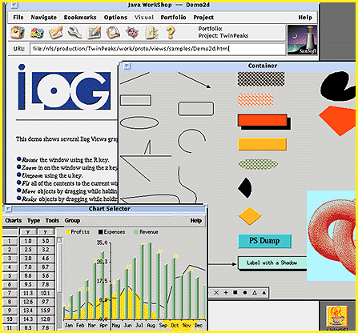

# TwinPeaks Brings Java and C++ Together

*International Bits*

Java offers a number of compelling benefits to Internet software developers: It is portable, high-level, and secure. However, Java still lacks an extensive catalog of application components. To bridge the gap between Java and the vast amount of tested and reliable C++ code, the French company ILOG (Paris) has developed a Java/C++ gateway translator, code-named TwinPeaks, that lets you access existing C++ components from any Java program.

TwinPeaks produces a Java interface to an ANSI C or C++ library based on header-file information. It also generates so-called bridge code that automatically translates API calls and data formats between Java and the precompiled C++ object code. "TwinPeaks automates the detailed and tedious coding of API calls and brings Java into the mainstream of enterprise computing," says Harley Davis, director of technology at ILOG's Mountain View, California, office.

TwinPeaks benefits both parties. It provides a smooth upgrade path for C++ developers and lets Java developers capitalize on existing C++ components. SunSoft bought the TwinPeaks technology earlier this year and will include it in its Internet Workshop product.

## Log Lady Gives the OK

TwinPeaks uses direct procedure calls to access C++ object code from Java.

## Images

