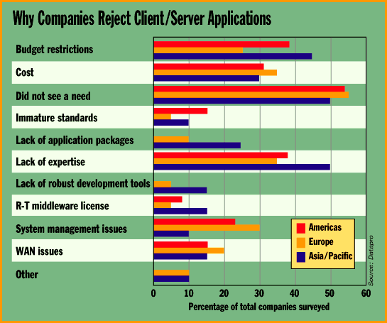

# Bus Wars

*International Bits*

Mark LaPedus

The bus contest is heating up in the PC peripheral arena. In one corner is the universal serial bus (USB), a standard that calls for connecting keyboards, monitors, input devices, and digital cameras over a 12-Mbps network. In another corner, there's IEEE-1394, or FireWire, a serial SCSI standard that allows transfer rates of from 100 to 400 Mbps -- giving speeds of 1.6 Gbps or even faster.

Intel, the world's largest microprocessor and chip-set supplier, supports USB. "USB is a lot slower, but it has the momentum right now," says Jason Lin, industry analyst with Dataquest Taiwan. "Because Intel is one of the major backers behind USB, you will have a lot of vendors following them. The latest motherboards from Taiwan support USB. Peripheral companies are supporting USB."

However, don't count out FireWire. Texas Instruments, one of its major backers (along with Apple and Sony), plans to introduce a slew of ICs that will make it easier for OEMs to support IEEE-1394.

At present, TI has a controller chip that supports 100-Mbps transfer rates, but by the end of 1997, it will have 200- to 400-Mbps ICs. Which standard will Taiwan PC and board makers follow? "Taiwan board makers will likely support both USB and FireWire," Lin says. "But initially, Taiwan board makers will support USB. It's unclear when FireWire will become a mainstream product -- perhaps 1997 or 1998."

TI sells two products that support FireWire, including its PCILynx Controller and a 100-Mbps physical (PHY) layer interface IC. By year's end, TI will be selling the TSB12LV31 VersalLynx chip, a low-voltage IC used in linking PCs with peripherals and digital cameras. And in 1997, TI will ship a lower-cost PCILynx IC designed for linking PCs with digital-videodisc (DVD) players and set-top boxes. Next year, TI will also ship 400-Mbps controllers and PHY ICs.

## Why Companies Reject Client/Server Applications

## Images

