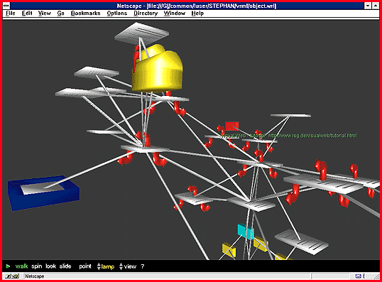

# Visual Web 2.0 Browses the Web in 3-D

*International Bits*

As the complexity of the Web increases, developers are always looking for new ways to navigate it. Innovative Software (Frankfurt, Germany) has mapped the logical structure of hyperlinked worlds into more easily understood 3-D graphs. "Our 3-D visualization techniques add new dimensions to the flat world of hyperlinks," says Stefan Wolf, managing director of Innovative Software. Version 2.0 of the company's Visual Web navigation tool creates a 3-D visual web of uniform resource locators (URLs) and server directories, and lets users manage interrelated Web documents by "flying through" and zooming in.

## Deep Links with Visual Web

Visual Web creates a 3-D image of how URLs link up on a Web server.

## Images

