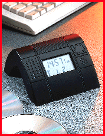

# Atomic Time

*International Bits*

## Bob Emmerson

The radio-controlled atomic desktop clock from Galleon Systems (Birmingham, U.K.) boosts an executive's status with an inaccuracy of 1 second in 1 million years. Via a serial-interface link and software drivers, it keeps PCs and networks in sync. Accurate timekeeping is a must for time stamping to ensure that data has not been modified. The clock provides an accurate audit trail.

The software to access the time and update the computer system for NetWare LANs resides on the server, and a NetWare loadable module (NLM) maintains the server to the accurate time. When a user logs on, the system receives this time from the clock on the desktop. Mobile users who remotely access corporate LANs are not forgotten -- versions for notebooks are available.

## Time for an Accurate Audit

CA radio-controlled atomic clock keeps clients and servers in sync.

Copyright

1994-1997 BYTE

I<N

## Images

