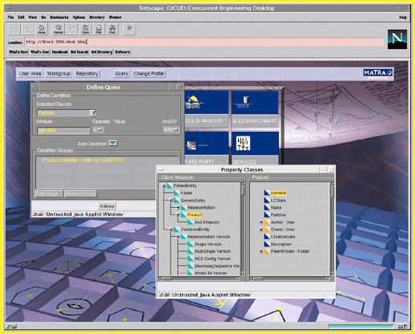

# 3-D Meets Manufacturing

*International Features*

The latest 3-D CAD systems improve manufacturing and design processes.

Adele Hars

To keep up with ever-shortening product-development cycles, European automobile, aerospace, and machinery-building manufacturers are beginning to restructure their development and manufacturing processes around the 3-D data models that are featured in recent CAD systems. This has led European CAD vendors to rapidly improve their products to keep pace with industry's ever-more-challenging demands.

The concepts that support these reengineering efforts under CAD -- object-oriented (OO) technology, solid-modeling kernels, and product data management (PDM) systems -- have been around for some time. Now they are mature, and manufacturers are starting to reap the benefits.

Sixty-three percent of European CAD users deploy 3-D modeling as their primary design method. According to a study by market research company Dataquest, about 50 percent of the sites polled are involved or will be involved with a related concept, PDM.

A PDM system stores product and design information such as 2-D drawings, 3-D solid models, assembly instructions, and process plans in a database across all phases of a product's life cycle. The PDM system also provides procedural control by facilitating approvals and notifying team members of a project's status. As a result, it provides the internal coordination required to let companies implement concurrent engineering and compress the product-development cycle.

The latest 3-D models also reduce manufacturing time during the transition from design to manufacturing. Because a 3-D model contains the complete geometric, topological, and functional information of an object, it is much easier to separate the data that's needed for manufacturing, visualization, or simulation than it is from a 2-D drawing. Most modern 3-D CAD modelers offer a consistent data model that, together with a PDM system, enables concurrent engineering in design, prototyping, and even manufacturing. This reduces the development times, the number of prototypes, and, finally, the costs of late revisions. The development of a product as a consistent 3-D model is often referred to as an electronic product definition (EPD), and the resulting model is usually called a virtual prototype.

Marcel Gerber, CAD/CAM manager for the Swiss-based Bobst Group, a leading manufacturer of packaging machinery, says, "The goal [of 3-D solid-modeling and concurrent-engineering techniques] is to reduce the number of interfaces between design and manufacturing, and make the process more fluid. If the process turns around a single model, it's easier to achieve."

Cost savings in large aerospace projects, for example, can be significant. Dennis Barritt, CAD/CAM manager for Short Brothers of Belfast, Northern Ireland, estimates that design iterations on a new jet model were cut in half using EPD and PDM systems.

Even though 3-D CAD's benefits are clear, the reality is that small and midsize companies often don't use EPD throughout the whole development process. "If you look at the design processes, very few companies are actually doing everything with solid modeling," notes Bob Simpson, worldwide sales and marketing manager for Hewlett-Packard's Mechanical Design Division. "However, we expect 75 percent of our CAD users to install 3-D CAD systems as the core of their design process during the next three years."

New Architectures

To meet the growing needs for data consistency and design flexibility, major CAD-system vendors such as Autodesk, Bentley, Computervision, Dassault Systems, and Matra Datavision developed OO CAD architectures and 3-D solid modelers (see "Objects of Design," September 1995 BYTE International Edition). OO CAD not only simplifies the user interface (UI), it also assigns well-defined properties to every object used in the design process, regardless of whether that object is a point, a surface, a part, an assembly, a file directory, or an analysis folder. Every object "knows" what commands you can apply to it, so when you select or create an object, the valid actions you can apply automatically appear in a pop-up menu.

This object awareness of today's 3-D CAD systems is best supported by object-oriented database management systems (OODBMSes). "Relational databases are inherently inadequate for representing complex 3-D data, because the nature of the relations and the volume of data are beyond the acceptable performance limits of most systems," explains Jim Phillips, a Matra Datavision vice president. "Representing construction components as objects [of OODBMSes] yields a more coherent data model; it gives you the ability to store data more intelligently."

The two leading European CAD-system developers, Dassault Systems and Matra Datavision, have different approaches to redesigning their CAD products. Dassault has been rearchitecting its Catia family of about 80 CAD modules since 1994, releasing changes piecemeal every few months.

Matra, on the other hand, has rearchitected its entire Euclid product suite in one new version. Announced this fall, the new version of

Euclid Quantum

is based on a C++ development framework called CAS.CADE (for computer-aided software/computer-aided development engineering) that Matra began developing in 1989, and in which it has invested almost 300 person-years.

Dassault's primary rearchitecting goals have been to make Catia more open, introduce a new UI, and support such industry standards as Common Object Request Broker Architecture (CORBA), OLE, and Standard for the Exchange of Product data (STEP). Dassault has rearchitected the Catia core system on most of the modules under what it describes as object-implemented engineering. "By this, we mean that although not based on OO languages such as C++, the Catia V4 [internal] architecture does support key OO characteristics, such as encapsulation, polymorphism, and, to some extent, inheritance," explains senior architect Didier Bourcier.

Based on these initial rearchitecting steps, the company is currently working on a C++ component-based architecture that will facilitate the visualization of designs in addition to object, data, and knowledge modeling. Dassault's new architecture will also include a 3-D modeler that allows for the hybrid modeling of solids and surfaces.

These components are incrementally replacing their counterparts throughout the Catia V4 architecture and are also the core of Dassault's latest products, the 2-D Dynamic Sketcher and the 4-D Navigator. The new architecture will also make Catia more scalable. "We want you to be able to use Catia on everything from a laptop to a superscalar machine," says Bernard Charl

s, Dassault's president.

A CAS.CADE of Objects

Matra's CAS.CADE provides the basic services for CAD applications development, such as a class definition language, class browser, GUI builder, data management functions, and general object definition. (For more information on development frameworks, see "A Better Foundation," September BYTE International Edition.)

The CAS.CADE architecture includes two layers that are called Engine and Front End. These two layers are linked through a CORBA-compliant object request broker (ORB). The CAS.CADE Definition Language formalizes the definition of all software components and the relations between objects. Furthermore, the latest version (1.5) of this framework comprises several thousand classes of general and application-specific objects and libraries for geometric modeling, graphical representation, topology, parametrics, constraint management, and documentation.

With an interactive class browser, developers of CAD and other graphics applications can insert components in the code by cutting and pasting. The system also complies with STEP, CORBA, OLE, and Open GL, and supports client/server configurations under Unix and Windows NT/95.

Matra sells CAS.CADE to independent applications developers in CAD as well as in such scientific fields as geology, molecular chemistry, and medical imagery. As mentioned earlier, the company also based Euclid Quantum, which includes the Designer, Analyst, Machinist, and Design Manager modules, on the CAS.CADE framework.

"A CAD model created with Euclid Designer encapsulates any pertinent information such as aesthetic criteria, technological function, material selection, and fabrication process," explains Denis Senp

, vice president of sales and marketing. "This information is then available throughout the entire product cycle." Euclid Quantum also features a PDM-controlled database that you can browse using a standard Web browser, thereby facilitating collaborative concurrent engineering via an intranet or the Internet.

Dispersed Teams

The advantages of 3-D solid modeling are remarkable: Geographically dispersed design teams can work concurrently, referencing a single, up-to-date database. Manufacturing engineers can use the data from the virtual prototype to directly program machinery and create molds, and a project manager can flag cost overruns while they're still virtual. However, as many CAD consultants emphasize, it's not enough just to implement solid-modeling design methodologies, it's important to really use them.

## Where To Find

Dassault Systems

Suresnes, France

Phone: +33 1 40 99 40 99

Fax: +33 1 40 99 43 76

http://www.catia.ibm.com

Internet:

http://www.catia.ibm.com

Matra Datavision

Les Ulis Cedex, France

Phone: +33 1 69 82 24 00

Fax: +33 1 64 46 02 13

http://www.matra-datavision.com

Internet:

http://www.matra-datavision.com

## Quantum Navigation

With Euclid Quantum, engineers can navigate through a PDM database with a standard Web browser.

mailto:"100325.3703@compuserve.com"

Adele Hars is a freelance writer with the GEID Press Agency and a BYTE correspondent based in Paris. You can reach her by sending e-mail to

100325.3703@compuserve.com

Copyright

1994-1997 BYTE

\~N

\~N

\~N

\~N

\~N

\~N

\~N

\~N

\~N

\~N

\~N

\~N

\~N

\~N

\~N

\~N

\~N

\~N

\~N

\~N

\~N

\~N

\~N

\~N

\~N

\~N

\~N

\~N

\~N

\~N

\~N

\~N

\~N

\~N

\~N

\~N

\~N

\~N

\~N

\~N

\~N

\~N

\~N

\~N

\~N

\~N

\~N

\~N

\~N

`uP

\~N

## Images

