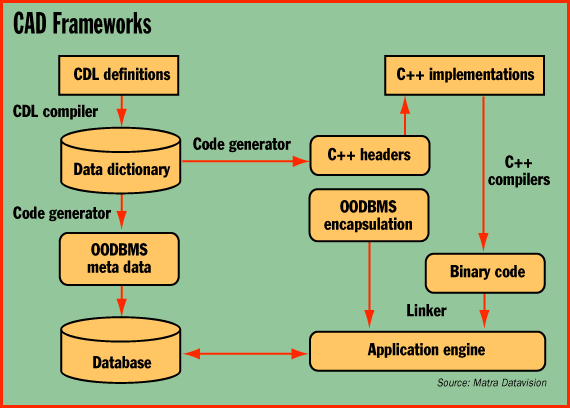

# Developing CAD Applications

*International Features*

Rainer Mauth

Frameworks help build more reliable code because they provide reusable components and the glue to link them. The core of CAS.CADE, Matra Datavision's framework for developing large-scale engineering software, is a data dictionary consisting of a kernel (graphs, a math library, and physical quantities), modeling (3-D geometry, topology, and Boolean operations), parametrics (parametric and variational approach), graphics (wire-frame, hidden-line, and shading algorithms), and data management services.

With the CAS.CADE Definition Language (CDL), developers can describe data types, including all attributes and operations and separate persistent and temporary data. CDL groups related classes and therefore works on an abstraction level higher than the class level. With CDL, developers do not write C++ header files. They define software components via CDL and implement methods using a C++ Persistent Programming Interface.

## CAD Frameworks

After defining components via CDL, CAS.CADE automatically creates C++ headers and OODBMS meta data.

Copyright

1994-1997 BYTE

8}P

8}P

(~P

8}P

p~P

8}P

8}P

8}P

8}P

8}P

8}P

8}P

8}P

## Images

