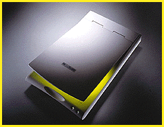
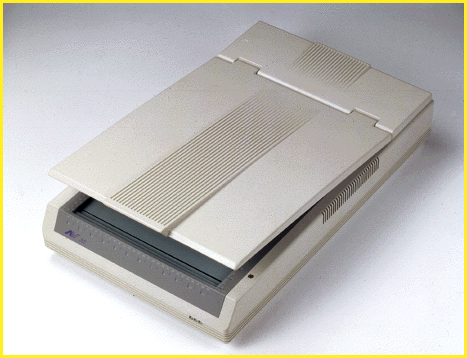
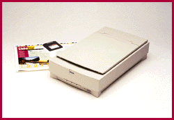
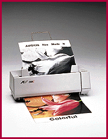

# Scanners for Everyone

*International Features*

=New technology is propelling scanners in to the mainstream.

Mark LaPedus

Scanners are rapidly evolving from a niche product to an essential, affordable peripheral. An entry-level flatbed -- a 24-bit, 300- by 600- dots per inch (dpi) color unit -- will cost $250 by mid-1997, down from $600 just two years ago, predicts Eric Chen, CEO of Mustek, a major Taiwanese scanner vendor. Some companies are adding a new twist to the monochrome keyboard scanner made famous by Visioneer. Acer, Spot Technology, and other Taiwanese manufacturers are developing a color keyboard scanner for 1997. Scanners are also being bundled with more software, for applications such as OCR, image editing, e-mail, and fax. Other factors helping to thrust scanners into the mainstream include improved components, faster PC hardware, software integration, and next-generation I/O buses such as Universal Serial Bus (USB) and FireWire.

In general, entry-level flatbeds and sheetfeds come in a

24-bit

configuration, with 300- or 600-dpi resolution. A 24-bit color scanner, for example, samples eight bits per pixel for each of the three major color channels (red, green, blue) for a total of 16.7 million colors.

Scanners used for professional desktop publishing are also becoming more powerful, and somewhat more affordable. The 36-bit color models, such as the new

Expression 636

from Japan's Epson, are moving toward a new price point of under $1000, says Karl Seppala, group manager for Epson America. Other scanner makers will respond with new high-end models that range from $1000 to more than $5000.

The Taiwanese are the world's leading scanner manufacturers, with a 64 percent market share, says Abel Wang, analyst with the Market Intelligence Center in Taipei. "Their ability to drive the price down will help expand the market," he says. Taiwanese companies not only sell systems with their own logos but also make low-cost products on an OEM basis for industry giants such as Hewlett-Packard, the world's largest scanner vendor.

Cheaper Ingredients

Other factors such as cheaper components, different lamp sources, and new PC connections are also reducing the cost of scanners. For example, there are two types of lighting sources used in flatbeds: hot and cold cathode fluorescent lamps. In recent times, flatbeds have moved from the traditional hot lamps to cold versions. Hot lamps have a working life span of about 1000 hours, whereas the cold versions can last about 10,000 hours.

Most important, prices are dropping for the main component used in flatbeds and sheetfeds -- the charge-coupled device (CCD), a light-sensing element that determines optical resolution. (For instance, a 5100-cell CCD in a scanner that accepts documents of 8-1/2 inches has a resolution of 600 dpi.) Prices for color CCDs with 300-dpi resolution (the kind used in entry-level scanners) have fallen to the $12 range from $50 two years ago. Prices for this kind of CCD could fall to the $7 range by year's end, a move that would further push down scanner prices, according to a source at Toshiba. (At this time, Taiwan's scanner makers buy all their CCDs from Japanese sources, including Toshiba and Sony. Some companies in Taiwan are trying to develop CCDs, but the island has yet to produce them in large volumes.)

High-End Holdups

For those scanners aimed at graphics professionals, prices for color CCDs with 600- and 800-dpi resolutions remain steep and are not expected to drop significantly or rapidly. These kinds of CCDs are used in 30- and 36-bit (or higher) scanners, capturing 10 and 12 bits per color channel, respectively.

But these scanners do not always produce a better image than the 24-bit units. In a

30-bit system

, for example, 2 bits per channel are sometimes eliminated during scanning, thereby reducing the yield to 24 bits. Some less-expensive CCDs are sensitive to electrical noise and distortion; the upper 2 bits of the device's theoretical color depth are destined to become "garbage bits" that don't yield accurate information. But high-end CCDs are improving in their ability to reduce degradation, says Albert Yang, a field engineer at Umax, a major Taiwanese scanner maker. "A 36-bit scanner has a maximum density range of 3.6, but it may lose some data because the CCD cannot see all the detailed information," explains Yang. "Japanese companies are making several improvements to CCDs in terms of higher dynamic ranges and lower signal-to-noise ratios." Newer CCDs will be able to capture 10, 12, and even 16 bits per channel, thanks to improvements in their dynamic range.

Memory Is Critical

The system's memory is perhaps the most critical factor in scanning, says Bill Dong, product manager for Acer Peripherals, a maker of scanners. "Falling DRAM prices is good news for scanner makers," he says. Many image editing packages require a system's memory to be three to five times the total file size. There's a reason for this: Scanning resolution has a geometric relationship to a file. For instance, if you scan a 3-inch-square color image into a 300-dpi system, you'll have a file of about 2.4 MB. The same image done at 600 dpi will yield a 9.72-MB file.

Xerox is directly addressing the challenges of desktop color scanning with Pagis Pro 97, a Windows 95/NT program expected to ship by now and sell for around $169. Pagis breaks down color pages into separate color image and text components. Using PerfectScan technology developed at the Xerox Palo Alto Research Center, Pagis "thresholds" the text into a black-and-white format that is optimal for conversion by Xerox's TextBridge OCR software, a full version of which comes with Pagis. Color images get treated by color-management software, and the whole multimegabyte package is compressed into a small, JPEG-like XIF (a new Xerox file format) file. During a recent demo at BYTE, a test file shrunk from 7.3 MB down to 130 KB.

You can easily recompose documents with decent-looking color images and text. These files are fully searchable (thanks to a bundled copy of Verity's Topic engine), and you can use Win 95 Explorer to scan, copy, fax, and print them with drag-and-drop commands.

## Easy Scanning

Another factor that is pushing scanners into the mainstream is that they are now becoming much easier to use. In the past, operating these devices has been nightmarish for people who weren't computer or graphics professionals. "Two years ago, most scanner makers bundled a separate OCR and image editing package. If I launched into the OCR or image editing packages, I had to learn two different functions and interfaces," points out Andy Chu, marketing manager for

## Avision

, a scanner manufacturer based in Hsinchu, Taiwan. "Today, scanner makers are looking for more ways to offer integrated software packages for end users."

In terms of software, many Taiwanese vendors are trying to move in the direction of Visioneer. Visioneer's keyboard scanner software supports OCR, image enhancement, business-card scanning, copying, e-mail, fax, and a link to the Internet via Netscape's Navigator. Tawainese companies have not licensed this software, but they are using different paths to reach the same goal. "We offer a suite," Chu says. "We buy and bundle an OCR engine [from a third-party vendor], but we don't use the interface. The image editing package is also bundled, but you don't have to call up two different programs. We also provide business-card readers and the ability to drag and drop data to a printer or fax."

For the most part, Taiwanese companies rely on third-party packages. They bundle their scanners with an OCR engine from Xerox (TwinBridge), Caere (OmniPage), or another vendor, with an image editing package from Adobe (Photoshop) or Ulead (PhotoImpact), among others. Many scanners from Taiwan are being bundled with a new version of Ulead's low-cost imaging editing program. Called PhotoImpact 3.0 with WebExtensions, the package includes auto-generated Hypertext Markup Language (HTML) code to develop your own Web page and send it over the Net, says Dwight Jurling, European sales manager for Ulead.

Spot Technology offers on a single CD-ROM a program called Scantastic, an 11-in-1 package that handles OCR, e-mail, fax, image editing, business-card reading, and more. Spot's program incorporates Caere's OCR engine (OmniPage Pro 6.0). The next version will include Iota's MyDesk, a technology for recognizing text on the fly without having to run the document image through an OCR program. "MyDesk is designed for data file and search functions," says Kevin Hwang, director of marketing for Spot. Spot's software will also include another component from Iota. Called InterSite, the software is based on what Iota refers to as Smart Image Technology, which creates and maintains Web-based document image databases that users can search.

Bus Options

Another feature contributing to the mainstreaming of scanners is that more entry-level models are employing a parallel port connection (both standard and high-speed Enhanced Parallel Port) rather than SCSI adapters. The Enhanced Parallel Port simplifies scanner installation and eliminates the need for a SCSI connection. It's slower, however. This port offers a maximum transfer rate of only 1.5 Mbps, and as slow as 750 Kbps in typical scanning operations.

There are two other bus technologies on the horizon. First, there's USB, a growing standard that calls for connecting keyboards and input devices over a 12-Mbps peripheral bus. Then there's IEEE-1394 or FireWire, a serial SCSI standard that allows transfer rates from 100 to 400 Mbps (with some companies even predicting 1.6-Gbps speeds).

"USB is suited for gray-scale scanners but not color systems because the bandwidth is just too limited. But if the scanner is sharing bandwidth on the USB, the scanning speeds will be even slower," says a source at one scanner company. "It's sad. USB will be popular by the end of this year, yet FireWire is a better solution. But FireWire won't be ready for some time, not until more vendors get behind it."

Higher-end scanners won't go in this direction. Instead, they will probably shift from SCSI to the faster SCSI-2 and Ultra Wide SCSI-3, Umax's Yang says. Fast SCSI uses an 8-bit data path and a transfer rate of 10 Mbps, but SCSI-2 offers 20 Mpbs on a 16-bit bus. Ultra Wide SCSI-3 has a limit of 40 Mbps.

Forever Paper

The paperless office isn't going to be a reality anytime soon. Scanners help bridge the gap between the world of hard images and the world of digital ones. That's just one more reason why scanners are fast becoming an essential component of any office setup.

## Where To Find

Acer

Taipei, Taiwan

Phone: +886 2 545 5288

Fax: +886 2 545 5308

http://www.acer.com

Internet:

http://www.acer.com

## Avision

Hsinchu, Taiwan

Phone: +886 03 578 2388

Fax: +886 03 577 7017

Epson America

Torrance, California, U.S.A.

*Phone: (800) 463-7766 or +310 782 0770

http://www.epson.com

Internet:

http://www.epson.com

First International Computer

Taipei, Taiwan

Phone: +886 2 717 4500

Fax: +886 2 714 8676

http://www.fic.com.tw/

Internet:

http://www.fic.com.tw/

Microtek International

Hsinchu, Taiwan

Phone: +886 03 577 2155

Fax: +886 03 577 2598

Mustek Systems

Hsinchu, Taiwan

Phone: +886 03 577 9373

Fax: +886 03 578 4139

Umax Data Systems

Taipei, Taiwan

Phone: +886 2 517 2080

Fax: +886 2 517 2017

## Spot

Spot's 24-bit color scanner

## Avision

(Avision's 30-bit color flatbed scanner

## Epson

4Epson's Expression 600-dpi, 36-bit flatbed scanner

## Avision Gets Personal

"Avision's color personal scanner

@Mark LaPedus is a BYTE contributing editor who lives in Taipei.

Copyright

1994-1997 BYTE

E5S

]5S

## Images

