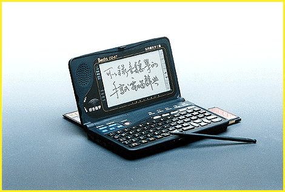

# A PDA with English/Chinese Language Recognition

*International What's New*

Mark LaPedus

Want to learn Chinese, play games, or keep phone numbers in a PDA? Inventec's CD-67 is a PDA that combines an electronic organizer, a calculator, and a Chinese-to-English dictionary -- all in one small, hand-held unit.

You input information on a small keyboard or with an electronic pen on an LCD screen. When I tried using the pen, the handwriting-recognition engine needed three attempts to recognize a letter H, but it immediately recognized K. The CD-67 had no problem with Chinese handwriting recognition, however.

Another interesting feature is crude voice recognition. Simply write or type a word on the screen in English or Chinese and then press one of three small buttons near the keyboard for Mandarin, Cantonese, or English. Instantly, the CD-67 utters (and sometimes mutters) the word -- a helpful feature for students or businesspeople learning English or Chinese.

The CD-67 is based on Motorola's 68000 processor. It incorporates ROM memory, a monochrome LCD screen, and up to 10 MB of storage capacity. Options include a slew of IC memory cards.

## Where To Find

CD-67........................from US$320

Inventec Besta Co., Ltd.

Taipei, Taiwan, R.O.C.

Phone: +886 2 880 1990

Fax: +886 2 880 1783

http://www.besta.com.tw

Internet:

http://www.besta.com.tw

Circle 1033 on Inquiry Card.

## Chinese Language To Go

## Images

