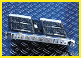

# Analog Modem for ISDN Dial-In Applications

*International What's New*

The Taxi-System Analog Modem Module (AMM) provides both digital-terminal-adapter and analog-modem access to a common ISDN (BRI or PRI) interface. You can use it as a central-site dial-in modem pool for Internet or remote-host applications. Each AMM contains four independent V.34 modems with up to 52 independent ports.

Price: Call company.

1Company: Controlware GmbH, Dietzenbach, Germany

Phone: +49 6074 858 00

Fax: +49 6074 858 191

http://www.cware.de

Internet:

http://www.cware.de

Circle 1036 on Inquiry Card.

'Taxi-System Navigates Internet Traffic

## Images

