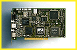

# New Board from Miro

*International What's New*

The miroVideo DC30 video-editing board brings more power to home and semiprofessional video users. The board uses PCI bus-mastering technology to accelerate data up to 6 Mbps and squeezes M-JPEG video to a compression ratio of 3.5 to 1. The system integrates with DirectDraw-compatible graphics boards, thus providing complete overlay functionality. It accepts both S-Video and composite video as input and output signals.

Price: DM 1499.

;Company: miro Computer Products AG, Braunschweig, Germany

Phone: +49 531 21130

Fax: +49 531 211399

http://www.miro.de

Internet:

http://www.miro.de

Circle 1038 on Inquiry Card.

## miroVideo Brings the Power Home

Copyright

1994-1997 BYTE

4 U

t U

B"U

|"U

m#U

G$U

Z#U

## Images

