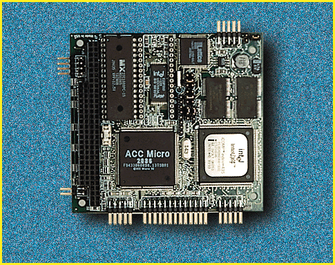

# Industrial-Strength Processor Board

*International What's New*

The Idea_AT32/4D4 is a highly integrated, high-performance, single-board computer that's compliant with the PC/104 standard (3.6 by 3.8 inches) and delivers 20 MIPS when it's paired with a 100-MHz 486DX4 processor. The board integrates all the standard AT functions and works with 4 or 8 MB of DRAM. It supports DOS, Windows, Unix, and QNX OSes. Typical applications include embedded systems for the robotics, industrial-control, and aerospace environments.

Price: Call company.

"Company: Eurotech, Maiano, Italy

Phone: +39 432 948390

Fax: +39 432 959474

http://www.eurotech.it

Internet:

http://www.eurotech.it

Circle 1039 on Inquiry Card.

2Italian High-Performance Not Limited to Race Cars

Copyright

1994-1997 BYTE

blU

4mU

blU

blU

blU

blU

blU

`pU

blU

blU

blU

hqU

blU

blU

blU

7rU

blU

blU

blU

blU

## Images

