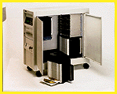

# Jukebox for NT or the Mac

*International What's New*

Tready, a combined jukebox and NFS server system, supports optical read and write (ISO 9660) drives and enables you to build up complete archiving systems. It provides access to more than 1500 CDs. The device, which is designed to fit the needs of Windows NT networks, is also available in a version for Macintosh networks (called MACready).

Price: Call company.

,Company: NSM Jukebox GmbH, Bingen, Germany

Phone: +49 6721 964430

Fax: +49 6721 964414

$E-mail: 73503.3467@compuserve.com

Circle 1040 on Inquiry Card.

## Ntready to Serve Your Needs

Copyright

1994-1997 BYTE

@kX

)lX

8nX

xnX

EoX

moX

## Images

