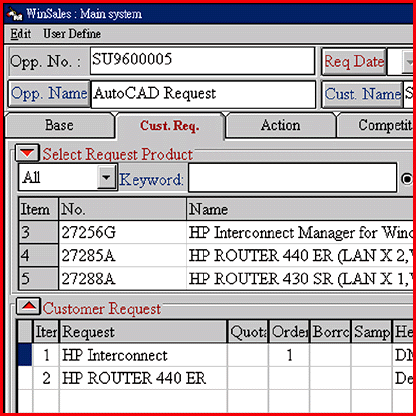

# Bilingual Sales Manager

*International What's New*

Mark LaPedus

Executives and other busy managers are the target market for Autotech's WinSales sales-tracking software. This Windows-based system allows you to easily keep tabs on your sales team and their customer accounts. Running on Windows 95 or NT in both English and Chinese, this sales-tracking program operates over a business's client/server network. By year's end, the package will have the ability to operate as an intranet-based solution for global corporations, according to the company.

The software lets your sales representatives select a product from your catalog, for instance, find the specs, and then print out a quote on an official form letter via WinQuo, another Autotech software package. In addition, WinSales keeps track of current and future leads, customer transactions and dates, and competitors' progress. At present, WinSales supports databases from Oracle, Sybase, and others. The package sells for $1500 for a five-node license.

## Product Information

WinSales........................$1500 Five-node license

Autotech, Inc.

Taipei, Taiwan, R.O.C.

Phone: +02 886 365 6488

Fax: +02 886 368 8307

Circle 1048 on Inquiry Card.

!Track Your Sales...Reps, That Is

## Images

