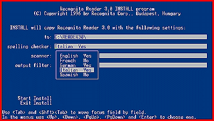

# OCR for Visually Impaired Users

*International What's New*

Recognita 3.0 is an OCR package designed for visually impaired users. It displays all recognized information in character mode. Any recognized text can also be passed to a voice synthesizer, which reads aloud from the command line. The user can select menus, submenus, and parameters via the keyboard. In addition, the software provides proofing facilities specially created for visually impaired users.

Price: Call company.

-Company: Recognita Corp., Budapest, Hungary

Phone: +36 1 201 8925

Fax: +36 1 201 7607

http://www.recognita.hu

Internet:

http://www.recognita.hu

Circle 1050 on Inquiry Card.

## OCR for the Visually Impaired

## Images

