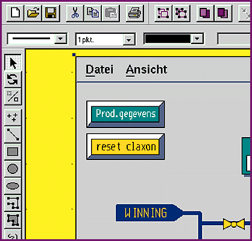

# Object-Oriented Visualization Toolbox

*International What's New*

Sphinx Open brings object orientation, platform independence, and client/server computing to the world of process visualization. The toolbox contains libraries of symbols, drawings, and process diagrams, and it allows for the multiple inheritance of drawing objects, thereby enabling fast and efficient process visualization. The program runs under Unix and Windows.

Price: Call company.

Company: in-integrierte informationssysteme GmbH, Konstanz, Germany

Phone: +49 7531 8145 0

Fax: +49 7531 8145 81

Circle 1051 on Inquiry Card.

"Sphinx Open Leaves Mystery Behind

## Images

