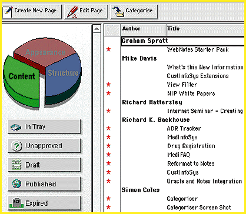

# Groupsoft Web Publisher

*International What's New*

Groupsoft Publisher, a Web publishing tool, helps you create the content and structure of your Web site. It provides subscription management, access control, user tracking, on-line forums for public and private discussion, and project management. The software, which is based on Lotus Notes and Lotus InterNotes Web Publisher, contains page templates that enable you to create a consistent look and feel for an entire site without manually reediting pages.

Price: Starts at 14,000 Pounds UK.

,Company: Groupsoft, Ltd., Crowthorne, U.K.

Phone: +44 1344 780878

Fax: +44 1344 772510

E-mail: info@groupsoft.co.uk

http://www.groupsoft.co.uk/

Internet:

http://www.groupsoft.co.uk/

Circle 1055 on Inquiry Card.

-Create and Structure Websites with Groupsoft

Copyright

1994-1997 BYTE

$c[

<c[

## Images

