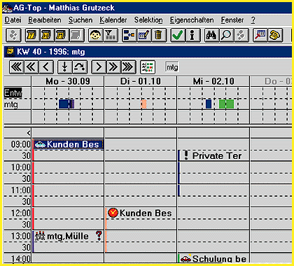

# Resource Manager for Teams

*International What's New*

AG-Top 2.6 is a groupware-enabled scheduling and resource management tool that can automatically check possible appointment dates for a team of workers. With AG-Top, you can link up to 10 documents to one appointment. The program also manages access rights to the schedule and alerts users in advance of scheduled appointments.

Price: Call company.

1Company: Grutzeck-Software GmbH, Hanau, Germany

Phone: +49 6181 9701 0

Fax: +49 6181 9701 66

%E-mail: 100042.2131@compuserve.com

Circle 1054 on Inquiry Card.

## This Tool is Tops

Copyright

1994-1997 BYTE

[f[

-g[

[f[

[f[

[f[

Gi[

[f[

[f[

[f[

[f[

^j[

[f[

[f[

[f[

[f[

xk[

[f[

[f[

3=\

[f[

[f[

## Images

