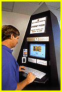

# Geek Mystique

*Bits*

Surf Now, Fly Later

Dave Andrews

From 3Com (aka Candlestick) Park to rock concerts, Internet-access terminals are showing up in various mainstream venues. Now they are also arriving in airports and hotels. Atcom/Info, which is a San Diego-based provider of public communication and information resources, will have 10 of its Internet-access kiosks (

see the picture

) installed at Dallas-Forth Worth International Airport. From there, business travelers will have access to e-mail, the Web, Internet newsgroups, ticketing services, information about local attractions, and other information. Each kiosk will have one sit-down and one stand-up access terminal, plus two stations for phone service. An electronic card-reader slot will accept credit-card payments. GTE, which is installing the terminals, will also provide the ISDN connections.

If you're too busy to stop at the airport to do some Web surfing, or to dash off a last-second e-mail message, perhaps you can do so when you get to your hotel. Atcom/Info is developing Internet-access systems for hotels that will allow busy business travelers to log in on the road even if they have forgotten their notebook.

## Net Access Joins Mom and Apple Pie

Copyright

1994-1997 BYTE

j*]

## Images

