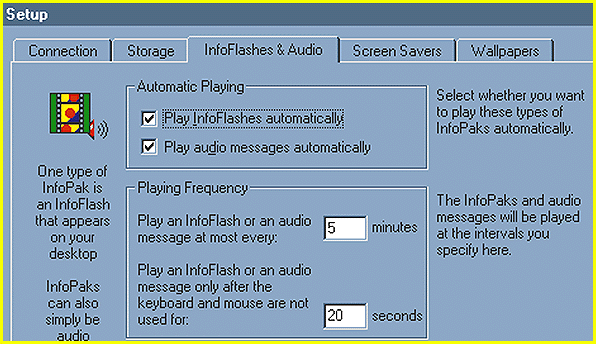

# Web Info the Way You Want It

*Bits*

Dave Andrews

The strength of the Internet -- its vast collection of information -- is a double-edged sword. You can spend hours looking for something without finding it. To address this problem, several new products and services let publishers deliver information over the Internet in a focused way to the people who most need it.

Search tools such as Yahoo and Alta Vista can help you find something more quickly on the Web, but sometimes you still have to browse through many bad hits before you find what you want. Off-line browsers can download information from Web sites while you sleep, but they don't help if your job requires instant access to the latest information. If you've configured your off-line browser to download information at midnight, you may not get an important piece of news that breaks early the next morning for another 24 hours.

New services that address the above problems let information-oriented businesses deliver just the news you care about directly to your PC. Subscribers to these services specify topics they are interested in, such as business competitors or stock prices. When news about those topics breaks, it is sent to your PC.

http://www.pointcast.com

Pointcast's (

http://www.pointcast.com

) advertising-supported service allows you to customize which kinds of topics you want to know about from a variety of news sources, such as Reuters, newspapers, and others. A new product from Pointcast called Iserver ($995 per server CPU) lets corporations distribute information more efficiently over an intranet.

http://www.backweb.com

http://www.wavo.com

http://www.netguide.com

BackWeb's (

http://www.backweb.com

) namesake product suite lets content providers create information-delivery broadcasts and send information to a wide audience or just a single end user. The BackWeb server console lets you track detailed statistics of how users interacted with information, and a scripting language allows you to

control how

8 information appears at the end user's desk. WavePhore (

http://www.wavo.com

) is also getting into the Internet and intranet real-time news-delivery business to complement its current broadcast services. And NetGuide (

http://www.netguide.com

\), an on-line guide to the Web, will deliver content based on your information preferences.

http://www.jup.com

One problem for would-be content providers is that some of these server platforms can cost thousands of dollars. That price is prohibitive for many small-size and midsize businesses, says Ross Rubin, senior analyst with New York City-based Jupiter Communications (

http://www.jup.com

), an Internet consultancy. He also says that a subset of what vendors such as Pointcast are offering may be available in a few years from standards-based Internet e-mail and even sooner from Web-server and database vendors.

http://www.software.com

John MacFarlane, CEO of software.com (

http://www.software.com

), a provider of standards-based Internet mail servers, agrees. Already, says MacFarlane, the new IMAP 4 standard lets mail users store Internet mail on servers instead of having to pull them onto a client machine. This lets active agents automatically file mail to the correct folder on the e-mail server. Although this filtering doesn't currently approach the level of functionality offered by services such as Pointcast and BackWeb, MacFarlane points out that the standards will continue to evolve. Also, discussions are under way among vendors to improve the integration among e-mail server and client programs. Improved integration would let someone using a program such as Qualcomm's Eudora create sophisticated filters that work well with any standard Internet mail server. Until then, products such as Pointcast provide a valuable filter for people who want targeted, fresh information updates.

## Au Courant and Customized

BackWeb can deliver news as an audio message, a news flash, or in an information package.

Copyright

1994-1997 BYTE

v-]

9-]

9-]

9-]

N.]

9-]

9-]

9-]

#2]

9-]

9-]

9-]

-9]

9-]

9-]

9-]

9-]

9-]

,Y^

9-]

9-]

S5]

j5]

r5]

~;]

## Images

