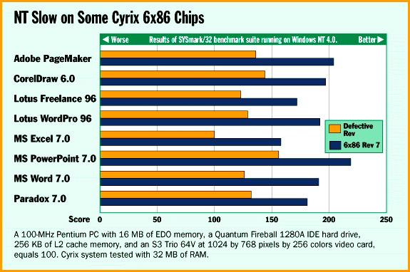

# Cyrix 6x86 Bug Puts Brakes on NT 4.0

*Bits*

Robert L. Hummel

Cyrix has apparently fixed a bug in its flagship 6x86 processor that results in sluggish performance of Windows NT 4.0, but not before chips affected by the bug reached the market. This bug, uncovered by Microsoft during its prerelease tests of NT 4.0, caused the new OS to crash. To guarantee NT 4.0's stability, Microsoft added code that disables write-back caching in the 6x86's on-board cache. Tests BYTE performed on a Cyrix PC with the 150-MHz 6x86-P200+ processor revealed that applications running under NT 4.0 on a Cyrix chip containing the bug suffered a performance degradation of about 30 percent, compared to later revisions of the 6x86.

Cyrix says it hasn't identified the specific problem in the 6x86 that caused the instability during Microsoft's testing. "We're trying to figure out what exactly is going on," said a Cyrix spokesman.

BYTE has confirmed that a new version of the 6x86 (designated as revision 2.7 by Cyrix) doesn't exhibit the slowdown, indicating that NT 4.0 can distinguish between defective and fixed versions of the chip. If NT 4.0 detects one of the fixed chips, it runs at standard speed with the chip's internal cache fully enabled.

Cyrix would not specify what changes it made in the chip or the manufacturing process between revisions 2.6 and 2.7 that may have fixed the problem. Company officials said it is Cyrix's policy not to discuss the specifics of chip revisions.

When asked about the 6x86/NT problem, Microsoft stressed that NT 4.0 is stable on all certified platforms, including all versions of the 6x86. Once Microsoft discovered that a 6x86 couldn't complete the company's so-called stress tests, it alerted Cyrix, and both companies developed a workaround for the problem.

In the workaround, the companies added a series of instructions to NT 4.0 to identify problematic 6x86es. When a chip with the bug is found, NT 4.0 changes the chip's internal cache operating mode from write-back to write-through. As a result, all memory writes, even those cached inside the chip, force an access to system memory. This change let the 6x86 complete Microsoft's testing, but at the cost of reduced system performance. Cyrix says it is investigating whether a software patch to NT 4.0 will correct the problem. The company also says that other members of its 6x86 family that run at slower clock speeds may be affected by the NT slowdown.

Measured by the SYSmark/32 benchmark suite of eight

real-world

Windows applications, a 6x86 with its write-back caching disabled turns in poorer NT 4.0 performance than a 133-MHz Pentium. One vendor who sells Cyrix-based systems didn't seem worried by the performance problem. Art Afshar, who is president of Micro Express (Irvine, CA), said that most of his customers buy a 6x86-based PC to run Windows 95 and choose the Pentium Pro to run NT. However, about 25 percent of the people who responded to an article about the Cyrix/NT performance slowdown that BYTE posted to its Web site said they had either bought or were strongly considering a 6x86-based PC as a platform for running NT. Afshar said that the company will replace the chip for customers with slow NT 4.0 performance on a 6x86.

Cyrix recently began direct-marketing its own brand of PCs built around the 6x86p. When asked if Cyrix would provide a chip that runs at full speed under NT 4.0 to customers who request one, Steve Tobak, vice president of marketing at Cyrix, said that it would offer a software fix if one is available. Or, he added, at the user's option, Cyrix will replace the chip.

!NT Slow on Some Cyrix 6x86 Chips

Real-world applications show the 6x86 slowdown.

Copyright

1994-1997 BYTE

?c^

?c^

Md^

?c^

?c^

?c^

?c^

?c^

?c^

?c^

cl^

?c^

!o^

?c^

?c^

jt^

?c^

?c^

?c^

?c^

?c^

## Images

