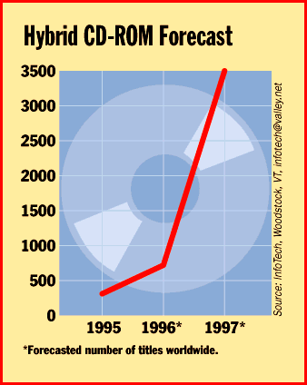

# CD-ROM Weds the Web

*Bits*

Dave Andrews

Although digital videodisc (DVD), the impending new CD-ROM standard, is currently attracting much attention, another important trend in optical storage is the marriage of the CD-ROM and the Internet's World Wide Web. Hybrid CD-ROMs are titles that include on-line communications, such as links to Internet sites where users can access expanded content. According to InfoTech (Woodstock, VT), a CD-ROM research and consulting firm, hybrid CD-ROMs

are expected

S to account for nearly 10 percent of all CD-ROM titles in print worldwide by 1997.

http://www.gzone.com/

Hybrid CD-ROMs have numerous advantages. A publisher can put high-quality video clips on the CD-ROM, instead of making you squint at postage-stamp-size, slow video as it transmits over the Internet. Game developers can establish links to Web sites that let you download gaming scenarios or participate in networked multiplayer sessions. Edutainment developers can create titles that have a link to an on-line interview. For example, a new title from the Graphix Zone (Irvine, CA, (800) 828-3838 or

http://www.gzone.com/

) called Herbie Hancock Presents Living Jazz includes links to an FTP site where you can download interviews with jazz greats to your hard drive.

http://www.marketscape.com

http://www.folio.com

Besides providing advantages to content developers, the emergence of the hybrids is also an opportunity for publishers of toolkits that make it easy to create such CD-ROMs. One such product is the WebCD development program, which is available from MarketScape (Colorado Springs, CO, (719) 593-9890 or

http://www.marketscape.com

). It does much of the work for you by helping you organize your Web content (for more information, see the review "Hybrid Web/CD-ROM: Do It Yourself"). Companies such as Folio (Provo, UT, (801) 229-6700 or

http://www.folio.com

), whose customers access data stored in proprietary infobases, have introduced Internet-enabled programs that leverage their core products.

For example, Folio says it will release a new version of its Web publisher that lets Internet users access information contained in Folio infobases. Folio's first Web publisher worked with only one HTTP server. Version 2, which should ship this fall, will run on HTTP servers from Netscape, Microsoft, and others.

Another version of Web publisher, which will follow version 2 and should ship late this year or in early 1997, will add some new features. They include support for document metering, rights management, and other functions currently supported in Folio, company officials say. Folio also provides tools for integrating disparate data stored in Folio infobases and Hypertext Markup Language (HTML) into a hybrid CD-ROM package. Says Ted Pine, chairman of InfoTech, "The Web will become the universal way to look at things, but the data you're browsing may originate from legacy databases.

Ds Say "I Do" to Web Access

1The next big thing: CD-ROMs with on-line access.

Copyright

1994-1997 BYTE

n-_

L._

## Images

