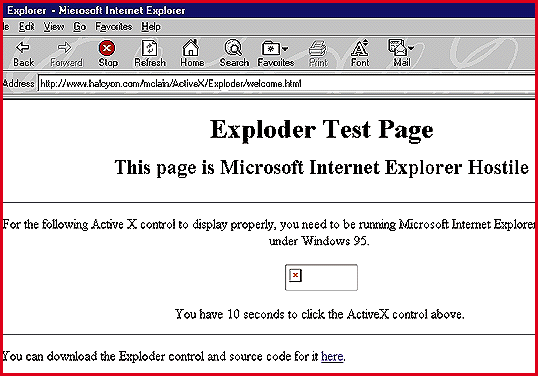

# Bug of the Month

*Bits*

Be Careful Out There!

This month's choice isn't a bug per se, but rather a dramatic example of what can happen when good people download bad ActiveX controls. Fred McLain, CEO of Apropos, a software engineering company, wrote an ActiveX control to illustrate the potential dangers in downloading ActiveX programs. If you're using the final version of Microsoft's Internet Explorer 3 and download his

Exploder control

:, it performs a clean shutdown of your Windows 95 system.

http://www.halcyon.com/mclain/ActiveX

"I'm warning visitors to my Web page [

%http://www.halcyon.com/mclain/ActiveX

] that you have to be careful," McLain says. He points out that someone else could just as easily write an ActiveX control that formats your hard drive or does other equally bad things.

Exploder went through the Authenticode process, in which controls are submitted to VeriSign, the digital-authentication company that is working with Microsoft. With Authenticode, a software publisher signs its code with a unique digital signature, which confirms to users who published the control and that it hasn't been hacked.

Microsoft says Authenticode wasn't designed to guarantee that users won't download malicious code, but that the technology does provide a measure of accountability on the Internet. McLain is not convinced that's enough.

"If I were to put a loaded pistol on the table with a note indicating who owns the gun, that won't prevent a 3-year-old from walking in, picking up the gun, and accidentally shooting himself," says McLain. "The note wasn't enough to prevent the accident." At press time, McLain was putting the final touches on a version of Exploder that does another clean shutdown, this time of Windows NT.

mailto:edejesus@bix.com

Send yours to

edejesus@bix.com

(Even Authenticated Controls Can Explode

Copyright

1994-1997 BYTE

\1_

\1_

(2_

\1_

e2_

\1_

\1_

\1_

\1_

p6_

\1_

\1_

\1_

\1_

l;_

\1_

\1_

\1_

\1_

## Images

