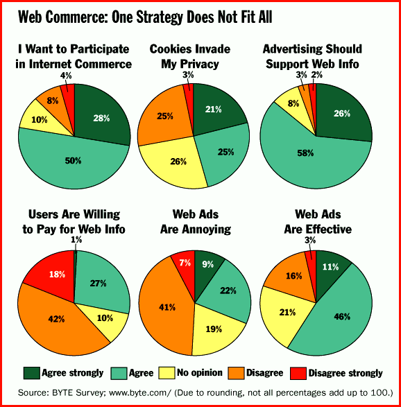

# Survey

*Bits*

Web-Commerce Polarization

This month's BYTE survey on Internet commerce and privacy reveals a sharp difference of opinion regarding how much privacy users are willing to give up in exchange for access to free information. The topic of cookies is an especially tricky one. Cookies, small pieces of code that are stored on an end user's computer, let a Web server automatically grant visitors access to areas to which they are specifically entitled. Paid subscribers can automatically access value-added information, for example, but Web masters can use cookies to track your activity on their sites in a detailed way.

This tracking capability makes users nervous. "Commercial sites have every right to monitor your actions within the spectrum of their site," says one respondent. "But they should not have the right to distribute that information to others." Another says, "Use of tracking data aggregated to eliminate individual identity is OK, but using individuals' data is too great an invasion."

Other respondents favored the use of advertiser-supported free information. Also, if faster links to the Internet become prevalent, letting ads come up more quickly in a Web browser, that may reduce complaints against on-line ads. What's the answer? Probably a mixture of strategies. As one respondent says, "I guess we live in interesting times when it comes to formulation of Net commerce."

,Web Commerce: One Strategy Does Not Fit All

Copyright

1994-1997 BYTE

J_`

## Images

