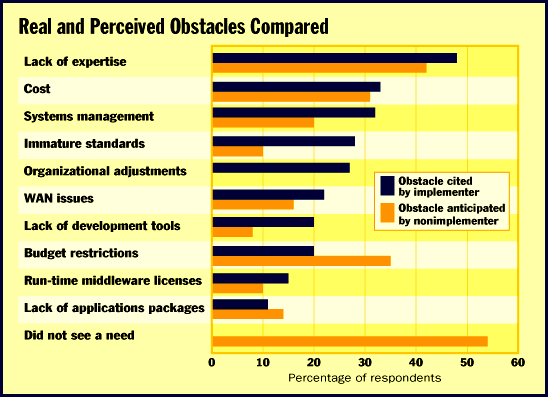

# Datapro Report

*Bits*

!Wanted: Client/Server Expertise

Dennis Byron

High costs and lack of expertise and systems management are the major obstacles on the way to realizing the benefits of client/server computing, according to Datapro's 1996 International Client/Server Issues Survey. Information systems executives understand the cost implications of client/server computing, realizing that, despite the conventional wisdom of the early 1990s, expenditures may be even higher than those of a monolithic system. However, they also believe that the benefits outweigh the cost and other disadvantages.

Implementers said the top benefits are improved end-user access to information, the ability to flexibly react to business needs, and scalability (i.e., the ability to add additional capacity).

As expected, the trend line for full implementation of a client/server system continues strongly upward. In 1994, 18 percent of the respondents to Datapro's survey had fully implemented a client/server system. By 1995, that number increased to 25 percent, and this year, it was up to 46 percent. Of the implementers, half use a two-tier scheme, but a third use multiple-tier schemes. Additionally, about 75 percent of them incorporated legacy systems, and about one-third of those incorporated legacy systems through real-time connections, as opposed to gateways or batch data transfer.

As you can

see in the chart

, the perceived disadvantages of client/server computing among those who haven't implemented a system differ -- in some cases by a large margin -- from the disadvantages as stated by those who have completed their systems. Nonimplementers seem to have less awareness of the pitfalls of immature standards, system management, and the lack of development tools compared to those who have already implemented a client/server system. Of this year's respondents, 29 percent are still making client/server plans. Those who are still in the planning process might want to reevaluate how many resources they plan to devote to trouble areas such as systems management and immature standards.

## Real and Perceived Obstacles Compared

Those not implementing a client/server system underestimate the obstacles of management and immature standards.

http://www.datapro.com

Dennis Byron is a senior analyst for Datapro Information Services. For more information on Datapro Information Services: (800) 328-2776, (609) 764-0100, or

http://www.datapro.com

## Images

