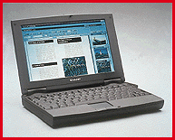

# Notebook Screen Future: Bigger and Wider

*Bits*

Jon Pepper

Major suppliers of LCD panels -- including Sharp, NEC, and Mitsubishi -- are developing displays that are larger and more advanced than today's 12.1-inch thin-film-transistor (TFT) standard. Sharp's new Super-V LCD, currently available only as a 13.8-inch prototype TFT model, has 1024- by 768-pixel resolution, a 140-degree viewing angle, an ultrahigh brightness-to-darkness contrast ratio (300-to-1), and a viewable image area roughly equivalent to that of a 16-inch CRT.

Although Sharp is not shipping this model yet, its PC-9090 notebook, due for delivery by the end of the year, will include some of its aspects. The PC-9090 uses a Super High Aperture 12.1-inch TFT with 1024- by 768-pixel resolution and brightness Sharp claims is 50 percent higher than previous models.

http://www

Sharp ((800) 237-4277 or

http://www

.sharp-usa.com) also just released the first wide-screen notebook, the 4.6-pound WideNote portable. Its 9.6- by 5.6-inch display (

see the photo

) can show two side-by-side Web pages or a standard-width letter with extra space left over on the side. The 16-to-9 aspect ratio is the same as a movie screen. The wide-screen LCD has a resolution of 1024 by 600 pixels and a diagonal measurement of 11.28 inches.

NEC and Mitsubishi (among others) are currently working on LCD screens bigger than 13 inches, and NEC has demonstrated 20- and 26-inch panels in Japan. While those are not intended for use in a notebook (such screens are wider than today's standard laptop size), analysts expect the 13.8-inch size to appear in notebooks toward the end of 1997. Today's 12.1-inch display that seems large will soon look as outmoded as 10.4-inch displays do now.

## Sharp Widens Your View

Sharp's WideNote display reduces the need to scroll through spreadsheets.

Copyright

1994-1997 BYTE

Ka

Ka

La

## Images

