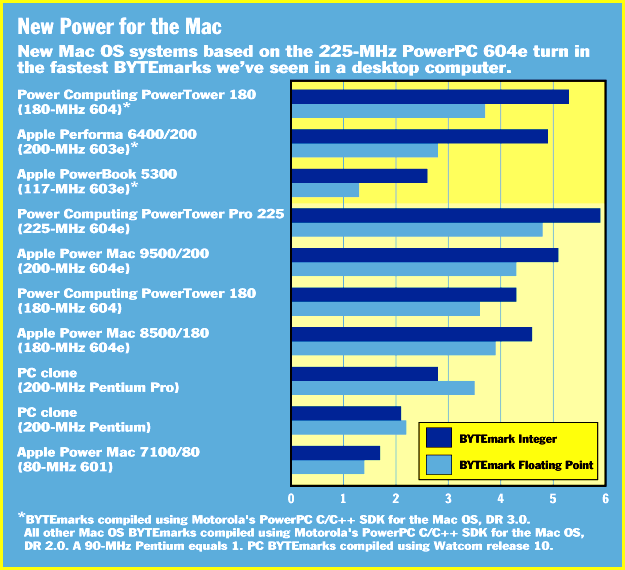

# New PowerPCs Boost Macs

*Bits*

Tom Thompson

Results from BYTE's cross-platform BYTEmark benchmark indicate that the latest PowerPC-based Macs give users a significant performance boost. As we expected, Power Computing's PowerTower Pro 225 is the fastest Mac we have tested, in terms of its raw processing power. Indeed, its BYTEmark scores are the highest we've seen in a single-processor desktop system.

Due to differences in compiler technology, a careful reader will notice that the results shown here for certain processors (e.g., the 200-MHz 603e) differ from the results we posted in our August issue. This is because we used different compilers to compile the BYTEmark suite for Windows NT and the Mac OS. Improvements in compiler technology can also improve performance on the same chip. For example, the 180-MHz 604 gets a big boost in integer performance when executing BYTEmarks that were compiled by release 3.0 of Motorola's PowerPC Software Development Kit (SDK) -- see the figure

"New Power for the Mac"

-- compared to release 2.0.

IBM and Motorola are preparing new PowerPC processors (code-named G3) for 1997. These will be based on the 603e and 604e, but with bigger caches and better system interfaces. Another generation will follow in 1998 (for more information on the PowerPC road map, see the State of the Art article "PowerPC Regroups"). The much-delayed PowerPC 620 may finally ship within the next three or four months, as well.

## New Power for the Mac

Copyright

1994-1997 BYTE

Oa

-Pa

## Images

