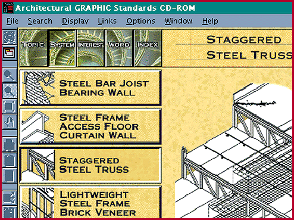

# CD-ROM Review:  Architecture Bible on CD-ROM

*Bits*

Jason Krause

Moving a venerable reference book onto a CD-ROM can be either a waste of plastic or a huge step forward in terms of usefulness. You hope that such a transposition increases the convenience, searchability, and portability of the material.

John Wiley and Sons has put the entire contents of Architectural Graphic Standards, a reference bible for architects since 1932, on CD-ROM. The disc defines and explains structural, mechanical, and electrical systems with text and technical diagrams. You can search it by several methods, including standard text searching and an index.

A potentially great feature of a CD-ROM like this is the ability to use its included diagrams in your drawings. However, only 10 percent of the diagrams on this version are in accurate vector format.

The interface is intuitive, although navigation is difficult because it is hard to retrace your steps. You can export whole illustrations or parts of them into your word processing or graphics programs, but you cannot cut and paste from this program. Currently, tables and equations found in the CD-ROM are not interactive, but they will be in a future version (slated to ship in about a year and a half).

John Wiley and Sons has not created a perfect transition of Architectural Graphic Standards from one medium to another. However, it is an important beginning that hints at exciting possibilities.

## Product Information

Architectural Graphics Standards

Company: John Wiley and Sons, 605 Third Ave., New York, NY 10158

Phone: (800) 225-5945

http://www.wiley.com

Internet:

http://www.wiley.com

Price: $345

'On the Right Track, Hasn't Arrived Yet

=An architectural reference bible is now available on CD-ROM.

## Images

