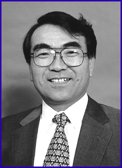

# Beyond R2D2: Robots Evolve

*Bits*

Takeo Kanade

, director of the Robotics Institute at Carnegie Mellon University, reveals how robots will make our world better and more entertaining.

Dave Andrews

BYTE: Robots are showing up in all kinds of new places and in new forms. What are some of the new uses we're finding for robots?

Kanade: The scope of where robots are used has been and will be expanded from robots in the factory floor to more natural environments, including agricultural fields, mines, and construction sites. We are also looking at things like space and planetary exploration, and working in hazardous environments, including natural environments such as volcanoes, and manmade hazards such as nuclear hazardous environments. Those are definitely the trends that we at Carnegie Mellon's Robotics Institute are working to make happen. One other area is in everyday life, such as driving on the highway or in the home.

BYTE: Where are we going to see robots showing up in cars and in homes? What will they do?

Kanade: Well, in cars we are working hard to develop the capability of having a vehicle drive autonomously on the freeway. We have already demonstrated navigation based on computer vision in a car that was able to drive autonomously from Pittsburgh to San Diego last year. Of course, I frankly don't know when people will completely take their hands off the wheel and let the robot or computer drive their cars throughout the journey. I would say it will be relatively soon.

But before that, you will see a more intelligent cruise control than the current one. The current cruise control in cars is used for speed control. The more intelligent one will change speeds relative to the curvature of the road. It will also determine whether or not you are in the correct lane or whether or not there is a potential obstacle in front of the car. The more intelligent cruise control tries to maintain the car in the lane depending on the environment such as distance relative to the car in front of it. It could also take into account the curvature and the up slope or down slope, and control the speed based on that. And if it the car is going off the way, drifting to the roadside, the system warns and even applies the brake. I would say that's probably short range.

BYTE: When you say short range, do you mean five years?

Kanade: I would say technically within two years, I am sure we are right there.

BYTE: And then there's the process of selling it to the car manufacturers.

Kanade: As well as acceptance by the society. There is some psychological barrier there between current cruise control and the one that I am talking about, even though, if you look at intelligent, anti-locking brakes, as an example, you can think of those brakes in one way as an intelligent robot. In spite of the way that you are applying the brake, where if you slam on the brakes when you want to stop quickly, the intelligent brakes are actually grabbing and releasing many times a second. This releasing of the brakes is, in the short term, opposite to your intention. But as a whole, the braking system tries to accomplish what you are trying to do, that is, stop the car.

Now what I am talking about, the intelligent lane control, the ability to control speeds relative to the curvature of the road and so on, that certainly has a little more psychological barrier to be overcome by the drivers. But separate from that, I would say technically, I don't see difficulty to be at the stage where we engineers say, "It's ready." Within a couple of years, I think.

BYTE: In terms of the Navlab 5 vehicle that drove itself across the U.S. last year, humans were still controlling the brake and accelerator on that one. But how fast could it go?

Kanade: Well, we could go up to 80 miles per hour, though we don't do that on the public roads.

BYTE: Today when people think of robots, they often think of those robots C-3PO or R2-D2 in the Star Wars movie series. But you appear to have a broader concept of what makes up a robot.

Kanade: I don't think we need to limit our concept of a robot to that of a separate entity which is walking or moving along separate from humans. You can think of it more as a symbiosis, or synergy, between machines, which, collectively I call a robot. And here we have the human and machine cooperating. So in the car, you the human driver know where you have to go, and of course, over all, you are responsible to make sure the car goes where you want to go, its safety, and so on. But some part of the controls can include the speed control, or sensors such as infrared or some microwave sensor that can actually see much farther than you can. Those sensors could tell you of potential hazards in front of the car. So that's a machine which I call robot, it cooperates with humans, and results in a symbiosis for overall safety, comfort, and efficiency of our life. I think that's a very important viewpoint.

BYTE: We already have machines similar to the ones you envision for automobiles in use in airplanes assisting pilots today.

Kanade: Airplanes can take off and land completely autonomously. In some cases, the human pilot is the one that makes the mistake.

BYTE: So what are the factors that are making these devices more affordable for consumers?

Kanade: The advancement of everything. Number one, sensors like cameras are now becoming so inexpensive that we can now have systems that use many of them, not just one camera. You can put a couple cameras looking in front, a couple looking in back. In that sense you have more eyes than yourself. The computers certainly help. In fact, the current Navlab Five is run off a laptop computer, instead of five SPARC 20 workstations it used to use. Before that, we even put a supercomputer on it, at the time of Navlab One. So you see the advancement of the computer.

BYTE: And then you are obviously modifying your code to work better too.

Kanade: Absolutely. I would say that the last one, the understanding of the algorithms, is the most important part. It's misleading to say that the speed [of the computers] has advanced, therefore we can do this and that. The most critical part is understanding the problem, always.

BYTE: So it's not just an issue of just throwing more MIPS at the problem.

Kanade: Right. However there is an interesting connection between the two, that is, the improvement of code and the computer. I would say advancement of computing, in other words, the fact that you can compute more things in a certain time, certainly allows us, the visual researchers, to think more systematically. Or to put it another way, we don't need to rely on a cheap trick to make the algorithm run within a required time. We can think of a more systematic, more correct way to make something work than a cheap trick to make things appear to work. There's a big difference.

BYTE: What are the benefits of this more systematic approach?

Kanade: The biggest benefit is we actually understand why something fails when it fails. Sometimes you are forced into a situation of "Well we know this is what we really want to do, but the computer can't do all that in realtime." And then you look for ways to skip things, areas to simplify. And when you do that, we, the designers of the algorithms ourselves, do not really understand when or where the effect of that simplification, shows up. Especially when it comes to building very reliable systems, it is very important to understand the effects of these simplifications. And now, due to better computers, we are relying less on having to use arbitrary simplifications just for the sake of making it faster. That in turn makes the system more robust and more understandable.

BYTE: Your robots have explored volcanoes to gather data that previously researchers had to place themselves in peril to get. In fact, scientists have died in volcanoes during an attempt to capture samples. What are some of the other interesting ways that robots will be used to accomplish tasks that currently humans must perform at great risk?

Kanade: Another one that we are working on is a helicopter project, a flying robot. This has an advantage in rescuing people in bad weather or fire fighting. It could also be used in industrial maintenance, such as monitoring power lines.

BYTE: You mean, checking to make sure power lines are installed properly?

Kanade: That's right. Now rescue is a very important scenario for us in bad weather.

BYTE: How would the robot accomplish something that a human could not?

Kanade: In bad weather, say for example, a ship sinks, and some survivors are expected, the first thing is to go and try to find them. Then when you find them, you can drop them supplies. But the first thing to do is to find them. And I often hear in the news that the weather is bad and therefore the mission is on hold. Well that's understandable. I often say, if the weather is good, then probably the ship would not have sunk. In these cases, the reason that the rescue mission is on hold in bad weather is that the people who would go out on a rescue would also be in danger. Now if this is an unmanned mission, we can risk the failure. If the helicopter crashes, at least we are not losing another human life. On all of these dangerous missions, the key factor is: the more risk you take, the more effective is the mission. If you can actually do a task in such a way that even a crash is still acceptable, because no human life is lost, then I think the effectiveness grows rapidly.

BYTE: How can it be effective if the robot copter crashes?

Kanade: In bad weather, finding a survivor in the sea, you have to fly low. And that's very dangerous. But the lower you fly, the better your chances to find them. But if you use a human pilot, you don't want to fly as low out of safety concerns, and this is less effective. So you have a multiplication factor. If you fly twice as high, well you may be able to fly, but then the effectiveness or possibility of finding them may be only half of what it would have been if you flew lower. Whereas if you can actually risk the failure, that is, a crash, then you send the robot searcher to a height that's lower and the probability to find them may increase. So, why not do it? There are lots of those cases.

BYTE: And a robot helicopter could help fight fires too?

Kanade: Yes, and again, the more effective the mission, the more dangerous. If you hit the hottest spot with a fire fighting agent, it's very effective. But it's also dangerous. So human pilots don't fly that close. The result is that many of the chemicals dropped are actually wasted. But if you can fly low and go close and drop at the most critical point, then you can do it effectively. It's the same situation.

BYTE: In terms of implementing these designs, bringing them out to the real world, what are the challenges for these robots to become more effective? Is it a question of honing the algorithms again?

Kanade: I would say the data interpretation is the biggest challenge. If we think of the robot's capability, I usually say the robot is useful as a whole because it is mobile. It is also useful because it can sense, including all kinds of senses, like vision, hearing, smelling, touching, and so on. It is effective because it can manipulate. It can drop something, manipulate something, move or dig, all kinds of things affecting the environment. Those three things have to be done. In some tasks, you may not have manipulation, you only have sensing and mobility. But the key among these three to me is the sensing at this point. Vision is definitely one of the most important aspects of that. But as a whole, you have to understand what is going on in order to react to it.

We frankly have a long way to go before we can develop enough variety of sensing capabilities for many tasks. It's getting better, but that is always the challenge. If you look at any robotics systems that have been successful, I think that so far, the success comes from the good combination of sensing, manipulation, and mobility. Sensing includes both sensors themselves and algorithms. The progress of interpretation methods is definitely slower than the progress of sensors themselves. Ordinary vision is the example. Cameras have been pretty good for a number of years. In some cases, cameras are even better than the human eye. But the algorithms are far worse than human vision.

BYTE: Are there any tools or technologies on the software side that will enable this to improve?

Kanade: One of the good things is that some of our algorithmic learning capabilities, including neural net, genetic algorithms, and multi-agent control methods, those are definitely helping to achieve new capabilities. There are quite a few examples of those.

BYTE: Such as?

Kanade: One of the things that we did was detecting human faces in the field of view, where you point your camera at a scene and have a robot detect humans by actually detecting the pattern of their faces. That program was not written in the sense of someone coming up with certain algorithms to do that. Instead, that capability was learned. And I think that it's important that these are not a blind application of neural nets. In this situation, you understand the problem of recognition, in this case, a human face, as to what are the important features, what are not, and how to present good examples of faces and things that are not faces. In the case of face recognition, the more difficult part is, what are the non-face examples? There are so many. And so we must decide what we should give the neural net as a non-face example. That's actually not an easy task. Giving a face example is easy. But what non-face example should we give? Should we give it a picture of a building? Should we give it a picture of a tree? A computer? It's an interesting question.

BYTE: What about robots and entertainment, as in vehicles on the moon that people would control from Earth?

Kanade: That's a new breed of robotics, where we're getting into entertainment. In this case, the images of the lunar surface are sent back to the Earth and people can enjoy it in a natural environment.

BYTE: So when the buggy goes over a dune or pothole, the floor underneath of the person back at Earth moves and shakes. Is that project still being financed by private money?

Kanade: That's still on track, yes. And another thing that is going on is virtualized reality. We have built a 51-camera dome that we call 3D-Dome. It's a five-meter dome where 51 cameras are looking inside. In other words, the dome space is covered by a sea of cameras. And whatever happens inside is modeled into computer graphics CAD model. It's a natural event. So imagine that you are inside the dome, and you swing a baseball bat. How your shirt, body, and hand moves, it's 3D shape, every 30 milliseconds is modeled into the computer. Because it is modeled, this is why we call it virtualized reality. Once we do that, we can place you in that environment anyway you want. Thanks to the 3D models, you can actually immerse yourself into that environment. One of the best applications that I envision is let's watch NBA on the court. If you watch TV today, you are allowed to see only from the viewpoint that the director selected. And the camera is placed outside the court. Because the physical camera would block the game.

BYTE: So this would allow you to watch the game from the referee's point of view?

Kanade: Or from anywhere inside the court. Or if your living room is big enough, you can wear goggles and simulate play with them. They don't know you are there, obviously, because you aren't really. But at least you can see what it's like in blocking, say Michael Jordan. Or you can enjoy the viewpoint from the ball, if the ball could see.

BYTE: There must be other applications for this, such as physical therapy?

Kanade: Yes, in education, physical therapy, or virtualized surgery. With virtualized surgery, medical trainees can see from any viewpoint, from the surgeon's viewpoint, from the nurse's viewpoint, and you can change it anytime. So those are the kinds of new interesting things that we can expect to see. The important viewpoint I would like to convey here is that robotics is not limited to mechanical things. You have to look at it as an information oriented mechanism. One example you can think of is, similar to the 3DDome, your house. If you have elderly people, your house may be filled with lots of sensors to monitor your health. This lets elderly people get more effective care while reducing the cost. In that sense, the house itself is a robot.

http://www.ri.cmu.edu

For more information on the Robotics Institute, see

http://www.ri.cmu.edu

1Takeo Kanade, director of the Robotics Institute

## Images

