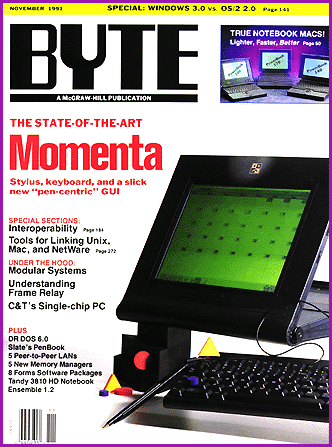
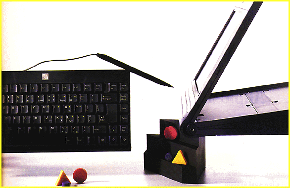
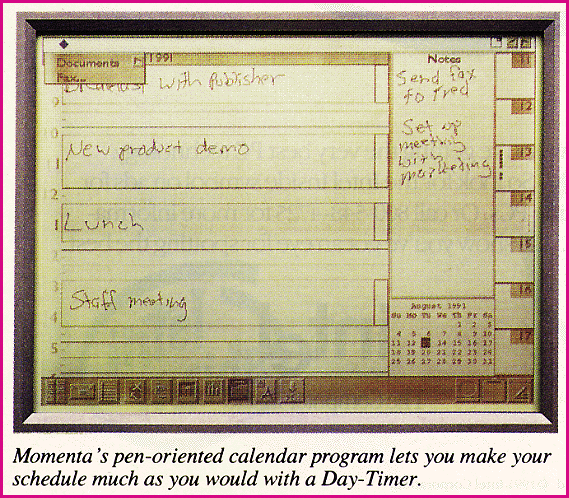

# 5 Years Ago in BYTE

*Blasts From The Past*

The industry was in transition. Apple and IBM were working together, as were IBM and Microsoft, despite their recent public divorce. More details on a new OS called Windows NT began emerging. Sales of Windows 3.0 were encroaching the Mac, but Novell was still pushing DR DOS. Meanwhile, we put the ill-fated Momenta computer on the cover. Pen-based computing hasn't yet broken into computing's mainstream, and Momenta Corp.'s eventual collapse is a good analogy for the eventual fate of many of the pen-based start-ups. A stronger trend that we devoted coverage to in that issue: network interoperability.

## November 1991

? found us covering the Momenta, whose time still has not come:

NEWS: First Impressions: Momenta Points to the Future

A new notebook merges the pen, the keyboard, and a slick -- but risky -- new GUI

by Andy Reinhardt

Many players in the nascent pen-based computing market see the transition from conventional notebooks to pen systems as a chance to bypass the DOS standard and start afresh with more modern technology. Although the era of pen-based systems has barely begun, there are already three competing operating environments. This mad scramble to set new software to norms for pen computers may be a rude shock to users comfortable with the uniformity of DOS.

In the midst of all this uncertainty, a fourth environment has arrived from start-up Momenta. One of the most widely anticipated entrants to the market, Momenta's pen-based laptop sports a new GUI that represents yet another effort to define the look and feel of pen computing.

The Momenta computer is different in other ways, too. The company is aiming it at mobile executives, not at the blue-collar and field workers who have until now been the target audience for pen-based PCs. Perhaps most surprising, Momenta is playing down the role of handwriting recognition in the system, saying that the technology is too immature to substitute for a keyboard in many cases. Instead, Momenta sees the pen, in conjunction with its new GUI, as a more intuitive substitute for a mouse.

Momenta is headed by an impressive team of industry veterans, and it has raised $30 million in venture capital. With its strong credentials and innovative technology, the company could grab a chunk of the mobile computing market. But it may have a hard time selling a new GUI against three tough competitors: Microsoft, Go Corp., and Grid Systems.

The Wedge

The Momenta is different from any other notebook even before you turn it on. Measuring 10 inches deep by 12 inches wide,

it tapers from

a thickness of 2-1/2 inches at the back down to 1-1/2 inches at the front. Momenta says that a sloped surface is easier to write on than a flat tablet, such as the NCR System 3125 (see "NCR Knows Notepads," August 1991 BYTE). The computer weighs 7 pounds.

The keyboard is an important point: Momenta calls its machine a pen-top, to indicate that it is a merging of a pen computer and a desktop. The system is meant to be used in the office as well as in the field, so it will ship with both a small "full-size" keyboard and a stylus that attaches with a short cord.

The brain ofthe Momenta computer is a 20-MHz 386SX chip. It's backed up with 4MB of RAM, 1MB of ROM, 256 KB of flash memory, and a 40-MB hard drive. A 2400-/9600-bps send/receive fax modem and a small microphone and speaker are built in, along with standard serial and parallel ports on the back. The system is powered by 10 AA batteries, which can be alkaline or rechargeable nickel-cadmium or nickel-hydride. Momenta says that the system works for 6 to 8 hours on a charge. Options include an external 3-1/2-inch floppy drive and Xircom LAN adapters.

Like other pen systems, the Momenta is dominated by its display, which is hinged at the front, so it can lie flat or be opened up for desktop use. The LCD panel, with 640- by 480-pixel VGA resolution, is reflective, not backlit, which saves power and improves legibility outdoors but makes it harder to read inside. A backlit screen will be available early next year.

Although the screen shows 80 dots per inch, the digitizer recognizes 400 dpi and the system retains that amount of detail, which means that "ink" written on the screen will be faithfully reproduced on a laser printer or when sent through the fax modem. There is no external CRT port, since a normal monitor could not be used for pen input, but Momenta may offer one in the future.

The Momenta computer offers typical power-conservation features (e.g., powering down the hard drive and display), and it also supports advanced capabilities such as suspend/resume.

New GUI

Momenta is treading a middle path between the DOS-incompatible PenPoint and Microsoft Windows for Pen Computing. The system is built on DOS and will run DOS and Windows applications unchanged, although at this time Momenta doesn't support the pen in DOS programs. But the intended interface is the Momenta software environment, an object-oriented GUI that is built in Smalltalk.

The computer normally boots up in the Momenta environment, an elegant graphical desktop with a suite of built-in productivity programs. Icons for the seven programs (i.e., an address list, a memo writer,

a calendar

, a to-do list, a presentation maker, a fax, and a "mark-up" program to annotate documents with handwritten comments) are located on the bottom left. All these modules share data, so an address selected from the address list and a "marked-up" document will flow automatically to the fax. In the bottom right corner of the screen are the clipboard icon and the suitcase, a trove of goodies like clip art, training programs, and a calibrator for the digitizer.

A guiding principle of Momenta's interface design was to display only the information needed at any time. The pulldown menus at the top of the screen are very spare, and they alter based on what you're doing. Most of the time, you won't need to use menus because of a feature called the command compass, a pentagonal object that pops up on the screen when you tap the pen. The command compass lets you move, copy, delete, and edit objects, or bring up a menu tailored to your situation. You can also teach the system to recognize your particular way of making gestures.

In addition to its built-in programs, the machine will be bundled with four third-party applications developed to run in the Momenta environment: a spreadsheet called PenCell that was developed by PenWare, a word processor and a file transfer program from Rupp Software, and a Structured Query Language database from a new company whose identity was not disclosed at press time.

Third-party developers who have used the Momenta environment praise its powerful object orientation and interfacebuilding tools, which have been compared to NextStep. Momenta plans to ship a full 486-based developer's kit, including class libraries and methods, to help third parties create "pen-centric" programs.

Training Required

The Momenta looks to be a solid product, although the prototypes I played with were slow. Momenta says the performance will be two to three times faster when the system ships. When it was running Microsoft Windows for Pen Computing, the performance was perky, but I found the screen a bit difficult to read in both Momenta and Windows for Pen Computing environments.

My more serious concern has to do with the GUI. I don't know if I've gotten slow in my old age, but I found it difficult to navigate and, at times, quite frustrating to use. Maybe more training would solve my problem. But if the Momenta interface isn't immediately and substantially better than its competitors, I find myself wondering why customers and developers should bother with it.

It's too early in the evolution of these kinds of systems for any machine to be considered the final word in pen-based computing. And Momenta's immediate challenge will be to attract sufficient third-party support to justify its unique GUI. But Momenta's hardware and the software reveal much about state-of-the-art pen-based system design, and they deserve a serious look.

At a Glance

Momenta Computer with 4 MB of RAM, a 40-MB hard drive,

and a built-in fax/data modem...................................$4995

Momenta Corp.

295 North Bernardo Ave.

Mountain View, CA 94043

Phone: (415) 969-3876

Fax: (415) 969-3877

## November 1991

## A Momenta Without Momentum

## The Electronic Day-Timer Interface

Andy Reinhardt was a BYTE news editor in New York at the time of the original publication of this article. He now works for Business Week.

## Images

