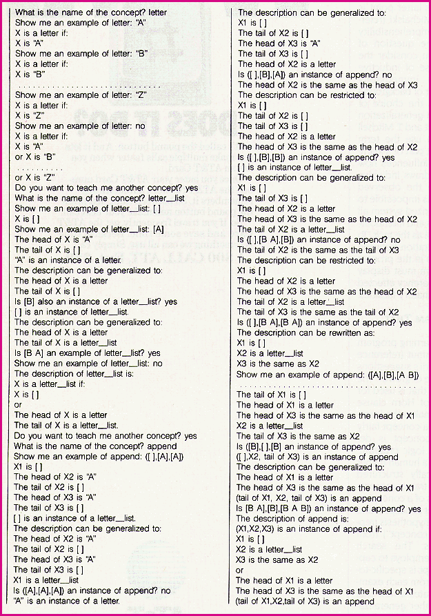
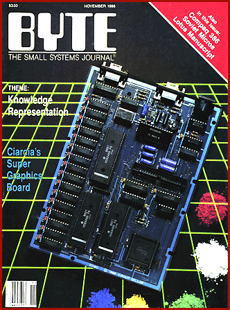

# 10 Years Ago in BYTE

*Blasts From The Past*

BYTE took an early look at Compaq's Deskpro 386, which started at about $6500. We also reviewed the Mac Plus, which upped the Mac's memory from 128 KB to 1 MB and increased the floppy drive from 400 to 800 KB, among other things. Also in that issue: scads of information on knowledge representation.

The theme of the

## November 1986

s issue was "Representing Knowledge". From the slate of seven articles, we present this lesson in machine learning:

Machine Learning

One approach to teaching computers to learn is with a language, such as Marvin's, that grows

by Angelos T. Kolokouris

In an attempt to make computers more accessible to humans, many researchers in the artificial intelligence field have been exploring ways to enable computers to learn. The motivation for machine learning is to have computers extract concepts and relations from databases or through interactive sessions with a user and then use them in any knowledge-intensive activity. Developing knowledge bases for expert systems applications is one such activity. Studying computer-based learning techniques will also give us a better understanding of our own mental processes.

A common method by which a machine learns is by proceeding from specific instances to general rules that more economically capture the content of the given instances. This form of Inductive generalization is characteristic of leaning from examples and improves on the performance of a knowledge-processing system by condensing a large base of its knowledge into a considerably smaller one. This reduction in size results in a more efficlent search, of the knowledge base.

When you take a closer look at the programs that learn from exmples, you can distinguish two types: those, called data-driven learners, that generalize by relying entirely on the data presented to them, and a group of more elaborate programs, called model-driven learners, that proceed by generating fairly general hypotheses that are subsequently tested against the given examples or against the user in a typical interactive session. In what follows I will contrast the model-driven learner with the data-driven learner and give an example of the former using a model-driven learner called Marvin.

What is Learning?

To give you an idea of just what's involved in modeling learning with computers, I should examine just what learning is. The best definition of learning that I am aware of -- that of Herbert Simon of Carnegie-Mellon University (reference 1) -- is that "learning denotes changes in the system that are adaptive in the sense that they enable the system to do the same task or tasks drawn from the same population more efficiently the next time." Taking a closer look at this definition, however, you may realize that it deals predominantly with skill acquisition or improvement, but not all learning is so concerned. Learning systems are those that are able to extract knowledge from raw data or through intersystem informative exchanges, including conversations with the user. Learning systems ought to have the ability not only to acquire knowledge in a cumulative form but also to absorb it.

Machine Learning Strategies

The methodologies used in machine learning applications with some degree of success are rote learning, learning by being told, learning by analogy. and learning from examples. In rote learning the computer makes no special effort to learn. The elements of new knowledge are given to it, through programming or by accessing an external data file, and inferencing is not required. Rote learning relies entirely on memorization, and it is debatable whether programs in this category display learning at all. This simplistic learning function is demonstrated by a checkers-playing program that learns the board positions it evaluates in its look-ahead search. In learning by being told general knowledge is modified into a form that the machine can recognize. The learner transforms the advice given into a set of statements that directly relate to what it already knows. This incorporation of new knowledge may facilitate further explanatory paths in the system's operation. In learning by analogy the knowledge given to the computer is not directly relevant, and the computer must hypothesize analogous cases to assist in solving the problem at hand.

In learning from examples the computer proceeds from individual cases to general principles, from particulars to universals. The problem of concept learning can be seen as the task of developing a classifying rule from several examples of proper membership in the investigated class. Learning from examples is the most successful method of machine learning today and has the longest history. Categorization was seen by Aristotle as the most fundamental step toward learning. In his attempt to provide a formal framework for the study of the way people acquire and process knowledge, he noticed that it is by inductive generalization that people get to know the set of objects that figure in the domain of their activity.

In their quest for knowledge people seek answers to basic questions like why and what. While why-questions are answered through the use of deductive logic, what-questions (i.e., those that relate to the task of taking stock of the foundations of descriptive language) are answered through inductive methods. Since Aristotle's day inductive techniques have been controversial, particularly regarding the degree of unsupervised function to which they are entitled.

Knowledge Representation

A related issue is representation. The properties of the objects you want to account for must be described in a particular language that accommodates such descriptions. A problem arises when you want a learning system to operate in different environments. A way to get around it is by choosing a flexible enough language to which you can add domain knowledge that reflects the peculiarities of the chosen environment.

In the early years of research on learning systems, R. B. Banerji (reference 2) suggested that rather than choose a language that is confined by the structure of the objects it is used to describe, a better choice would be a language that can "grow." He proposed that such a language could be developed using the predicate calculus as a starting point. This type of language would enable a learning program to create descriptions by learning the domain knowledge. The upshot of this approach is that the language becomes richer as more knowledge is acquired. The learning system learns concepts that can be used in future learning.

Data-Driven Learners

Here is a simple example of how a data-driven learning program functions. Assume that the data-driven learner is given the following data expressed in a Prolog-like syntax:

customer(X),profession(X,accountant),

#lives_in(X,cleveland),buys(X,300).

"customer(X),profession(X,lawyer),

)lives_in(X,berverly_ills),buys(X,25000).

&customer(X),profession(X,accountant),

*lives_in(X,berverly_hills),buys(X,30000).

The data-driven learner would extract what is common to these expressions and give the following generalization:

customer(X), lives_in(X,beverly_hills),

buys(X,Z) and Z >= 25000.

This example uses one of the simplest generalization rules, referred to as the dropping condition rule. According to this rule, in order to generalize a conjunction you may drop some of its conjunctive conditions.

Model-Driven Learners

A model-driven learning program is characterized by its hypothesis formation. Such programs form hypotheses that are then tested for verification against available data or through the assistance of the trainer.

From a general standpoint, the algorithm for a model-driven learner looks like this:

begin: develop a hypothesis

while hypothesis does not satisfy target concept do try another hypothesis that is more general or more specific depending on how the trial concept relates to the target concept.

Marvin's hypothesis formation differs from most other model-driven learners by taking advantage of what it already knows. Learned concepts that reside in memory are used to learn more complex concepts. Marvin develops concepts in much the way a human would: that is, the repertoire of concepts grows hierarchically.

Expert Systems

The expert systems applications at work today perform quite well in a limited domain and for routine rules of thumb in most cases. Enter the slightest novelty and deviation from the programmed knowledge and users get such discouraging answers as "This parameter has not been defined." Worse yet, the system cannot learn the new concept or relationship. Users are quickly frustrated by the expert system when they notice the wasteful paths it takes time after time trying to prove the same thing, not being able to improve on its problem-solving strategies, and, most important, not being able to learn from past errors. The knowledge-acquisition bottleneck can be eliminated by letting the expert system learn both rules and concepts in a more automated fashion. Such a system should also have the ability to acquire control techniques for optimizing its own processing. There are encouraging developments in all of these areas.

There is a danger that I may be overselling the automated part of learning and underestimating the difficulties involved. I would like to stress a simple point: For what the machine learns to be relevant it is necessary that humans stay close to the learning process. Also, for what is learned to be useful it must be scrutinized before it is used. This latter point is referred to by R. S. Michalski (reference 3) as the "comprehensibility principle." As for the question of relevance, even if you consider the seemingly simple case of inductive generalization, you immediately discover that a number of background assumptions go into the choice of direction along which generalization takes place. Paul Utgoff and T. Mitchell (references 4 and 5) use the term "bias" to describe that part of a learning program which influences how the concept learner draws inductive inferences based on the observed training instances." It is impossible to capture in a computerized system all the human constraints and intentions, those apparent as well as the tacit. To assure greater cooperation between machine and humans in the process of learning, the system must display a good deal of transparency effected through flexible explanatory facilities.

Marvin: A Program That Learns To Learn

Marvin, a machine learning program developed by C. Sammut (reference 6), pays heed to Banerji's suggestions for a language capable of growth. The description language that is used for Marvin is a subset of Horn clause logic. This language makes the learning and execution of a concept fairly easy because the concept is described in terms of a logic program.

Marvin depends on a human trainer to supply hierarchically structured sets of examples. The trainer presents Marvin with examples of a concept to be learned (the "target concept"), and Marvin generalizes a hypothesis (represented by a "trial concept") from the given examples. The search strategy that Marvin employs to capture the target concept is specific-togeneral (i.e., starting from each example, the program creates a new trial concept that is a further generalization of the first example). To find out whether the hypothesis is a proper one, Marvin comes up with objects that are adequately described by the trial concept. These objects are in turn presented to the trainer.

If the trainer decides that the object is contained in the target concept (such an object is referred to as "consistent"). Marvin attempts a further generalization. If, however, the trainer decides that a particular object is not contained in the target concept (such an object is called "inconsistent") and there are no other possibilities for generalizing, Marvin takes into account the error of overgeneralizing and creates a new trial concept that is more restricted. A concept has been learned when all possibilities for generating trial concepts have been exhausted.

Marvin is composed of the following components:

A description language.

An intepreter. This interpreter for Marvin's language must recognize objects described by a concept and generate instances of the concept.

An associative memory.

A generalization procedure. This procedure creates a more general description once it is given a concept.

A learning strategy. Marvin begins with an initial hypothesis and continues applying the generalization procedure until the target concept is learned.

The learning algorithm forms hypotheses that are tested for verification against available data or through the assistance of the trainer. The learning algorithm is given as follows:

1. Initialize. The example given by the trainer is described in a form of clausal logic. This makes up the initial hypothesis.

2. Generalize. Attempts are made to further generalize. If these attempts are proved unsuccessful, the learning process stops.

3. Test. The generalization is tested by constructing an object from the trial concept. If the trainer finds the object consistent, then go to 2.

4. Restrict. If the trial concept contains objects that are not to be found in the target concept, a more specific hypothesis is created. Go to 3.

The Description Language

Following Prolog, Marvin represents concepts using Horn clauses, that is, expressions of the form Q(X) <-- P(X) & R(X). The basic constructs of these expressions are predicates like father(X,Y). interpreted as X is the father of Y. The choice of Horn clause logic means you can use a uniform way of describing sets of objects and relations among objects. Also, since concepts are represented as sets of Horn clauses, they can be executed as logic programs.

Suppose you want Marvin to learn the concept of New Yorker as a more specific case than that of a Manhattan resident. The concept could be given as

new_yorker(X) <-- human(X) &

resides_in(X,manhattan) &

waIks_nervously(X).

While at work to learn concepts Marvin uses two types of memory: a longterm memory that is a database of descriptive Horn clauses like the one above and a short-term memory that contains only facts, that is, instantiated predicates like resides_in(francois,paris). The short-term memory contains descriptions of the trainer's examples. Such an example might look like this:

human(koch),

resides_in(koch,manhattan).

walks_nervously(koch).

A Session With Marvin

Figure 1 shows

the transcript of a session with Marvin where the trainer teaches Marvin the concepts of letter, letter_list, and append in that order.

At the outset, a distinction should be made between the syntactic repertoire of Marvin, which includes primitive constructs of lists, and semantic representations. Marvin's syntactic repertoire includes the properties of head and tail, which are separate from the concept of the semantic notion, list. Marvin has the ability to recognize when two objects are the same.

All concepts known are contained in Marvin's memory. which at the beginning of the session is empty. The trainer painstakingly gives Marvin every example of a letter and indicates that there are no other examples by replying to Marvin's query for another example of a letter with "no." Marvin then presents its concept of a letter and asks if the trainer wants to teach it any other concepts. The interactive session continues with Marvin, and two incrementally more sophisticated concepts are learned, those of letter_list and append.

Conclusion

Professor Banerji and his colleagues of the Machine Learning Laboratory at St. Joseph's University are working on languages that are characterized by self-enrichment. One matter of particular interest is the way research in this area can be useful in future Prolog implementations that incorporate intelligent backtracking techniques. In a joint venture, the State of Pennsylvania through its Ben Franklin Partnership, St. Joseph's University. and Orphic Experts Inc. are in the process of developing learning programs that could prove of significance as enhancements for expert systems in the defense area in particular.

Finally, from what has been said in the course of this article you might get the feeling that I should be talking about machine-aided learning rather than machine learning. This goes along with the realization that despite the growing sophistication of its use, the computer remains just a tool for humans, at least for now.

REFERENCES

1. Simon, Herbert A., "Why Should Machines Learn?" in R. S. Michalski et al., eds., Machine Learning I. Palo Alto, CA: Tioga Publishing Co., 1983.

2. Banerji, R. B., "A Language for the Description of Concepts," in General Systems 9. Society for General Systems Research, University of Louisville, 1964.

3. Michalski, R. S., "Understanding the Nature of Learning: Issues and Directions," in R. S. Michalski et al., eds., Machine Learning II. Los Altos, CA: Morgan Kaufmann, 1986.

4. Utgoff, Paul E., "Shift of Bias for Inductive Concept Learning," in R. S. Michalski et al., eds., Machine Learning II.

5. Mitchell, T., "The Need for Biases in Learning Generalizations." Technical Report CBM-TR-1 17. Rutgers University, 1980.

6. Sammut, Claude, and R. B. Banerji, "Learning Concepts by Asking Questions," in R. S. Michalski et al., eds., Machine Learning II.

## Learn Along with Marvin

## November 1986

Angelos T. Kolokouris, a native of Greece, holds a master's degree in physics from Penn State and is completing his Ph.D. at Temple University. He is cofounder of Expert Systems International (1700 Walnut St., Philadelphia, PA 19103).

Copyright

1994-1997 BYTE

K.j

e/j

#0j

k0j

.1j

~1j

e2j

c5j

S8j

\<j

Aj

Cj

!Fj

Ij

?Jj

Mj

Rj

Sj

Uj

Xj

z]j

R_j

S`j

#aj

Wcj

Sdj

## Images

