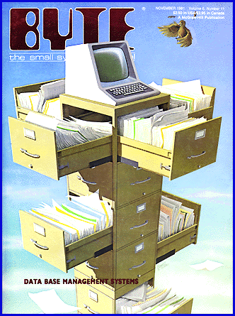

# 15 Years Ago in BYTE

*Blasts From The Past*

We focused on data management and the problems thereof. Other articles focused on how to use the microcomputer as a laboratory instrument and a hardware product from Microsoft called the Softcard. This was a $399 board that allowed you to run programs and languages written for CP/M on your Apple computer.

An early Microsoft offering was one of the System Reviews in

## November 1981

SYSTEM REVIEW: Microsoft Softcard

by Mark Pelczarski

The Microsoft Softcard offers Apple owners increased flexibility and a strong alternative or complement to the Language System from Apple. At a suggested retail price of $399 Softcard comes with version 2.2 of the CP/M operating system and Microsoft's BASIC-80, version 5.0.

In addition, a number of other Softcard support products are available, including Microsoft's FORTRAN and COBOL, an assembly language development system, a BASIC compiler, muMath and muLisp, and 16 K-byte memory expansion cards. None of these are inexpensive; for example, the COBOL language system retails for $750 (making FORTRAN seem like a comparative bargain at $195), but the point is that you can now have these languages, plus a variety of software already written for CP/M, on your Apple.

## Overview

The Softcard package comes with the card, 13- and 16-sector disks, and two thick manuals. The card is manufactured for Microsoft by California Computer Systems of Sunnyvale, California, and was designed by Don Burtis of Burtronix in Huntington Beach, California. With the exception of slot 0, it works in any of the Apple peripheral slots and the Softcard package will work alongside the Apple Language System. The Language System actually extends the ability of the Softcard system by providing an extra 12 K bytes of programmable memory. The Softcard is not compatible with the Apple III. It does work with all of the 80-column boards now available for the Apple II.

The software supplied is the CP/M operating system and two versions of BASIC. The 13-sector disk contains MBASIC, which is Microsoft's ANSI (American National Standards Institute) compatible BASIC-80, with a few additions to accommodate Apple's low-resolution graphics features. The 16-sector disk also contains GBASIC, which includes highresolution graphics commands. CP/M, the operating system, is an abbreviation for Control Program/Microcomputer, and is licensed by Microsoft from Digital Research, Inc. This version of CP/M includes a variety of disk and transfer utilities, plus an 8080 editor/assembler/debugging utility. The software was produced by Neil Konzen, a name that will be familiar to anyone fortunate enough to own Synergistic Software's Program Line Editor, another of Neil's Apple creations.

Using the Softcard

The two system manuals are very thorough and provide simple to very technical information. One is for CP/M, the other tells how to use BASIC 5.0 and the included software utilities. The first subject covered is how to back up the master disk. The beginner will probably want to go from there to more familiar ground and play with some of the BASIC commands, learning how to use the operating system as the need arises.

BASIC 5.0 is a nice way to convert to a structured language. If you're already familiar with BASIC, Applesoft or another version, you won't be trying to learn a new language from scratch.. The advantages of BASIC 5.0 include several new commands that support structured programming. (

See Table 1

5 for a list of enhancements and their descriptions.)

The most convenient additions are the inclusion of the ELSE clause in the IF-THEN statement, the PRINT USING statement for explicit formatting of output, the inclusion of real disk commands, replacing the ungodly PRINT Control-D commands of Apple's DOS, and BASIC's version of a DO WHILE loop: WHILE/WEND. An example of the latter, paraphrased, would be: WHILE this condition is true, keep repeating all the commands before the WEND statement. This version of BASIC is also compatible with. current ANSI standards, so the use of BASIC programs written for other machines using ANSI BASIC is possible.

After the language is loaded, about 14 K bytes of working storage are left on a 48 K-byte system. Hence, there are advantages to having the Language System or the optional 16 K-byte memory board. Either choice gives an added 12 K bytes of working storage. A 4 K-byte slice of that memory range is inaccessible; those are hexadecimal memory locations COOO thru CFFF, which are allotted for peripheral card I/O by the Apple. Another 4 K bytes, for the 6502 microprocessor's stack, the text screen, and other miscellany, are not available to the Z80, so Microsoft refers to 44 K- and 56 K-byte systems, rather than 48 K- and 64 K-byte systems.

CP/M for the Softcard is a complete version of the operating system. The command files provided with CP/M are shown

in Table 2

. The standard CP/M 8080 assembler is included, along with a line-oriented text editor and DDT (Dynamic Debugging Tool) for machine-language programmers. Utilities are also available for transferring files from one device to another PIP (Peripheral Interchange Program), simulating batch jobs with disk input files (SUBMIT), dumping the hexadecimal contents of any file (DUMP), and transferring text and binary files from Apple DOS disks (APDOS).

Using Other CP/M Software

A language or operating system is of little value if it is nonstandard or can't be used with existing software. Softcard provides a DOWNLOAD program, a listing, and programming details for an UPLOAD program, that when loaded into respective systems (DOWNLOAD for the Apple, UPLOAD for another CP/M machine) allow the transfer of CP/M files from another CP/M system to the Apple through a serial RS-232C port. This does, of course, assume that you have the appropriate serial interfaces and another CP/M system available. A working knowledge of 8080 assembly language is also necessary for implementation of the UPLOAD program.

Another possible solution is to transfer CP/M files to an Apple DOS disk as a text file and convert that file to a CP/M file using APDOS. However, the text file created with the Apple DOS will use only a carriage return as a delimiter, while CP/M requires a carriage return and a line feed. Depending on the language, at this point, more tinkering is needed for the Softcard to understand your program. The saving grace to all nontinkerers is the fact that companies such as Lifeboat, Peachtree Software, Microapt and Structured Systems offer their CP/M software already on Apple-format disks. Also, the Computer Shack in Pueblo, Colorado, will, for $10, download any CP/M program you send them for use with the Softcard.

Using the 6502 from CP/M

It is possible for programs written for the Softcard to call routines written for the 6052 processor. The Z80 is enabled with a memory write to a specific location. This soft switch can be toggled back to the 6502 with a similar write performed by the Z80. 6502 subroutines may be called by putting the subroutine address in a predesignated location, then toggling the soft switch. Values can also be passed to the 6502's A, X, Y, and status registers through another set of specified memory locations. The only confusion may come from the fact that the Softcard re-maps the Apple's memory to conform to CP/M standards. This means that the same location will have different addresses under the 6502 and Z80 modes. Apple's zero page has been moved to the top of the Z80's memory, so the Z80's location zero is actually hexadecimal 1000 to the 6502. This may sound confusing, but the adjustment is not difficult.

Conclusions

Because of the flexibility it offers Apple users, I consider the Softcard an excellent buy. Despite the introduction of many new and often better languages, three of the first popular computer languages (FORTRAN, COBOL, and BASIC) continue to enjoy the widest use. Although I'd like to jump on the Pascal bandwagon, I don't think that it and other languages will replace any of the above three. New languages will be used, but the trend is that existing languages continue to evolve to keep pace with the times. Look at BASIC. It's hardly recognizable from its original version or the version of FORTRAN of which it was supposedly a subset. The cost of rewriting software and retraining programmers is just too high to allow drastic changes or entirely new languages The Softcard lets you choose among the many standards of the industry as it now exists. It has the most current version of BASIC, is capable of handling COBOL and FORTRAN, and uses CP/M, the closest there is to a standard operating system for microcomputers. The price is reasonable, and it works.

At a Glance

Name: Microsoft Softcard

.Manufacturer: Microsoft Consumer Products

# 400 108th Ave NE

$ Bellevue WA 98004

! (206) 454-1315

Price: $399

Computer needed: Apple II, 48 K-byte minimum storage, and a disk drive

6Hardware: Peripheral card that fits in any of

8 the Apple expansion slots (except 0).

0 The microprocessor is a Z8OA.

@Software: CP/M, version 2.2, from Digital Research, and

F Microsoft BASIC 5.0, 13-and 16-sector versions with

% Apple enhancements

Documentation: Two manuals, approximately 400 pages, one primarily

8 about CP/M, the other about BASIC 5.0

Options: Microsoft's FORTRAN, COBOL, muMath, muLisp, assembly-

C language development system: and BASIC compiler;

I 16 K-byte memory expansion card (or the Apple Language

System)

Audience: Those seeking to increase the software flexibility

. of their Apple II computers

(Table 1: Some New Features of BASIC 5.0

Comparison of the features available in Microsoft MBASIC 5.0 as

:supplied with the Microsoft Softcard and Applesoft BASIC.

9AUTO -- Automatic line numbering when entering programs.

DBEEP -- Sounds the "Bell," instead of using an invisible Control-G.

Boolean operators -- In addition to AND, NOT, and OR, BASIC 5.0

Bhas XOR (exclusive OR), IMP (implication), and EQV (equivalence).

?BUTTON -- Instead of PEEKing at locations to find if a paddle

button is pressed.

ACALL -- Can be- used to call Z80 and 6502 subroutines, and pass

parameters to them.

FCHAIN -- Runs another BASIC program, allowing variables to be passed.

JCOMMON -- In conjunction with CHAIN, passes variables to another program.

=Disk I/O -- OPEN instead of PRINT ""D OPEN"; likewise CLOSE,

!GET#, INPUT#, WRITE#, and so on.

#EDIT -- An in-line program editor.

@ELSE -- As in: IF X = 0 THEN PRINT "ZERO" ELSE PRINT "NOT ZERO"

?Functions -- New string functions INSTR, which searches for a

Csubstring, and STRING$, which allows repetitive string definition.

KHSCRN -- Tells whether a point on the high-resolution screen is on or off.

ILPRINT -- Outputs a line to the printer, instead of using: PR#1 : PRINT.

0MERGE -- Allows two program files to be merged.

AMOD -- Finds the remainder of a division. This was available in

3Integer BASIC, but it's not included in Applesoft.

\PRINT USING -- Allows formatting Of output, and is much more flexible than HTABs and VTABs.

4RENUM -- Allows you to renumber your program lines.

CSWAP -- Interchanges the values of two variables without using an

intermediate variable.

User Functions -- Can be defined with multiple arguments, instead

*of Applesoft's single-argument functions.

Variable types -- Includes integer, single, and double precision;

up to 16-digit accuracy.

3VPOS -- Finds the vertical position of the cursor.

?WHILE/WEND -- A loop structure similar to FOR-NEXT, except it

6checks for a condition each time instead of counting.

"Applesoft commands not supported:

Cassette LOAD and SAVE, STORE and RECALL -- Cassette functions

are not included at all.

AESC editing -- Replaced with the EDIT function for line editing.

!FLASH -- No flashing characters.

HIMEM, LOMEM

Shape Tables -- None of the shape functions, DRAW, XDRAW, ROT,

or SCALE, are supported.

2IN#, Pr# -- Commands are already device oriented.

%Table 2: Features and Utilities List

List of the features and utilities of the CP/M operating system

*included with the purchase of a Softcard.

Built-in CP/M Commands:

!DIR -- Lists the disk directory.

)ERA -- Erases a file or files from disk.

REN -- Renames a disk file.

SAVE -- Saves a file to disk.

4TYPE -- Displays the ASCII contents of a disk file.

=USER -- Used to divide the disk into up to 16 separate user

? areas. USER specifies access to one of those 16 areas.

Transient Commands:

CASM -- Loads the 8080 assembler and assembles a program from disk.

?DDT -- Dynamic Debugging Tool, an interactive machine-language

9 debugging aid, allows program traces and editing.

5DUMP -- Displays the hexadecimal contents of a file.

ED -- CP/M's editor utility.

BLOAD -- Creates a transient command file from a machine-language

file on disk.

IPIP -- Peripheral Interchange Program, allows you to copy, merge, print,

and load disk files.

ESTAT -- Provides statistical information about disk space and device

assignments.

ESUBMIT -- Executes the CP/M commands put in a special file with. the

E editor program. Allows programs and commands to be batched

1 together as Apple's EXEC command does.

CP/M Software:

8APDOS -- Allows transfer of ASCII and binary files from

K Apple-formatted disks to CP/M disks. This program requires two or

E more drives and cannot write CP/M files to Apple DOS disks.

BCONFIGIO -- Allows you to configure CP/M to your system, such as

H upper/lower case, 80 columns, and redefinition of keyboard

/ characters for external terminals.

COPY -- Disk copy utility.

GDOWNLOAD -- In conjunction with the UPLOAD program on another system,

D allows transfer of CP/M files to the Apple CP/M system.

FORMAT -- Formats new disks.

BGBASIC -- BASIC 5.0 with. high-resolution graphics enhancements,

/ provided on the 16-sector disk only.

KMBASIC -- BASIC 5.0, with some additional commands for use with the Apple.

CRW13 -- Allows the 16-sector CP/M to read and write on a 13-sector

CP/M disk.

DUPLOAD -- A listing of a program to be used on another CP/M system

H in conjunction with DOWNLOAD for transferring of CP/M files.

F A working knowledge of assembly language will be necessary

7 to implement this program on another system.

## November 1981

Mark Pelczarski is a software consultant and Director of Micro Co-op, a consumer buying cooperative. He previously was Editor of SoftSide magazine, and a computer science instructor at Northern Illinois University.

Copyright

1994-1997 BYTE

#'o

f'o

;)o

q-o

$0o

9Ao

*Bo

~Bo

Co

_Do

Eo

Fo

Go

@Ho

@Io

Jo

Ko

Ko

Lo

Mo

No

Po

Qo

~Qo

Ro

Ro

|So

"To

6Vo

Wo

Xo

6Yo

Zo

_[o

]\o

G]o

.^o

E_o

#`o

j`o

?ao

abo

Tco

|co

@do

hdo

.eo

Veo

"fo

fgo

4ho

Sio

{io

Jjo

Eko

0lo

qlo

pmo

kno

Yoo

#po

Kpo

#qo

<ro

3)o

## Images

