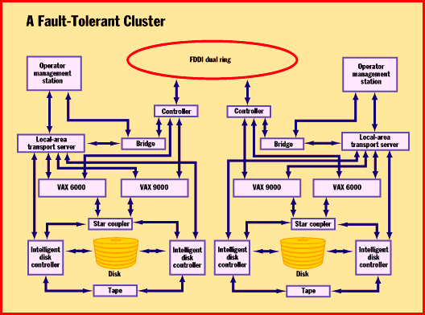

# In Case of Emergency, Use Duplicate Clusters

*Core Technologies*

Digital implements multiprocessor computing over the entire spectrum of configurations: from tightly coupled computers that share memory and whose processes must be tightly synchronized, to the very loose asynchronous model of networked heterogeneous computers that share tasks through remote procedure calls (RPCs). The VMScluster lies between these two extremes.

VMScluster implementations share resources between processors in such a way that the processors and the resources appear as a single system to the user. The connections between a cluster's elements can be through just about any method; the loosest is a simple Ethernet connection. These connections are made through redundant one-way cables with duplicate "send" and "receive" ports.

For disaster tolerance, portions of the cluster "mirror" the activity of the other portion, as shown

in the figure

. That is, the system takes all the processing and storage that lives on one part of the cluster and duplicates it in another part of the cluster. One side is designated as the primary segment of the cluster until it fails, at which time the other section becomes the primary.

By placing parts of a cluster several miles from the other and having the processing and storage mirrored between the sites, disasters such as a power failure or fire at one site don't affect the others. When the systems are connected by high-bandwidth fiber-optic lines, processing continues uninterrupted. This kind of fault-tolerant computing is what stock exchanges, electronic funds transfer centers, and military systems require. Additionally, VMS is laudably secure in contrast to the majority of Unix systems.

## A Fault-Tolerant Cluster

Smart disk controllers make devices they manage available to all processors on the net, thus resumbling a unified system.

Copyright

1994-1997 BYTE

k"q

/#q

k"q

k"q

k"q

k"q

0'q

k"q

k"q

{+q

k"q

k"q

k"q

k"q

k"q

('q

## Images

