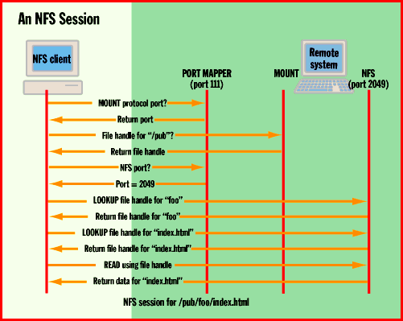
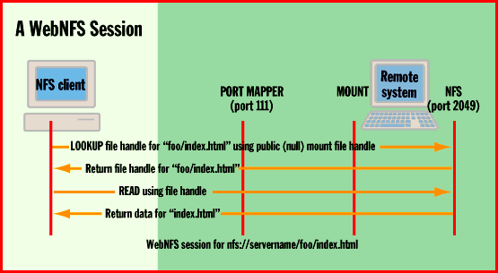

# A File System for the Web

*Core Technologies*

\Sun's revised NFS could overcome HTTP's limitations in handling large amounts of Web data.

Bob Friesenhahn

The popularity of the Web has skyrocketed in the past few years. Few technical challenges have impeded its expansion. However, it is beginning to show severe growing pains. Popular Web sites now use networks of multiple high-performance computers to sustain the heavy load when serving data via HTTP.

The intranet is now beginning to rival the Internet's growth. Corporate users expect to manipulate Web data in the same way that they deal with data in their other productivity applications. Unfortunately, poor data-manipulation capabilities are the Achilles' heel of existing Web technologies.

The Web is based on Hypertext Markup Language (HTML) and the simple HTTP. While it's simple to implement and understand, HTTP is an expensive protocol in terms of connection overhead and data transfer. Each object you transfer via HTTP requires a new TCP connection. (See "The Backbone of the Web," October BYTE, for details.) Furthermore, you must transfer the entire object at one time. Each HTML page can contain references to other objects (e.g., graphics images) that you must download to build the entire page. This requires additional TCP connections.

Web browsers such as Netscape's Navigator have adopted a threaded model that allows multiple HTTP accesses to be concurrent per HTML page. While threading helps avoid TCP-connection latencies (causing pages to load faster), it increases the load seen by the server.

What we need are more efficient Web data-access technologies that let users selectively access, manipulate, and update data as they have become accustomed to. Sun Microsystems believes it has a technology in its inventory that can provide the solution with a little brushing up. The basic technology is NFS, and the Web-enhanced version is called WebNFS.

NFS in a Nutshell

NFS implements a virtual network file system that maps remote disks so that they appear local to a client computer on the network. NFS is a mature product that Sun introduced commercially in 1986. It rose to industry-standard status in 1989 with the publication of RFC 1094, covering NFS 2. In 1995, there was the publication of RFC 1813, which covers NFS 3.

NFS is based on Sun remote procedure call (RPC), RFC 1057, which is in turn based on data formats established by External Data Representation (XDR), RFC 1014. Client and server versions of NFS are available for all major OSes. Development of NFS is relatively easy, because the source codes to XDR, RPC, and NFS are available in the public domain. Alternately, you can license NFS technology from Sun as part of its ONC+ platform, which most Unix system vendors license.

Sun considers any Web use of NFS -- whether it's NFS 2, NFS 3, or NFS with WebNFS enhancements -- to be a form of WebNFS. This can be extremely disconcerting to users, given that no specific form of the protocol can be labeled as WebNFS. In this article, I refer only to Web-enhanced versions (described below) of NFS as WebNFS, rather than using Sun's broader scope.

The Evolution of NFS

If NFS is so great, how come we have not seen it used on the Internet? NFS is an efficient protocol that's optimized for LANs. As such, it originally relied on UDP, which provides no flow-control mechanisms or error recovery, other than for time-outs. Because of this, NFS has proven to be largely unusable over the Internet.

With the advent of NFS 3, TCP became the preferred transport protocol. TCP offers flow control, reliable transfer, and ordering characteristics that UDP lacks. With Sun's recent announcement of WebNFS, many of NFS's drawbacks over high-latency networks have now been eliminated.

Unaltered NFS is a terrible protocol for use over high-latency networks, as shown in the figure

"An NFS Session."

NFS's design was intended to be pure in that few assumptions were made regarding the OS's characteristics, such as path-name separators or even port addresses. Similar to other protocols based on Sun RPC, a port-mapper process maps the RPC protocol types to specific port addresses.

NFS depends on two RPC protocols: MOUNT and NFS. MOUNT gets a handle to the top, or start, of a directory tree. Once MOUNT accomplishes this, the client has "mounted" the server and uses this handle through the remainder of the session. Unfortunately, all this port mapping takes quite a bit of time over slow networks.

A more significant problem than port mapping is how NFS works with files. Rather than access files via their full paths, NFS iterates through the directory elements, retrieving file handles for each element. NFS then uses the final file handle to read the file.

To improve its performance over high-latency networks, NFS needs to eliminate port mapping, mounting, and path-name recursion overheads. To accomplish this, WebNFS makes three assumptions: The NFS default port is 2049, a directory can be exported as "public" with a known handle (zero or null length), and path-name delimiters are similar to an HTTP uniform resource locator (URL). That is, they use a forward slash to separate path elements, which lets full file paths be specified.

WebNFS thus introduces a new type of URL, the nfs URL. Nfs URLs are specified via the format nfs://server:port/path, which is immediately familiar to Web users because the format is similar to that used by HTTP. As just mentioned, WebNFS uses the default NFS port of 2049, unless the URL specifies one.

The steps the modified protocol takes are illustrated in the figure

"A WebNFS Session."

These steps reduce the number of RPC packet transmissions to retrieve a relatively short path name from 12 to four. Furthermore, with traditional NFS, retrieving extra path elements increases the number of packets sent by two per element. With WebNFS, the required number of packets remains constant.

Presuming packet latencies of 250 milliseconds, the overhead to retrieve the first file on a server is reduced from a minimum of 3 seconds to 1 second (not including TCP-connect time). NFS RPC requests are inherently threaded in that you can send them in any meaningful order and back-to-back. This tremendously enhances throughput and decreases the effects of network latency, because responses stream back to the client as requests are serviced.

WebNFS Limits

While use of WebNFS provides significant performance and usability benefits, it has inherent limitations. They are related to the fact that NFS implements a file system. A network file system implements the semantics of a file system on a local disk drive. As a result, many features that HTTP provides today (or may provide in the future) cannot be supported directly by WebNFS.

For example, WebNFS does not support the Multipurpose Internet Mail Extensions (MIME) Content-Type information, a feature that HTTP supports. Thus, data that's obtained via WebNFS must be identified locally by some means (usually a file extension) rather than being identified by the server (which could have more accurate information).

WebNFS has another significant limitation: It is impossible to support server applications without radical modifications to the NFS server. You might overcome this limitation by simply using HTTP where NFS is not appropriate.

Will you ever see WebNFS in a Web browser near you? There are still many unanswered questions regarding how WebNFS would be made available in a browser, and even whether any major browsers will support it. WebNFS has the technical prowess to become a major Web technology. At the same time, we have seen how difficult it is to predict which technology will succeed. We can only wait and see how the story unfolds.

http://www.sun.com/sunsoft/solaris/networking/webnfs/

If you would like to learn more about WebNFS, Sun has made the technical details available (including an excellent white paper by Brent Callaghan of SunSoft) at

5http://www.sun.com/sunsoft/solaris/networking/webnfs/

## An NFS Session

QNFS requires many data transfers to establish access to a specific remote file.

## A WebNFS Session

Smart defaults and an improved file mechanism reduce access to remote files to a fixed number of transfers.

mailto:"bfriesen@simple.dallas.tx.us"

Bob Friesenhahn is a consulting writer for BYTE who specializes in Unix and TCP/IP networking-related topics. You can reach him at

bfriesen@simple.dallas.tx.us

Copyright

1994-1997 BYTE

J=r

## Images

