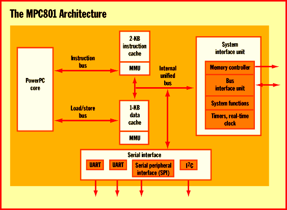
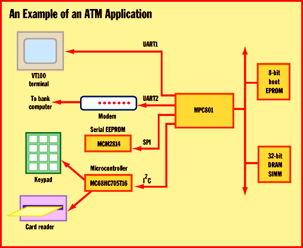

# The Consumer PowerPC Revisited

*Core Technologies*

Motorola's embedded PowerPC processor offers a rich set of communications features.

Tom Thompson

Motorola intends to expand its reach into the world of personal communications with a slimmed-down variant of the PowerPC called the MPC801. The chip began sampling recently and will be available in quantity late this year. The MPC801's feature set makes it attractive not only for use in communications products such as pagers and cellular phones but also for general-purpose embedded applications and consumer electronics.

The MPC801 is a three-metal-layer, 0.35-micron CMOS part with 800,000 transistors. The fully static 3.3-V chip consists of an embedded PowerPC core plus caches, timers, memory controller, and peripheral support logic. It has four low-power modes that make it suitable for hand-held products, for which long battery life is paramount. If these specifications sound familiar, it's because they're similar to IBM's embedded PowerPC processor, the 401GF (see "The PowerPC Goes Consumer," August BYTE). Upon closer examination, there are significant differences between the two chips.

IBM's 401GF serves primarily as an embedded controller. The MPC801 also acts as controller but, true to Motorola's heritage as a communications company, it sports a rich set of communications features. This includes two serial UARTs and a serial peripheral interface (SPI). (IBM can provide a custom 401GF part that includes a serial I/O interface.)

The heart of the MPC801 is its PowerPC core. It is a 32-bit

implementation of

the PowerPC architecture. It has thirty-two 32-bit general-purpose registers. Two function blocks, an integer unit and a load/store unit, execute all integer and load/store operations in the hardware.

To reduce the transistor count -- which both reduces the processor's size and power consumption -- the designers removed a number of features present in the 60x architecture. The floating-point unit is gone, since embedded applications execute mostly integer instructions. Additionally, the core's architecture was simplified so that the core executes only one instruction per cycle. This compromise eliminates the support logic required to implement multiple execution units. While this approach does exact a performance penalty, the design win is reduced power consumption. To boost performance, the core provides several instruction queues. It also has branch prediction logic that performs branch folding and branch prediction with conditional prefetch. However, in keeping with the goal of a simple, low-power design, the branch logic doesn't do any conditional execution on any prefetched instructions.

The core has two on-chip caches, a 1-KB data cache and a 2-KB instruction cache. The caches are two-way set associative, which helps compensate for any performance hit due to their small size. Portions of each cache can be locked to hold critical sections of code or frequently used data sets. Each cache has its own memory management unit (MMU). The MMUs support a variety of memory page sizes ranging from 4 KB to 8 MB. They can arrange a maximum of 16 virtual address spaces with 16 protection groups. You can program the MMUs to set the data caches to copyback or write-through modes and inhibit the caching of specific pages in memory (typically for memory-mapped I/O). The combination of the PowerPC core and the caches allows the MPC801 to deliver 33 MIPS at 25 MHz (using Dhrystone 2.1) and 52 MIPS at 40 MHz.

To reduce power consumption, the MPC801 supports four low-power modes: doze, sleep, deep sleep, and low-power stop. A phase-locked loop (PLL) obtains the processor clock signal, which enables a system designer to dynamically reduce the clock rate to conserve power when a hand-held device is idle.

Interfaces Galore

The MPC801 has a system interface unit (SIU) that enables it to work with a variety of peripherals. It handles dynamic bus sizing to 8-, 16-, and 32-bit wide memory and devices. The SIU's built-in memory controller can generate the signals and timings for SRAM, synchronous static RAM (SSRAM), EPROM, FLASH EPROM, DRAM, self-refreshed DRAM (SRDRAM), and extended data out (EDO) memory. It can manage up to eight separate memory banks. The processor supports a glueless interface to one bank of memory, but additional banks require external buffer logic to maintain the signal levels.

The MPC801 has two on-chip full-duplex serial UARTs. Each of these UARTs can be independently programmed for baud rates ranging from 300 bps to 115.2 Kbps. Eight maskable interrupts assist I/O transfers. Interestingly, these serial ports provide direct support of the IrDA physical layer protocol. IrDA is an infrared beam communications protocol, developed by the Infrared Device Association, that's used to transfer information in some hand-held machines. By implementing the IrDA protocol in the hardware, the MPC801 can reduce the parts count in a hand-held's design, thereby lowering its costs.

The processor also provides two other communications interfaces: SPI and I

C. The SPI is a four-wire, full-duplex, character-oriented interface. It supports 8- and 1-bit character operations, and it can operate in master or slave modes. Like the UARTs, the SPI can also interrupt the processor to expedite data transfers. I

C is a low-speed, full-duplex, two-wire bus that enables the MPC801 to communicate with a variety of controller chips. It, too, supports interrupts.

ATMs and Web TVs

Because of its built-in communications functions, the MPC801 is thus ready-made for embedded applications that require such capabilities. It can be used in set-top boxes, cellular base stations, automated teller machines (ATMs), hand-held computers, and Internet terminals or network computers. Two examples help emphasize how the MPC801 is an ideal fit for applications that demand extensive communications support. In the figure

#"An Example of an ATM Application,"

the MPC801 is shown acting as an embedded controller. The processor operates the hardware and handles the user's interactions with the machine. It can also manage the communications the ATM requires to verify transactions with a remote bank computer. One UART operates a smart terminal that serves as the teller machine's display screen; the other operates a modem that relays transaction data to and from the bank computer. The SPI updates nonvolatile data in a serial EPROM. This nonvolatile data might consist of encryption codes and hardware configuration settings, which can change over time. The I

C interface directs a microcontroller that scans the teller machine's keypad for key presses and reads the data from the magnetic strip on the customer's ATM card.

Here's the most intriguing application of the MPC801. Mitsubishi Consumer Electronics is using it to convert a 40-inch TV into a Web browsing box called the DiamondWeb TV. Because of the MPC801's glueless interface to memory and to Motorola's Scorpion Graphics processor (which is used to mix text, graphics, and live video), the DiamondWeb TV's parts count -- and therefore its cost -- can be kept low.

The MPC801 implements a Web browser and a Java virtual machine on the device. Its serial connections help implement the TV's audio, modem, video, and TV monitor interface functions. The DiamondWeb represents the convergence of TV, the Web, and computing in one integrated device. The MPC801's capabilities make it all possible. And affordable.

## Where To Find

Motorola Microprocessor and Memory Technologies Group

Austin, TX

Phone: (512) 891-3823

http://www.mot.com/SPS/HPESD/prod/eppc/MPC801.html

Internet:

2http://www.mot.com/SPS/HPESD/prod/eppc/MPC801.html

## The MPC801 Architecture

Motorola's MPC801 processor has a built-in memory controller and a number of serial functions.

!An Example of an ATM Application

The MPC801 can operate the automated teller machine's hardware, display, and communications with the bank computer.

mailto:"tom_thompson@bix.com"

Tom Thompson is a BYTE senior technical editor at large. You can reach him at

tom_thompson@bix.com

Copyright

1994-1997 BYTE

Dr

'Er

+Tr

}Ur

/Xr

#br

_er

lfr

## Images

