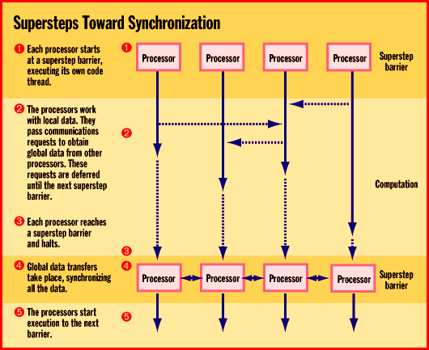

# Parallel Processing in Bulk

*Core Technologies*

lA new programming model for parallel processing simplifies writing programs and promises code portability.

Dick Pountain

Parallel processing -- using more than one CPU to increase computation speed -- is one of those cutting-edge technologies that always seems poised to break through into the mainstream. The problem has been that writing software for parallel computers is just too difficult. It requires complex code to synchronize the data and activity of tens or hundreds of processors. Furthermore, because parallel programs aren't portable between different supercomputer architectures, no volume software market has ever taken off to sustain the effort.

A new parallel-programming model, called Bulk Synchronous Parallelism (BSP), promises to remedy this situation. Developed by teams at Oxford in the U.K. and Harvard in the U.S., BSP offers a simple synchronization mechanism. It also has the potential to make parallel programs portable between different parallel-computer architectures.

Parallel's Pitfalls

Parallel programming's fundamental problem is that there has been no generally accepted model of what a parallel computer should look like. Some designers have favored distributed-memory machines, whose processing nodes communicate by passing messages. Others have preferred symmetric-multiprocessing (SMP) or shared-memory architectures, where all the processors read and write the same memory.

Yet others have used collections of workstations connected by a LAN to simulate a single parallel computer. The clustering of workstations into virtual parallel computers is immeasurably easier since the emergence of standard message-passing environments such as Message Passing Interface (MPI) and Parallel Virtual Machine (PVM). Still, moving a program from one type of parallel machine to another normally involves a complete rewrite of the program.

What's needed is an abstract model of a parallel computer that describes all these schemes, hiding the physical details of particular architectures from programs to make them portable. Another desirable feature of such a model would be predictability (i.e., the ability to accurately analyze how such portable programs will perform on different real architectures). BSP provides just such a model.

BSP's Structure

The BSP model assumes a set of processor/memory pairs. These pairs are connected by a communications network that efficiently supports a global memory space and a mechanism for the barrier synchronization of all the processors. Execution of a BSP program proceeds in phases, and all global communication takes place between phases.

Each phase is called a superstep . It consists of a number of parallel-running threads that contain any number of operations. The threads perform only local communication until they reach a synchronization point or barrier. At a barrier, all the threads must wait until the last one becomes ready, at which time all global communication (i.e., accesses to the physical memory of remote processors) takes place, as shown in the figure

$"Supersteps Toward Synchronization."

This model completely decouples communication from synchronization, so that the synchronization of individual messages ceases to be of concern to the programmer.

BSP doesn't care whether a parallel computer implements barrier synchronization via hardware or software, because this affects only absolute performance. As an example, Cray's T3D, a massively parallel supercomputer based on Digital Equipment Alpha RISC processors, supports hardware barrier synchronization by providing each processor/memory node with a special barrier register.

BSP is equally unconcerned about the underlying mechanism used for communication. Thus, the same program could run on an Ethernet of PCs using the WinPVM library or on a T3D.

BSP Parameters

As important as BSP's support for program portability is the way it provides an analytic cost model for assessing the performance of parallel algorithms. This is something to which synchronized message-passing programs have never been amenable.

Any BSP computer is defined by three parameters: p, the number of processor/memory pairs; l, the latency, or number of time steps consumed by barrier synchronization; and g, a ratio obtained by dividing the total local operations performed by all processors per second by the total words delivered by the communications system per second. Note that g measures only a bulk property of the whole system, not the speed of individual CPUs or links. The l and g parameters are normalized with respect to a fourth parameter, s, the number of time steps per second or MFLOPS rate, so you can compare algorithms running on different hardware.

You can consider any scalable parallel system to be a BSP computer and determine what its p, l, and g parameters are by benchmarking. You can then use these results to analyze the computational complexity of both architectures and algorithms. Designers of parallel architectures strive to reduce land g to a minimum. Likewise, a programmer's choice of algorithm will try to offset the bad effects of large land g inherent in a hardware design.

A Parallel Future

The Oxford University Computer Lab (OUCL) has set up a unit called Oxford Parallel to commercialize and spread the word about BSP. The firm offers the Oxford BSP Library for a number of machines, including a free generic version for any homogeneous parallel Unix machine that has access to PARMACS, PVM, TCP/IP, or System V Shared Memory primitives. There are also optimized native libraries for IBM's SP1/SP2, Cray's T3D, Silicon Graphics' Power Challenge, Meiko's CS/2, and other supercomputers.

Oxford Parallel is working on BSP support for SMP machines running Windows NT and for clusters of NT servers. Such a development would be timely indeed, given that the PC industry is entering an era of multimedia and 3-D graphics applications that cry out to be accelerated by parallel processing. Perhaps after all those false dawns, BSP is the technique that will bring parallel processing into the mainstream for the first time.

## Where To Find

Oxford Parallel

OUCL

Oxford, U.K.

Phone: +44 1865 273897

Fax: +44 1865 273819

"Supersteps Toward Synchronization

BSP's step-by-step scheme simplifies the synchronization of both processors and any shared (global) data.

mailto:"dickp@bix.com"

Dick Pountain is a BYTE contributing editor based in London. You can contact him at

dickp@bix.com

Copyright

1994-1997 BYTE

F!s

-"s

X"s

o#s

## Images

