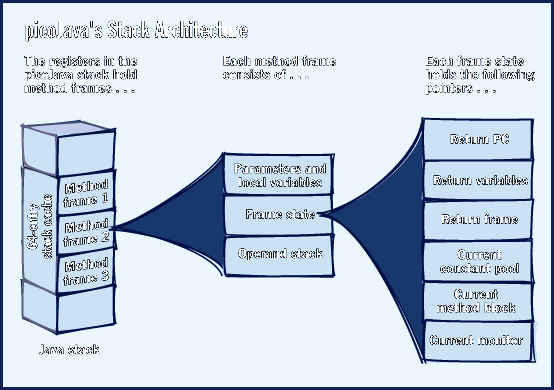
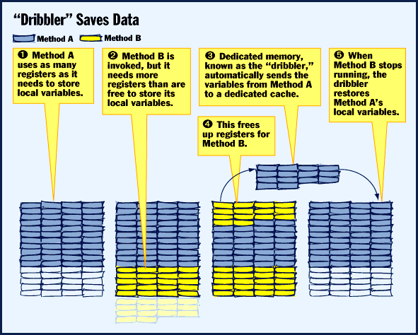
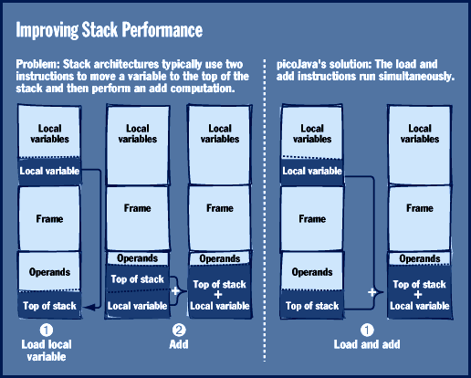
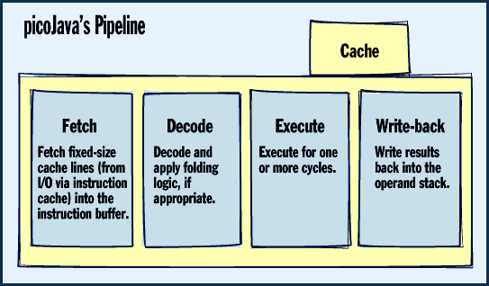

# Sun Gambles on Java Chips

*State Of The Art*

\Are Java chips better than general-purpose CPUs? Or will new compilers make them obsolete?

Peter Wayner

Download a small Java application from the Internet today and your trusty x86 or RISC processor won't blink. These CPUs are designed to optimally run C-based applications, but they also work well at emulating the Java virtual machine (VM) for the simple Web-based applets we're seeing now.

Life is good, as long as Java spawns nothing more complicated than cute dancing applets on Web pages. But Java has the potential to become much more. Its cross-platform compatibility is motivating some software companies, such as Corel, to develop large-scale business applications entirely in Java.

Suddenly, our decisions about which CPU platform to buy may become twice as difficult. Do we stick with a general-purpose processor and hope it will run tomorrow's Java applications efficiently? Or do we bank on a new generation of processors built from the ground up for fast Java performance?

Sun Microsystems, the company that launched Java, is betting on dedicated Java chips to deliver the performance needed for Java-based business and embedded applications. To this end, Sun is developing a core specification -- known as picoJava -- for Java chips. BYTE has exclusively obtained the spec prior to its public release. The architecture outlines a number of design innovations for optimally running Java code. At prices that fall below $100 for even the most expensive versions of these chips, Sun hopes the price and performance characteristics of Java processors will both ride on and help power the Java wave. Chips based on Sun's picoJava core architecture should appear early in '97 and make their way into commercial products by the end of the year. Sun also wants to license the picoJava core design to other companies that want to produce their own Java chips.

Sun's strategy is compelling but not airtight. Platform-specific processors have been tried before with mixed results. And some competitors believe they can enhance their existing processors to boost Java performance without resorting to Java-specific chips.

Either way, we're watching the opening volley of a technical war that may take months or even years to resolve. While many questions will remain unanswered until we see actual silicon, we can begin to sort out the technical merits of Java chips today.

Two Flavors

Sun's picoJava architecture will be the foundation for the first-generation Java chips, known as microJava, a low-cost (approximately $25-$50) family for resource-stingy embedded applications. Typical applications might include industrial data-acquisition devices, PDAs, cellular phones, set-top boxes, and low-cost network computers.

Sun is also developing a more expensive (approximately $100) chip called ultraJava, which will be for desktop systems. Sun officials won't say whether or not ultraJava chips will use a picoJava core. However, these chips could include multimedia capabilities such as JPEG decompression and the graphics-processing optimizations now found in Sun's UltraSPARC RISC processors.

BYTE couldn't obtain actual silicon samples of Sun's Java chips at press time, so we don't know how well picoJava succeeds at boosting Java performance. According to Sun, these chips will run Java programs about 12 times faster than the same code executed by Sun's current Java interpreter. (See the sidebar "Preliminary Speed Tests,".) But Java bytecode interpreters are getting better, too. For instance, Intel has written its own Java interpreter for the x86 series and claims it runs Java code three times faster than Sun's interpreter.

Just-in-time (JIT) compilers can run Java code even faster than interpreters, but Sun says the picoJava chips could be five times faster than a Pentium with a JIT compiler. However, Sun concedes that it still isn't certain how much picoJava's hardware improvements for thread synchronization and garbage collection will contribute to the overall speed of Java chips. Sun officials are optimistic about seeing performance improvements in these areas once they test actual silicon. Nevertheless, the actual performance improvement you get will depend on whether the Java program is heavy on computation and light on object juggling. Applications that require more system overhead may see a smaller performance improvement.

Sun is pinning much of its hopes on the developing market for Java-based embedded devices. MicroJava chips could fit well onto tiny platforms, thanks to their memory efficiency. Since a Java chip will natively execute Java bytecode without converting it to another CPU instruction set, it doesn't need the extra memory or cache space that's required when a general-purpose processor runs a Java bytecode interpreter or JIT compiler. Also, the bytecode is generally smaller than that for a RISC processor. For example, Java bytecode averages 1.8 bytes per instruction (without the tables for dynamically linking the code during method calls), while RISC code generally requires 4 bytes per instruction.

Pushing the Stack

What makes picoJava chips different from other processors? Foremost is how picoJava refines the stack. In the picoJava architecture, Java chips allocate variables locally on the stack, and method calls and bytecode operations also pass data through the stack.

Most C compilers convert C source code into a stack-based language, but the compilers then go through an additional step of converting this intermediate language into native RISC code (see the sidebar "RISC vs. CISC"). This allows the compiler to analyze the flow of data and keep the most essential elements in the CPU registers. A standard RISC processor simulates a stack machine by loading or storing data from the stack into registers, then using one of the registers to represent the stack pointer. This operation is simple, but the number of registers limits the opportunities for optimization.

The picoJava architecture uses a stack of sixty-four 32-bit registers with a pointer to the top register on the stack (see

"picoJava's Stack Architecture"

). If you have 20 registers allocated for a particular stack frame (call it method A), then a call to another method (B) would begin using register 21. The pointer to the top of the stack would move down from 20 to the last register used by method B.

Smart Cache

Sun architects devised a clever method of caching data if all the registers are full (

see the figure

). For example, when you invoke method B, the picoJava register file allocates all remaining empty registers and carries over to register 1 if additional space beyond 64 is required. What happens to the method-A data in those registers if method B quits running and method A resumes? Something Sun calls the "dribbler" steps in from the background to restore the method-A data. The dribbler constantly reads and writes data from the 64 registers to a copy that's kept in memory. So when method B grabs the additional registers, the dribbler has already copied the data. (If for some reason the dribbler hadn't yet made a copy, the Java chip would pause any processing tasks until the dribbler finished this operation.) When method B stops running and gives up the registers, the dribbler restores the data to the stack, so method A is current.

The dribbler takes advantage of the fact that the data traffic between the registers and its image in memory is highly predictable. System designers are able to easily tune a cache to anticipate the requests of the dribbler and make sure the necessary data is available in the local data cache when it needs to be.

The flexible register approach of picoJava contrasts with the simple register files of RISC processors. Java's dribbler dynamically tries to keep all the local variables available in fast registers. RISC chips, on the other hand, rely upon the compiler to orchestrate the movement of information in and out of the chip. Static register allocation works well with scientific code, which may have complicated loops that use each piece of data in multiple calculations.

A robust compiler may find a way to unroll the loops and arrange the flow of data in and out of the registers. The compiler might also be able to leave data in a register in cases where the data needs to be reused 50 cycles later.

The picoJava stack is not well suited for leaving data around or for pushing information deeply onto the stack so it can reemerge at the right time. (Smart compilers that do this magnificent optimization for scientific code should be able to do the same for Java code by creating faux local variables that act like registers.)

However, the picoJava stack can shine with code that calls many short procedures that are constantly starting and stopping. These function calls are constantly clearing and filling data in registers. The Java stack handles these chores in the background, with the dribbler keeping the register file accurate.

The stack at the center of the Java virtual machine is a simple conceit that makes it easy to pack code. This design challenges RISC machines and their ability to speed the flow of data by using registers in a smart way. A Java interpreter can't anticipate the flow of data through the stack, so it can't use the registers for much more than a temporary image of the very top of the stack. Just-in-time compilers may be able to do the analysis necessary to use the registers more efficiently, but spending time on this kind of analysis would end up undermining their effectiveness.

Stack Efficiency

The picoJava architecture wrings out efficiency in another important way: It can dispatch simultaneous instructions when you need to move a local variable to the top of the stack and perform some computation on it (

see the figure

). If the instructions were not dispatched simultaneously, the data would be consumed immediately after it's written to the top of the stack. PicoJava issues the move and the arithmetic operation together so they execute at the same time without disturbing the stack, writing over a register, or forcing the dribbler to do anything. This reduces memory accesses and potentially cuts execution time.

Early reports from Sun indicate that the effect of simultaneous instructions can be dramatic. According to Sun's code analysis, stack operations account for 43 percent of all operations a picoJava-based chip performs. If you combine instructions, stack operations drop to 29 percent of the tasks done by a Java chip.

A persistent challenge in the design of all CPUs is how to manage the flow of data through the system. A modern RISC processor typically has two levels of cache that pull data in and out of main memory. The main memory, in turn, acts as a cache for a much larger amount of virtual memory on the hard disk. Ordinarily this combination works to keep the most needed information as close as possible to the CPU, based on the assumption that the most recently accessed data is the most likely to be accessed again.

Garbage collection, in which the processor examines all objects and determines which ones are not in use, can ruin this scheme. This exhaustive search can destroy all the work that the cache and the virtual memory controller have done to keep the most current and important data close to the CPU. Suddenly, all objects are the most recently accessed. This can be a real problem if the Java garbage collector runs as a concurrent thread, as it often does.

The simplest solution is to allow the software to turn parts of the cache on and off. This can help manage the stack because the top of the stack -- more so than the bottom -- is likely to be accessed next. Many RISC chips use this method of cache control.

A bigger problem results because even the simplest garbage-collection mechanism cannot be interrupted by normal system tasks. If garbage collection is interrupted, the list of referenced and unreferenced memory might be corrupted and good information thrown away. To guard against this, picoJava maintains a tag bit, known as a write barrier, on each object. This barrier allows garbage collection to operate in the background and practically eliminates the effect it can have on running code when the entire machine pauses to identify unreferenced memory.

Streamlined Pipeline

For optimum performance, any CPU design must balance the computational power of each instruction so it can efficiently pipeline the code. Pipelining splits an instruction into several parts, with each part taking the same amount of time to process. This allows a superscalar (multipipelined) CPU to process several instructions simultaneously.

For pipelining to work, all the data needed for a computation must be in the right place at exactly the right time. RISC pipelines driven by optimizing compilers have done this quite well, and Sun uses a very RISC-like pipeline for picoJava. The pipeline has only four stages: fetch, decode, execute, and writeback (see

"picoJava's Pipeline"

The chip accesses the cache during the execute phase, which can also perform some addition operations. For example, some Java instructions demand that you access a field of an object by adding n bytes to the pointer at the start of the object. These Java instructions execute in the picoJava pipeline as one instruction.

Sun is hoping that an innovative stack architecture, a tweaked garbage-collection mechanism, and a stripped-down pipeline design will add up to fast performance for picoJava chips.

Do We Need Java Chips?

The great potential of Java has generated enthusiasm throughout the computer industry. However, not everyone believes dedicated Java chips are necessary. After all, university researchers have built specialized chips for languages such as LISP or Smalltalk only to discover that software implementations running on RISC chips offered superior performance.

Some chip vendors say their existing RISC and CISC architectures can handle Java quite well. Advanced Risc Machines (Cambridge, U.K.) tuned its StrongARM architecture (see "StrongARM Tactics," January BYTE) for embedded applications and stack-based languages, such as Java and PostScript. The StrongARM can move a stack frame in and out of the register set with a single instruction, according to Dave Jaggar, ARM's technical marketing director. By itself, this probably won't make Java programs run any faster, but it does conserve system resources and use the cache more efficiently.

Other processors will soon ship with subtle Java enhancements. The Mips division of Silicon Graphics is working on improvements to its Rx000 architecture that could speed up Java programs. These enhancements will save memory and bandwidth and help speed the interpretation of Java code. The Rx000 will probably use a single instruction to transfer a set of bytes from the stack to the registers while incrementing the stack pointer. Mips officials believe that users of Silicon Graphics workstations, set-top boxes, and videogame machines require computational performance first and Java prowess second. "We want to concentrate on evolving the Mips architecture," says Derek Meyer, director of international marketing and sales. "Java performance will follow."

Some embedded-systems developers are both encouraged and skeptical about Java. "There's a direct relation between Java and the Internet, and this has a lot of potential for embedded applications," says George Nicol, president of Silicon Composers (Palo Alto, CA). One idea his company has been investigating is to connect real-time data-acquisition instrumentation to the Internet to distribute information quickly to widely dispersed groups of clients.

However, Nicol says the Java language specifications leave him cool in terms of performance for real-time process control and data acquisition. "The design doesn't seem as elegant as it could have been. There's a strong software orientation," he says. "But Java does have business momentum behind it."

Economics also enters the picture. ARM, Intel, and Mips sell their chips for a wide range of applications, so they can justify spending more engineering time on their core engines. This could lead to a tighter performance race between general-purpose CPUs with JIT compilers and picoJava chips. Another hurdle for Sun could be unforeseen problems integrating picoJava chips into systems.

In the end, the success of Java chips will depend largely on the success of Java. An advantage for Java chip proponents is how complex it is to design a chip for fast C and Java code performance. CPUs that run C well may do a good job of emulating the Java VM, but they may never approach the speed of a chip optimized for Java code. The reverse is also true. To compensate, designers need more than a thorough understanding of CPU design; they need expertise in compilers and overall system architecture as well. But a one-size-fits-all approach to CPU design -- with the right mix of software and hardware to wring out performance for two different platforms -- probably won't satisfy end users if Java applications become ubiquitous.

If Java's platform independence and security features lead developers to embrace the language, users may be perfectly happy with Java-specific systems. But if native-code applications continue to dominate the market, specialized Java chips may be of interest only in the world of low-power embedded devices.

## Where To Find

## Sun Microsystems

Mountain View, CA

Phone: (415) 960-1300

http://www.sun.com/sparc/

Internet:

http://www.sun.com/sparc/

## Vital Statistics

Estimated picoJava die: .35 microns

picoJava core = 8.0 mm

optional FPU = 5.5 mm

______

TOTAL 13.5 mm

4*Total size without the instruction or data caches,

* which are both variable from 0 to 16 KB.

## picoJava's Stack Architecture

The picoJava stack uses 64 32-bit registers. picoJava allocates variables on the stack; method calls pass data through the stack.

## "Dribbler" Saves Data

Sun's "dribbler" is a clever method of caching data and returning it ot the stack when registers become full.

## Improving Stack Performance

A picoJava chip moves data to the top of the unused registers in the stack and simultaneously dispatches a computation instruction.

## picoJava's Pipeline

}To get data in the right place at exactly the right time, picoJava uses a simple, RISC-like pipeline with only four stages.

mailto:"pcw@access.digex.net"

MBYTE consulting editor Peter Wayner lives in Baltimore. You can reach him at

pcw@access.digex.net

Copyright

1994-1997 BYTE

hgt

mht

!zu

9zu

({u

## Images

