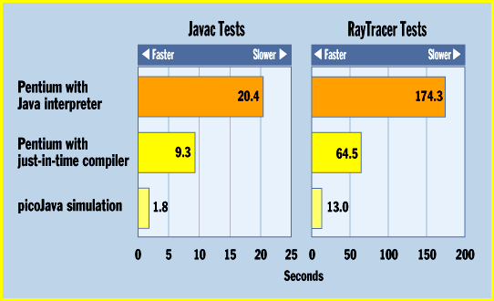

# Preliminary Speed Tests

*State Of The Art*

When we went to press, chips based on Sun's picoJava core architecture didn't exist, so we were unable to evaluate performance of these dedicated processors. However, preliminary statistics from internal Sun tests indicate that Java chips could deliver significantly better performance than today's two main alternatives for running Java code: using a Java interpreter or a just-in-time (JIT) compiler with a general-purpose processor.

Note, however, that while Java chip advocates are finishing their core designs, developers of Java interpreters and JIT compilers are creating new and faster versions of these technologies. So view the following numbers as snapshots: The competition to deliver faster Java performance will continue to heat up over the coming months.

How Sun Tested: Javac is Sun's JDK 1.0.2 javac compiler for the RayTracer benchmark. It consists of 25,000 lines of Java code (with comments) in 170 different classes. The Java bytecode totals 422 KB. The RayTracer benchmark generates an image of a 1400-triangle dinosaur standing on a glossy table. RayTracer is a 3500-line Java program in 32 classes. The bytecode totals 36 KB.

The picoJava simulator is 100 MHz, with 4 KB of direct-mapped instruction cache and 8 KB of two-way data cache and no off-chip cache. The FPU is present. DRAM is 120-ns latency.

The test Pentium machine was a Hewlett-Packard Vectra VL 5/166 Series 4, with 32 MB of RAM and 256 KB of off-chip cache. The interpreter is Sun's JDK 1.0.2 for Win 95/NT. The just-in-time (JIT) compiler is Symantec's Cafe 1.5 for Windows 95 and NT.

All the times were scaled to 100 MHz to match the picoJava simulator output. Thus, times for the Pentium system were multiplied by 1.66. The picoJava simulator does not accurately simulate I/O, so 0.8 seconds were added for the Javac benchmark for I/O, and 0.4 seconds for I/O were added to the RayTracer benchmark results. The effects of garbage collection were also minimized by sizing the amount of memory allocated by Java for the program. By allocating a large amount of memory for the benchmarks, garbage collection was never invoked.

## Preliminary Results

## Images

