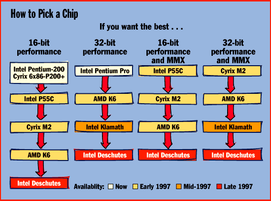

# The x86 Gets Faster with Age

*State Of The Art*

PC buyers face tough choices in 1997 as x86-chip vendors race to maintain their dominance.

Tom R. Halfhill

Call it the year of megahurts. Rarely have PC users shopping for a new system faced so many microprocessor-induced headaches. And it won't end in 1997; hotter competition, architectural transitions, and software factors will probably make users' decisions difficult for the next few years. Hibernation is not an option.

Call it the year of megahurts. Rarely have PC users shopping for a new system faced so many microprocessor-induced headaches. And it won't end in 1997; hotter competition, architectural transitions, and software factors will probably make

users' decisions

A difficult for the next few years. Hibernation is not an option.

While novices continue to blindly compare megahertz and megabytes, knowledgeable users will be juggling many more variables. These are outlined below.

Intel's fastest Pentium is cruising at 200 MHz this fall, but due to inherent limitations of its aging architecture, it's barely faster than a Pentium-166. Also, the current P54C-series Pentiums don't recognize Intel's new MMX multimedia instructions. Early next year, Intel will address these problems by introducing the new P55C-series Pentiums. But the P55C is still a fifth-generation x86 processor that will appear at a crucial juncture when Intel is attempting to push the mainstream market toward the sixth-generation Pentium Pro.

Lower prices and new system chip sets are making Pentium Pro-based desktop PCs more affordable. Unfortunately, the Pentium Pro isn't the best choice if you're running 16-bit software, including Windows 95. Also, current Pentium Pros do not support MMX. Intel is readying a new P6-class processor, code-named Klamath, that improves 16-bit performance and supports MMX. But you'll have to wait for it until mid-1997 at the earliest, and the upgrade path for Pentium Pro users is muddy.

Cyrix's rejuvenated 6x86 handily beats a comparable Pentium, has no trouble with 16-bit code, and boasts the fastest I/O bus in the business. However, Cyrix can't match Intel's fastest core speeds, and the 6x86 doesn't support MMX. In addition, BYTE recently discovered that some revisions of the 6x86 suffer from serious performance problems when running on Windows NT Workstation 4.0.

Cyrix plans to address all these issues early next year with an improved version of the 6x86, called the M2. But its MMX compatibility will be in question at first because Cyrix doesn't have a licensing agreement for the Intel technology.

AMD, still struggling with its disappointing K5 series, will finally ship a version that lives up to the company's early promises. But the K5 is hopelessly far behind the leading edge. In 1997, AMD's hopes will ride on the K6, which is supposed to support MMX and match or exceed the performance of the Pentium Pro. After stumbling with the K5, AMD desperately needs to win back the confidence of system vendors and users.

A new contender, International Meta Systems (IMS), claims that it will introduce a CPU that fits into Pentium sockets and approximates the performance of a Pentium Pro. IMS has made previous attempts to break into the x86 market, but those products never shipped. This time, IMS is taking a different approach (see the sidebar "IMS Rides Again with the Meta6000").

Looming on the horizon is Intel's seventh-generation x86, known as the P7 or Merced. It will introduce a 64-bit x86 architecture. However, systems built with this chip probably will not appear until 1998 at the earliest, so the Merced should not affect your near-term plans.

Intel's Introductions

To defend its high profit margins and to keep its huge wafer-fabrication plants busy, Intel must periodically abandon an older-generation CPU and steer the market toward the next-generation product. That's what will happen to the Pentium in 1997. Although the Pentium will remain a high-volume product next year, Intel wants users to start thinking of the Pentium Pro as a mainstream CPU. Until now, Intel has mainly positioned the Pentium Pro for servers and workstations.

However, this predictable transition (which happens about every four years) is a little more confusing this time because Intel is simultaneously introducing MMX, an architectural enhancement that spans both generations (see "x86 Enters the Multimedia Era," July BYTE). Because MMX will debut with the Pentium, not the Pentium Pro, users who buy new systems during the transitional phase will have to wrestle with a few more decisions.

MMX will appear first in the P55C-series Pentiums, which are scheduled to begin shipping in the first quarter of 1997. They have improved pipelines and twice as much on-board cache: 16 KB each for the primary instruction and data caches, compared to the 8-KB caches in previous

Pentiums. As a result, the P55C will outperform a regular Pentium at the same clock speed, even without MMX acceleration. Sources estimate the performance gain to be about 15 percent -- an important point if you're comparing two systems with different Pentiums.

The P55C will likely debut at 200 MHz, but it may run as fast as 233 MHz. Unfortunately, upgrading to a P55C probably won't be as simple as plugging the chip into an existing Pentium socket. Although it's pin-compatible with existing sockets, Intel had to reduce the voltage so that the chip runs cool enough at higher clock speeds. Thus, you'll probably need a new motherboard for the P55C.

Waiting for Klamath

Astute users who want to postpone obsolescence are looking toward the next generation: the Pentium Pro. Unfortunately, this chip has several problems. It bogs down under 16-bit software and won't support MMX until after the P55C. It's also expensive, because it uses a multichip module to incorporate a 256- or 512-KB Level 2 (L2) cache in the same package with the CPU die. And it requires more costly system chip sets and six-layer motherboards.

Intel's solutions are the Klamath and new chip sets. Intel isn't talking about Klamath yet, but this P6-class chip will almost certainly eliminate the expensive multichip module. Intel will reportedly offer the Klamath on a small daughtercard that plugs into a special slot on the motherboard. The daughtercard would include the CPU and the L2 cache, and some daughtercards may have sockets for multiple CPUs.

Getting rid of the multichip module would drastically reduce Intel's manufacturing costs. It would also make it easier to upgrade a system, because users could swap daughtercards to get a faster CPU, more cache, or both. That's why Apple started using CPU daughtercards in its high-end Power Macs last year.

But separating Klamath's CPU and L2 cache could have some less desirable side effects as well. First, there's the question of performance. The Pentium Pro's L2 cache is closely coupled to the CPU over a dedicated 64-bit bus that runs at the same clock speed as the core. It's an extraordinarily fast bus that contributes a lot to the Pentium Pro's superior 32-bit benchmark results. Moving the L2 cache out of the package may force Intel to adopt a slower bus. If so, Klamath would need a larger cache, higher clock speeds, and perhaps some additional enhancements to compensate for the loss. If Intel puts Klamath on a daughtercard, the bus that connects this card to the motherboard is another potential bottleneck.

Faster Clocks

In any case, Klamath will support MMX and probably include some modifications to enhance 16-bit performance. Higher clock speeds are a certainty, thanks to Intel's new 0.28- and 0.25-micron CMOS processes. In 1997, these smaller processes will supersede the 0.35-micron BiCMOS process on which today's Pentiums and Pentium Pros are built.

Klamath will debut sometime in 1997 at 0.28 micron, yielding a minimum clock speed of 200 or 233 MHz, going perhaps as high as 266 MHz. Later in the year, Intel will phase in the 0.25-micron CMOS process. This will lead to a P6-class chip (code-named Deschutes) that should hit 300 or 333 MHz.

That'll be great for new buyers, but where does it leave the early adopters of the Pentium Pro? If Intel, as expected, discards the multichip module, Klamath almost certainly won't be compatible with existing 387-pin Pentium Pro sockets. Moving the L2 cache outside the package onto an external 64-bit bus would require 72 more pins. The only alternative would be to interface the L2 cache to the front-side I/O bus, but that would seriously impair performance.

The bottom line: If Intel segregates the L2 cache, existing Pentium Pro systems probably won't be upgradable to Klamath. The new chip wouldn't fit the old sockets, and the old motherboards don't have a daughtercard slot. Intel has long-range plans for Pentium Pro OverDrive chips, but they probably won't appear before 1998. Pentium Pro users will end up swapping motherboards or buying a whole new system.

On the bright side, those new motherboards and systems will cost less. New system chip sets from Intel and Silicon Integrated Systems (SiS) are slashing the cost of building a Pentium Pro system. For example, Intel's new 440FX chip set has only three parts and costs less than half as much ($94) as the eight-part 450KX chip set found on many of today's Pentium Pro motherboards. And SiS offers a one-chip solution, called Archer, that costs only about half as much ($39) as the 440FX. Moreover, these solutions work with four-layer motherboards instea of the six-layer boards required by the 450KX. Although they sacrifice a few features -- such as memory expandability and multiprocessor support -- these compromises are reasonable for desktop systems priced in the $2000-to-$3000 range.

Merced Mania

Further out is Intel's seventh-generation x86, the mysterious P7/Merced. Merced will extend the 32-bit x86 architecture to 64 bits and introduce a new instruction set. This architecture, dubbed IA-64, will be backward compatible with the existing x86 architecture, just as the 32-bit architecture of the 386 was compatible with the 16-bit 286, 8086, and 8088.

Although Merced is the fruit of Intel's partnership with Hewlett-Packard, it's looking less likely that IA-64 will radically depart from today's x86 architecture by adopting very-long-instruction-word (VLIW) technology. Intel will probably take a more conservative approach by extending the microarchitecture of the Pentium Pro. Pure VLIW is the antithesis of Intel's current design track; the Pentium Pro optimizes the instruction stream during execution, while a true VLIW processor would shift that responsibility to the compiler at design time.

There's still plenty of performance to be gained by extending the Pentium Pro's "dynamic execution" core. Intel could expand the reorder buffer, tweak the reordering algorithms, improve the branch prediction, add more execution units, boost the Level 1 (L1) caches (which are relatively small), and make other general improvements that would legitimately represent a seventh-generation design.

If VLIW plays any role at all, perhaps Intel and HP have found a way to adapt some tenets of that philosophy to the x86, just as Intel has integrated some elements of RISC into the Pentium Pro. Or maybe a full-blown VLIW design will appear in a subsequent processor.

Intel's alliance with HP also calls for Merced to run PA-RISC software. Some observers think this trick will require emulation, in either software or hardware. It would be useful to run PC applications on an HP workstation, but it's doubtful that the ability to run PA-RISC software on PCs would win significant additional market share for Intel.

In any event, Intel is committed to a 64-bit CPU that runs 16- and 32-bit x86 software without emulation. Native IA-64 programs will run faster than 16- or 32-bit programs, but nobody -- possibly not even Intel -- knows exactly how much faster.

Another unknown is how quickly the industry will adopt IA-64. Remember, it's been 11 years since Intel went 32-bit with the 386 in 1985, and most PC users are only now migrating to 32 bits. Microsoft didn't ship a 32-bit OS until 1993, and the vast majority of PC users still use 16-bit Windows 3.1 or 16-/32-bit Win 95. Although Microsoft recently dropped some vague hints about a 64-bit Windows NT, the first 64-bit OS for Merced will probably be Summit 3D, a new flavor of Unix currently under development by HP and The Santa Cruz Operation (SCO). If the 64-bit transition follows the same course as the 32-bit transition, then IA-64 won't be a significant market force until the year 2009.

Cyrix Crystal Ball

After a shaky start with the 6x86, Cyrix is finally gaining on Intel's price/performance lead. The first 0.6-micron version of the 6x86 suffered from a huge die. Cyrix switched to a process with five layers of metal instead of three, shrinking the die from 394 square millimeters to 210 mm

. During the summer, Cyrix moved to a 0.5-micron process, achieving a die size of 170 mm

Like an overweight athlete shedding excess fat, the 6x86 chip now runs a lot faster: 150 MHz instead of 100 MHz. And thanks to a more efficient microarchitecture, the 6x86 easily outruns a Pentium at the same clock speed. In fact, the 150-MHz 6x86 chip slightly outperforms a 200-MHz Pentium, which is why Cyrix designates this chip the 6x86-P200+ in accordance with the P-rating benchmark (see the sidebar "The Problem with P-Ratings").

Recently, however, BYTE discovered that some 6x86-based systems have a serious problem with the final-release candidate of Windows NT Workstation 4.0. We ran 32-bit Windows applications tests on a 6x86-P200+ system and then compared the results to those obtained on the same system with a beta version of NT 4.0. To our surprise, the tests ran about 25 percent slower on the release candidate of NT 4.0. The 6x86 also ran NT 4.0 about 16 percent slower than NT 3.51 and 24 percent slower than Win 95. In similar tests with Pentium-based PCs, performance improved on the release candidate of NT 4.0.

http://www.byte.com

This problem might be related to some last-minute code that Microsoft added to NT to make it more stable on Cyrix-based PCs. Check The BYTE Site (

http://www.byte.com

3) for the latest updates on this developing story.

Another upcoming challenge for the 6x86 is MMX. Cyrix was working on its own multimedia extensions when Intel unveiled MMX and announced a cross-licensing agreement with AMD. Cyrix doesn't have such a deal, but it promises that the next version of the 6x86 -- code-named M2 -- will be MMX compatible.

The M2 is scheduled to start sampling in the fourth quarter of this year and then begin volume production during the first quarter of 1997. That means the M2 will be committed to silicon before Cyrix's engineers can get a close look at the P55C. To support MMX, they will have to rely on publicly available technical data from Intel -- and perhaps some Texas windage as well.

Cyrix says that it has indirect access to some Intel technology through its fab partners, IBM Microelectronics and SGS Thomson, which have licensing agreements with Intel. Cyrix also notes that it has a good track record of x86 compatibility. Even so, MMX will be a question mark until independent parties get a chance to thoroughly test the M2.

Klamath Competition

The M2 will also move to a 0.35-micron process and beef up its unified L1 cache to an impressive 64 KB. M2 clock speeds will be 180 MHz and 200 MHz at introduction, with 225 MHz coming later in 1997. In combination with other improvements, those clock rates should allow the M2 to beat a P55C and compete strongly against Klamath.

Cyrix's biggest contribution to the PC industry might be a kick in the pants toward 75-MHz I/O buses. The 6x86-P200+ runs its core at 150 MHz and the I/O bus at an unprecedented 75 MHz. Until now, the fastest x86 buses topped out at 66 MHz. That 14 percent improvement provides a significant boost for I/O-intensive servers.

Unfortunately, systems designers have trouble making 75-MHz motherboards, which is why nobody has done it until now. Only one system chip set (from VLSI Technology) currently supports the 75-MHz bus. Without that chip set, the 6x86-P200+ has to synchronize its bus at 50 MHz, which bleeds so much performance that the chip no longer merits the P200+ designation. Maybe that's why Cyrix entered the systems business last summer; if you want to get a 6x86-P200+ system with a 75-MHz bus, you can buy one directly from Cyrix.

Cyrix is also working on an 83-MHz bus. That's nearly 26 percent faster than 66 MHz and would certainly provoke server envy among rival vendors. Until chip-set makers and motherboard manufacturers catch up, however, these bus speeds are mainly a technical curiosity. It will probably require the weight of Intel to shove the industry forward, and Intel hasn't publicly committed itself to speedier buses.

In another interesting move, Cyrix is introducing a highly integrated chip that would allow consumer PCs to retail for $800. Tentatively called the Gx86, the new processor is based on a low-cost chip that Cyrix announced last year for notebook computers. If the $800 consumer PCs succeed, Cyrix hopes to design a version for corporate intranets. Cyrix would position that chip as a CPU for low-cost, Windows-compatible network computers. (See the sidebar "Cyrix Gx86 for Dirt-Cheap PCs".)

AMD Road Map

Sometimes a design that looks great on paper falls flat in the real world. AMD's ordeal with the K5 wasn't quite as embarrassing as the baggage-handling debacle at Denver's new airport, but it was bad enough. The K5 was supposed to bring AMD's chips within striking distance of Intel's top CPUs; instead, numerous problems have kept the K5 from seriously challenging even the Pentium, much less the Pentium Pro.

Now the K5 is back on track. It's too late for the chip to gain the leading edge, but it can still compete against the Pentium for desktop PCs costing under $2000. Currently, AMD is shipping the K5 at three speeds: 75, 90, and 100 MHz. They closely match Pentium performance at equivalent clock rates, earning them P-ratings of PR75, PR90, and PR100, respectively.

The next versions of the K5 -- which are scheduled to ship in September or October -- are supposed to live up to the K5's original specifications, which called for 20 percent to 30 percent greater performance than a Pentium running at the same clock speed. The new chips run at 90 and 100 MHz but carry P-ratings of PR120 and PR133, respectively.

To attain these higher P-ratings, AMD's engineers tweaked the K5 chips's core in several ways. First, they optimized the K5's execution of certain x86 instructions (e.g., repeat MOVs and far CALLs) that occur more often in real-world software than AMD's simulations had predicted. Next, they added a small prefetch cache in front of the L1 instruction cache. This fixed a problem that arose when the K5's prefetch logic aborted a cache fill in order to follow a branch to a new target address; if the program later branched back to the original instruction stream, the K5 had to fill the cache all over again. The new prefetch cache temporarily holds the cache lines to prevent a slow memory transaction. Finally, AMD eliminated some internal bus bottlenecks.

According to AMD, the K5 now runs about 30 percent faster than an equivalently clocked Pentium. (BYTE has not yet confirmed these claims.) In November or December, AMD plans to start shipping a 120-MHz version of this core, which would yield an equivalent Pentium performance of PR150. Even faster cores may appear in 1997.

Pinning Hopes on the K6

With Intel ramping up the P55C, Pentium Pro, and Klamath, 150-MHz performance will keep AMD firmly stuck in the number-two spot -- or at number three, behind Cyrix. Clearly, AMD's future hopes ride on its next-generation product, the still-evolving K6 processor.

Here, too, the road to glory has been rocky. As originally designed by NexGen, the K6 was supposed to have a dedicated bus for the L2 cache, an integrated L2 cache controller, and a new execution unit for multimedia instructions. It was also going to be manufactured by IBM Microelectronics, NexGen's fab partner. When AMD acquired NexGen in late 1995, those plans abruptly changed.

For the past year, AMD engineers have been modifying the K6 to make it compatible with MMX. This could require some major changes. The original K6 included a special multimedia execution unit, while Intel's MMX instructions are integer operations designed to execute in the regular integer units. It's possible that AMD will replace the multimedia unit with another integer unit, which would improve the K6's performance with non-MMX code, too.

Another significant change is that the K6 will be pin-compatible with P54C-series Pentium sockets. The original Nx686 had a proprietary pin-out that required special system chip sets, a disadvantage that stunted the sales of NexGen's ear-lier Nx586 processor. Pin compatibility with Pentium sockets opens up a more lucrative market for the K6. Unfortunately, it also forces AMD to abandon the K6's high-speed L2 bus and integrated cache controller, because Pentium sockets don't support those features. To compensate, the K6's L1 caches now total 64 KB, compared to 32 KB for the Nx586.

Finally, engineers are reworking the K6 so that AMD can manufacture the chip at its new Fab 25 in Austin, Texas. The K6 will debut on AMD's 0.35-micron, five-layer-metal CMOS process, migrating later to 0.25 micron.

In an important move, AMD has licensed an advanced pad-bonding technology, called C4, from IBM Microelectronics. On most chips, the wires leading to the pins are soldered onto tiny pads crowded along the edges of the die. C4 technology allows circuit designers to distribute those pads anywhere on the die. This gives the designers more flexibil-ity and also shortens the chip's critical paths, yielding higher performance. In addition, when the chip migrates to smaller processes, C4 prevents it from becoming "pad-limited" -- AMD won't have to hold the die at a certain size just to leave room for the pads.

AMD says it will begin sampling the K6 late this year and start production in March. The K6 will debut at 180 MHz and support bus speeds as high as 75 MHz. AMD is sticking to NexGen's original performance estimates for the Nx686, claiming that it will be "competitive" with the Pentium Pro when running 32-bit software and considerably faster with 16-bit code. If AMD can deliver on those promises -- admittedly, that's a big if -- the K6 will help close the performance gap that widened when the K5 missed the target.

Look Before You Leap

In a transitional year like 1997, purchasing decisions will be more critical than ever. It's not as simple as buying the fastest Pentium.

If multimedia matters, you should wait for MMX. If you want to get the best possible performance with 32-bit software, then wait for Klamath or even Deschutes. If you're running a great deal of 16-bit software (especially on Windows 3.1 or Win 95), wait to see how well Klamath and Deschutes address the Pentium Pro's 16-bit weaknesses -- or consider getting a Cyrix or AMD chip. If you crave the fastest possible bus for an I/O-intensive server, the Cyrix 6x86-P200+ is the only game in town.

You can shop for bargains, too. There will be markdowns on regular Pentium systems after MMX appears and while Intel pushes the Pentium Pro as the next mainstream CPU. There's nothing wrong with buying a system that isn't top-of-the-line -- as long as you know what you are getting.

## Where To Find

## AMD

Sunnyvale, CA

Phone: (408) 732-2400

http://www.amd.com

Internet:

http://www.amd.com

## Cyrix

Richardson, TX

Phone: (214) 968-8388

http://www.cyrix.com

Internet:

http://www.cyrix.com

## Intel

Santa Clara, CA

Phone: (408) 765-8080

http://www.intel.com

Internet:

http://www.intel.com

International Meta Systems

El Segundo, CA

Phone: (310) 524-9300

http://www.imes.com

Internet:

http://www.imes.com

Silicon Integrated Systems

Sunnyvale, CA

Phone: (408) 730-5600

## Who's Who in x86

Here's what to expect from x86 vendors over the next year.

8(Note: Performance estimates and ship dates are BYTE's

<assumptions based on preliminary information from vendors.)

Company CPU x86 MMX Availability Comments

! generation

LAMD K5 Fifth No Now Latest versions have

O significantly increased

C performance.

OAMD K6 Sixth Yes March 1997 Redesigned NexGen Nx686.

Cyrix Gx86 Fifth No Now Highly integrated chip

H for low-cost PCs.

Cyrix 6x86 Sixth No Q1 1997 75-MHz I/O bus is the

O fastest on any x86 chip.

Cyrix M2 Sixth Yes Q1 1997 Improved version of 6x86;

K MMX compatibility a

A challenge.

MIMS Meta6000 Sixth Yes Late 1997 Company has uncertain

D track record.

Intel P54C Pentium Fifth No Now Dominates market; fastest

H speed is 200 MHz.

Intel P55C Pentium Fifth Yes Q1 1997 Slightly faster than P54C

? Pentium.

Intel Pentium Pro Sixth No Now L2 cache in multichip

K module; poor 16-bit

C performance.

Intel Klamath Sixth Yes Mid-1997 (?) Improved Pentium Pro; L2

O cache probably separate.

Intel Deschutes Sixth Yes Late 1997 Improved Pentium Pro;

L should reach 300 MHz.

Intel P7/Merced Seventh Yes 1998-1999(?) Highly secretive joint

T project with Hewlett-Packard.

## How to Pick a Chip

Are you confused by all the different x86 chips that are coming soon? Here's how to find your way through the maze.

mailto:"thalfhill@bix.com"

]Tom R. Halfhill is a BYTE senior editor based in San Mateo, California. You can reach him at

thalfhill@bix.com

Copyright

1994-1997 BYTE

Qv

Rv

Rv

6Sv

;Vv

"Wv

Yv

r[v

6^v

Fcv

Hev

#gv

bhv

@kv

lmv

.ov

9uv

}xv

<zv

{}v

Dw

## Images

