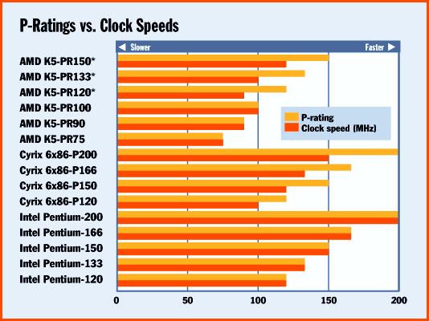

# The Problem with P-Ratings

*State Of The Art*

AMD and Cyrix will soon face a dilemma: How can they compare the performance of their processors to that of Intel's when the baseline keeps changing?

Until recently, users could judge the relative performance of two different x86 chips of the same generation by comparing clock speeds. CPU cores from AMD, Cyrix, and Intel were similar enough that performance didn't vary much -- a 33-MHz 486 from one vendor was as fast as a 33-MHz 486 from a competitor.

But as the x86 moves through its fifth and sixth generations, microarchitectures are diverging to the point where clock speeds are no longer valid, even for shorthand comparisons. For instance, Cyrix's 150-MHz 6x86 outruns a 200-MHz Pentium.

Industry-standard benchmarks, such as SPEC95, are one answer, as are magazine benchmarks, such as the BYTEmark and WinBench. But these tests typically yield measurements that don't directly compare different CPUs. (BYTEmarks are normalized to a Pentium-90 baseline, not relative clock speeds, although you could figure it out by doing a little math.)

AMD and Cyrix prefer numbers that users can compare directly to Intel clock speeds. That's why they joined forces last year to standardize on Performance Ratings, abbreviated as P-ratings by Cyrix and as PR-ratings by AMD.

MicroDesign Resources, which publishes the Microprocessor Report, acts as the independent testing lab. Cyrix's 150-MHz 6x86 is labeled the 6x86-P200+ because it matches or exceeds the performance of a Pentium-200; AMD's new 100-MHz K5 is called the K5-PR133 because it's comparable to a Pentium-133.

But P-ratings use today's Pentium as the baseline. When Intel introduces the P55C Pentiums in 1997, they're expected to perform about 15 percent better than a regular Pentium at the same clock speed. Users might be confused: Which Pentium does the P-rating refer to?

Then there's the Pentium Pro. Comparisons to Intel's flagship CPU will require yet another variation of the P-rating.

Cyrix and AMD claim they're working on a solution. But knowledgeable buyers don't rely exclusively on vendors' performance claims, anyway. By collecting benchmark data from multiple sources -- including the popular magazine benchmarks, which are freely available -- expert users can reach their own conclusions, even if it takes a little more effort.

## P-Ratings vs. Clock Speeds

An x86-compatible chip rated at P-120 delivers performance comparable to that of a 120-MHz Pentium.

Copyright

1994-1997 BYTE

7ew

yew

7ew

yew

]fw

7ew

yew

7ew

yew

agw

7ew

yew

7ew

yew

7ew

yew

\kw

7ew

yew

{lw

7ew

yew

7ew

yew

7ew

yew

7ew

yew

rqw

7ew

yew

7ew

yew

7ew

yew

7ew

yew

7ew

yew

## Images

