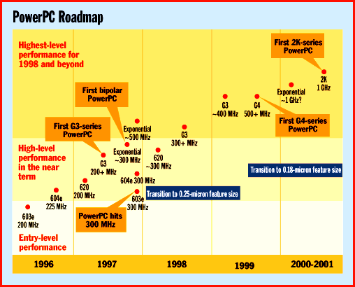

# PowerPC Regroups

*State Of The Art*

Stung by Intel's gains in processor performance, the PowerPC alliance will strike back with higher clock speeds and new chip designs.

Tom R. Halfhill

Don't count your megahertz before they're hatched. That's what the PowerPC alliance has learned after prematurely gloating over the imagined obsolescence of Intel's x86.

One famous advertisement from 1992 showed how CISC performance was falling flat while RISC technology soared toward the SPECint stratosphere. Another ad warned about the coming fate of x86-based PCs by picturing a highway running smack into a brick wall.

Somehow, things didn't work out that way. Intel's Pentium and Pentium Pro have not only managed to keep the 18-year-old x86 architecture competitive; they have at times surpassed the performance of leading RISC chips, including the PowerPC. Apple fulfilled its promise to sell millions of Power Macs, but system-level limitations have foiled Apple's attempts to exploit the full potential of the PowerPC chips. IBM fumbled the introduction of its own PowerPC desktop systems and embarrassingly failed to port OS/2 to PowerPC. And four years after the PowerPC's birth, the alliance is only now finalizing the PowerPC Reference Platform for clone makers.

If the PowerPC is to retain any credibility as an alternative to the x86, the alliance must deliver a steady stream of faster chips and a viable system standard that attracts big-volume vendors. In 1997, Motorola and IBM will roll out faster versions of current PowerPC chips, introduce a new generation of 32- and 64-bit processors, accelerate the development of future CPUs, and oversee the debut of PowerPC Platform systems that can run the Mac OS, Windows NT, and Unix. With Intel running full speed toward 300-MHz Pentium Pros and the 64-bit Merced, 1997 could be the PowerPC's last shot at glory.

The Indy 300

One measure of the PowerPC's competitiveness will be its ability to break the 300-MHz barrier. Digital's exotic Alpha did it more than a year ago, but CPUs for mainstream desktop systems are only now creeping beyond 200 MHz. By the end

of next year

, we should see 300-MHz chips from Intel, IBM, Motorola, and probably Exponential Technology, a Silicon Valley startup that will ship the first PowerPC processor built with bipolar transistors (see the sidebar "Exponential's Bid to Beat the Pack").

CPUs capable of attaining 300 MHz include Intel's Deschutes (a Pentium Pro variant), the PowerPC 603e, and the PowerPC 604e. At 300 MHz, the 603e and 604e will offer about five times the performance of the first PowerPC 601, which ran at 60 MHz.

Of course, raw clock speeds are no longer an adequate way to compare processor performance, especially between two architectures as disparate as the x86 and PowerPC. However, clock speeds do indicate which companies have the most advanced wafer-fabrication processes and speed-tuned microarchitectures. Intel designed the superpipelined Pentium Pro for high clock speeds to exploit its lead in building new fabrication plants (fabs). But IBM and Motorola are no slouches in this category, either. The PowerPC 604e hit 225 MHz last summer while Intel's chips were stuck at 200 MHz, and Mac clones running at 225 MHz and 240 MHz have been available for several months now from Power Computing. Even at 200 MHz, the 604e outguns Intel's fastest x86.

As part of their plan to carry the PowerPC architecture into the twenty-first century, IBM, Motorola, and Apple have forecast three generations of chips that will run at even higher clock speeds. They refer to these generations as G3, G4, and 2K. (The 601 is considered the first-generation PowerPC because it was a hybrid chip based on IBM's POWER architecture and Motorola's 88110; the PowerPC 603, 603e, 604, 604e, and 620 are more mature designs that comprise the second generation.) All future generations will be compatible with today's PowerPC software.

The most significant departure from the alliance's original strategy, as first mapped out in 1991, is that the new projects are going forward concurrently, so the development work on each generation overlaps work on the previous generation. This is similar to the accelerated development schedule at Intel, where independent teams are working on new x86 generations simultaneously.

To make this possible, the PowerPC alliance has expanded its Somerset lab (a shared design center in Austin, Texas) by 50 percent. In addition, IBM and Motorola are working on PowerPC projects at their own labs in Texas, Vermont, and elsewhere. New designs can emanate from any of these labs, and IBM and Motorola share manufacturing rights to any PowerPC chips they jointly develop.

Future Generations

The G3 series is scheduled to arrive in mid-1997 with a CPU that will run at about 200 MHz on 0.35-micron CMOS. This chip has already taped out and is available in samples. Later G3-series chips will migrate to a 0.25-micron CMOS process, and clock speeds will scale upward to about 400 MHz, according to Will Swearengin, PowerPC product manager at Motorola. The fastest G3 chips will run about 10 times faster than the original PowerPC 601, he estimates.

Some chips in the G3 generation will be 32-bit processors, while others will be 64-bit implementations based on the 620. Presumably they will improve on the 620, whose performance has been disappointing. A year ago, in fact, there were rumors that the 620 would be killed. Those rumors were greatly exaggerated, says IBM PowerPC product manager Dave Ryan; the 620 was merely delayed until a better process technology was ready. Instead of making its debut on a 0.5-micron process at 133 MHz, the 620 will appear next spring on a 0.35-micron process at 200 MHz. So far, only Motorola and Groupe Bull are committed to making 620-based systems.

Some G3-series chips will inherit the 128-bit backside bus that the 620 uses to address its secondary (level 2) cache. Others may have integrated L2 cache controllers, multichip module L2 packaging (like the Pentium Pro), or integrated L2 caches (like the Alpha). A strong clue that IBM and Motorola are thinking about integrated or closely coupled caches is that transistor counts in the G3 series will soar as high as 30 million, nearly an order of magnitude greater than the number of transistors in today's PowerPC chips. It's unlikely that the chip architects will design logic circuits requiring so many transistors in this generation; bigger caches are a virtual certainty.

In 1999, IBM and Motorola plan to introduce the G4 generation, which will first appear at about 500 MHz on 0.25-micron CMOS. Later, the G4-series chips will graduate to 0.18-micron CMOS, which should enable clock speeds approaching 1 GHz (1000 MHz). Transistor counts will range as high as 50 million -- again, mostly cache, not logic.

Some G4 chips will be 32-bit, but most will probably be 64-bit. Users probably won't realize the full benefit of 64-bit architectures until OS vendors and applications developers rewrite their software to take advantage of the wider architectures. Even then, I/O-intensive applications such as databases probably stand to gain more performance than mainstream desktop applications.

Even the 32-bit versions of the G4-series processors will match or exceed the performance of Intel's 64-bit Merced, Motorola's Swearengin claims. G4 chips will be available in mainstream desktop systems immediately after introduction, he says. (Intel's pattern is to introduce a new x86 generation in servers and high-end workstation PCs, then phase in the lower-priced desktops later.)

Both IBM and Motorola maintain that the PowerPC will weather the 32- to 64-bit transition better than the x86. Intel's Merced will introduce a new architecture, known as IA-64, that almost certainly will require developers to recompile their software to get maximum performance (see the article "The x86 Gets Faster with Age"). Although PowerPC developers face a similar transition, it may be a little smoother simply because the PowerPC carries less architectural baggage. For example, x86 users will expect a 64-bit x86 to be backward compatible with 16- and 32-bit software dating as far back as 1981, while the PowerPC started life as a modern 32-bit architecture in the 1990s. Of course, there's no way to verify any of these claims until the end of the decade.

In 2000 or 2001, IBM and Motorola plan to introduce their fifth-generation PowerPC series, code-named 2K. The alliance is saying very little about this long-range project. If process technology stays on track, the 2K series will premiere at 0.18 micron and the best fabs will be moving toward feature sizes of 0.15 micron or smaller. That should yield CPUs with as many as 100 million transistors and clock speeds exceeding 1 GHz. When combined with further architectural improvements, the result should be microprocessors that run at least 10 times faster than today's CPUs.

No MMX or Java

Neither IBM nor Motorola acknowledge any plans for additional multimedia support in the PowerPC architecture. Intel, of course, is adding 57 new MMX instructions for multimedia to the x86 architecture next year. Multimedia enhancements are less imperative for the PowerPC architecture, which already includes some RISC instructions that duplicate MMX instructions. BYTE's tests show that PowerPC chips have overall better integer performance than x86 chips, and there's no context-switching penalty when the PowerPC mixes multimedia with floating-point operations, as there is with MMX. IBM and Motorola argue that the architecture of the whole system, not just the CPU, is the most important factor in multimedia performance.

Up to now, the vast majority of PowerPC-based systems have been Power Macs. Next year, however, PowerPC systems will undergo a major transition to the new PowerPC Platform. This is the system architecture for all future PowerPC systems, including Macs, Mac clones, and machines that run Windows NT and Unix. Although you might expect that a brand new system architecture would offer much better performance than the older x86-based PC architecture, it's not guaranteed. The PowerPC platform carries some baggage from both the existing PC architecture and the Mac because it's designed to work with industry standard PC components and Mac peripherals. It remains to be seen whether this baggage will compromise performance.

Likewise, it's too early to tell whether Java will become important enough to justify modifications to the PowerPC architecture. Sun is betting heavily on Java with a line of dedicated Java chips -- but then, Sun invented Java. Another major chip vendor (which gave BYTE this information on a confidential basis) is planning to enhance its CPU architecture with new instructions that improve Java performance. Other chip makers are waiting to see if Java becomes a significant market force or fizzles out like a fad.

Turnaround: 1997?

Since the PowerPC alliance came together in 1991, it has largely kept its promise to offer microprocessors at roughly twice the price/performance ratio of Intel's x86 -- in other words, twice the performance at a comparable price, or comparable performance at half the price. But the alliance has failed to even dent the x86's overwhelming market share.

Indeed, it's possible that the most significant impact of the PowerPC has been to prod Intel into accelerating its research and development. Ironically, Intel seemed to take the PowerPC more seriously than almost anyone else. As a result, the x86 is still highly competitive and far from obsolete. The PowerPC is the best-selling RISC architecture on the desktop, but almost all PowerPC systems are Power Macs, and Apple has less than 9 percent of the market.

The long-awaited PowerPC Platform is the best bet for a turnaround. After inexcusable delays, it's finally ready to open up the Mac clone market and provide a common hardware platform for multiple OSes. Although the PowerPC stands little chance of dethroning the x86, the alliance can at least do a better job of running in second place.

## Where To Find

Apple Computer

Cupertino, CA

Phone: (408) 996-1010

http://www.apple.com

Internet:

http://www.apple.com

IBM Microelectronics

Fishkill, NY

Phone: (800) IBM-3333

E-mail: askibm@www.ibm.com

http://www.chips.ibm.com/products/ppc/index.html

Internet:

0http://www.chips.ibm.com/products/ppc/index.html

Exponential Technology

San Jose, CA

Phone: (408) 441-6050

Fax: (408) 441-6051

E-mail: info@exp.com

http://www.exp.com

Internet:

http://www.exp.com

Motorola Microprocessor Group

Austin, TX

Phone: (800) 845-MOTO

Fax: (512) 244-9222

!E-mail: motorola@selectnet.com

http://www.mot.com/SPS/General/chips.html

Internet:

)http://www.mot.com/SPS/General/chips.html

PowerPC News

RimaTech

http://www.rimatech.com/html/ppcnews.html

Internet:

)http://www.rimatech.com/html/ppcnews.html

## Five Generations of PowerPC

@Company CPU PPC Feature Availability Analysis

$ Generation Size

) (micron)

LIBM/Motorola 601 1st 0.5 Phasing out Maximum clock speed

J limited to 120 MHz

OIBM/Motorola 603 2nd 0.5 Now Smaller caches, slower

G clock than 603e

OIBM/Motorola 603e 2nd 0.35 Now Exceptionally low power

C consumption

OIBM/Motorola 604 2nd 0.5 Now Smaller caches, slower

G clock than 604e

OIBM/Motorola 604e 2nd 0.35 Now Outperforms Pentium Pro

K at same clock speed

QIBM 615 Unknown Unknown Never Dual PowerPC/x86; project

I probably canceled

RIBM/Motorola 620 2nd 0.35 1997 Disappointing performance

L delayed introduction

Exponential Bipolar 2nd Unknown 1997 Unique hybrid of bipolar

L logic and CMOS cache

PIBM/Motorola G3* 3rd 0.35-0.25 1997 32- and 64-bit chips; up

Q to 30 million transistors

PIBM/Motorola G4* 4th 0.25-0.18 1999 32- and 64-bit chips; up

Q to 50 million transistors

OIBM/Motorola 2K* 5th 0.18 2000-2001 Good bet to break 1-GHz

? barrier

9*Code names for a series of chips in the same generation

## PowerPC Roadmap

PowerPC designers need to achieve 300 MHz next year to stay in the performance race with the x86.

mailto:"thalfhill@bix.com"

]Tom R. Halfhill is a BYTE senior editor based in San Mateo, California. You can reach him at

thalfhill@bix.com

## Images

