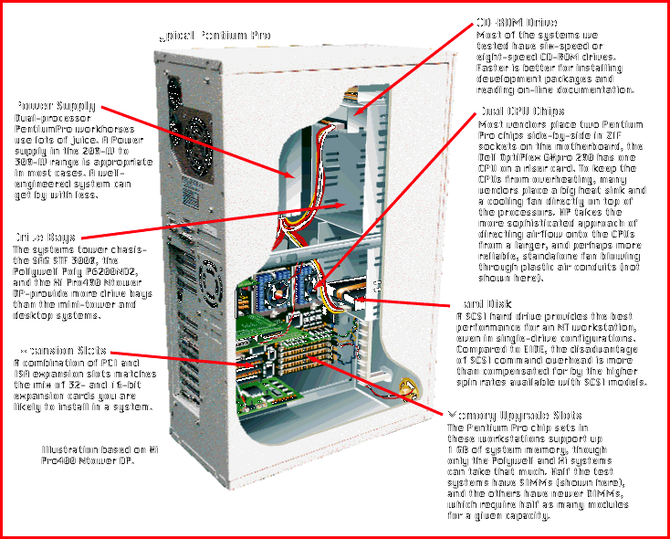

# Eight Twin-Engine Pentium Pro Workstations

*BYTE Hardware Lab Report*

[For compute-intensive applications, a second Pentium Pro chip can make the job go faster.

;Maggi Bender, Dorothy Hudson, Jim Kane, and John McDonough

For 32-bit number-crunching and running technical applications under a 32-bit OS like Windows NT, the Pentium Pro is the Intel processor of choice. For some people, two Pentium Pros is an even better choice, either to run a multiprocessing NT application or to multitask -- downloading from an FTP site or handling e-mail with one processor while you tie up the other with your heavy-hitter 32-bit application.

In this month's Hardware Lab Report, we take a look at eight 200-MHz dual-processor Pentium Pro workstations that will keep you from sitting on your thumbs. Our test subjects come from Dell Computer, Digital Equipment, IBM, Hewlett-Packard, Polywell Computers, SAG Electronics, and Xi Computer (which supplied two systems). These vendors are betting that NT will emerge soon as a prominent general business platform. The recent release of Windows NT 4.0, in particular, has increased interest in high-end

Pentium Pro systems

Built for 32 Bits

With one of these symmetric multiprocessor (SMP) speed demons on your desk, you can take full advantage of both 16- and 32-bit applications simultaneously. Admittedly, the Pentium Pro processor isn't optimized for 16-bit DOS and Windows 3.x software, or even for the mixture of 16- and 32-bit code found in Windows 95. Such software is full of segment writes, partial register operations, unaligned data accesses, and instruction-prefix bytes that have stymied the Pentium Pro in previous BYTE tests.

However, you won't care if a Pentium Pro doesn't run 16-bit code much faster than a less expensive Pentium system for two reasons. First, the clock speed is high enough that you won't notice a slowdown with an older legacy application, particularly if it's running on its own private processor. Your performance-critical software will be 32-bit. Second, business software is starting to go 32-bit; many office suites are already there. The proliferation of Windows NT-optimized applications isn't an adequate reason in itself to buy a dual-Pentium Pro workstation, but it helps.

The desktop, mini-tower, and tower systems we review range in price from $4700 to $9200 as configured for testing: with 64 MB of system RAM, 2- to 9-GB hard drives, and 17-inch displays. The Dell, Digital, and SAG models came with integrated Ethernet, while HP provided an Ethernet card. In general, the vendors chose similar high-performance components in designing their dual-processor Pentium Pro systems. Only Dell went with the costly 512-KB-cache version of the Pentium Pro chip.

Six of the eight systems have SCSI hard drives of various flavors, while the Dell and Xi systems have slower-spinning, but less expensive, Enhanced IDE (EIDE) drives. Five systems use a Matrox Millennium graphics adapter, two have a Number 9 Imagine 128 Series 2 adapter, and one has a Diamond Stealth 64 card -- all PCI. Most systems include six- or eight-speed CD-ROM drives; the Hewlett-Packard Vectra XU 6/200 has a four-speed drive.

Most of the systems use Intel's latest 82440FX Pentium Pro chip set, which supports fast extended data out (EDO) memory, Universal Serial Bus (USB), and dual concurrent PCI buses. HP and Polywell stayed with the older 82450KX Orion chip set. Six systems actually implement USB by providing ports. The Dell and HP workstations have none. The Digital, Polywell, and Xi systems have two ports.

The USB defines a standardized connector and socket for many types of peripherals (see "Let's Make It Universal"). Because you can daisy chain many peripherals to a single port, USB has the potential to eventually eliminate the number and kinds of connectors on the back of a typical PC. With USB-enabled PCs, users will also be able to hot-plug USB peripherals without rebooting their systems or having to deal with IRQ settings, DMA channels, and I/O addresses. With USB, you could connect up to 127 devices to a single PC. USB's 12-Mbps serial data rate provides ample throughput for low- and mid-bandwidth peripheral devices. With strong support from Microsoft, Intel, and big system vendors, USB is as inevitable as was PCI.

Tight Bunch

Although Windows NT 4.0 is the hot news, it was just out of beta when we were testing these systems, so we stuck with tried-and-true NT 3.51. Our suite of NT benchmarks shows that these systems provide unprecedented performance on the Intel x86 platform.

While the three fastest systems -- Dell's OptiPlex GXpro 200, Digital's Personal Workstation 200i, and Polywell's Poly P6-200ND2 -- are benchmark burners, the remaining five models were right behind them. You won't notice speed differences among them when navigating through typical desktop applications. Though it wasn't the fastest overall, IBM's PC 365 performed best in the two benchmarks that test dual-processor efficiency (see "Test Specs"). The Dell took second.

Only one system lagged noticeably behind the others -- Xi Computer's Pro400 Mtower DP -- and that can be blamed on its EIDE hard drive. Xi's Pro400 Ntower DP, which had a high-rpm IBM Fast/Wide SCSI drive, ran right with the pack.

Who needs so much horsepower at their desk? Vendors' marketing plans give some idea. Hewlett-Packard aims its Vectra XU 6/200 at users who need enough computing force to create two-dimensional animation or to design electronic components with a package like AutoCAD. Polywell provides options for its Poly P6-200ND2 that let it serve as a CAD/CAM workstation, a SQL-based Internet server, or a video editing workstation. Dell sees its OptiPlex GXpro 200 as a number-crunching financial workstation. SAG Electronics offers the STF 3000 both as a workstation and, when configured with RAID 5 storage options using the Ultra-SCSI architecture, as a low-end network server; indeed, the SAG system has many built-in server features such as temperature, fan speed, and voltage sensors, as well as the necessary software to report on problems these sensors find.

The systems we tested for this Lab Report were similar in their overall performance, mainly due to the commonality of architecture dictated by Intel's PCI chip sets. The small differences in speed are due mainly to the vendors' selections of hard drives and graphics cards. Given the narrow performance spread between these machines, we recommend that you pay more attention than usual to features, usability, and, of course, price.

Contributors

Jim Kane, Project Manager/NSTL

Dorothy Hudson, Project Manager/NSTL

John McDonough, Technical Writer/NSTL

Maggi Bender, Technical Analyst/NSTL

Dave Rowell, Senior Technical Editor/BYTE

## Typical Pentium Pro

## Images

