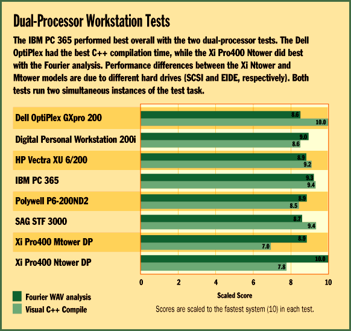

# Pentium Pro Workstations

*BYTE Hardware Lab Report*

The eight dual-processor Pentium Pros we tested not only boast top-notch performance, they also provide a bridge to a future dominated by 32-bit applications. Loaded with 64 MB of RAM, they were all exceptionally fast in our benchmarks, with only small performance differences between them. Still, we had to pick winners in our two categories: Best Overall and High Performance.

Tight scoring

8 resulted in the same three-way tie in both categories.

Dell's OptiPlex GXpro 200 ($6685) -- a combined Best Overall and High Performance winner -- differentiated itself by using Intel's most expensive CPU, the 200-MHz Pentium Pro with 512-KB cache. The big-cache chip helped it eke out a small lead in the performance testing, but at a cost of roughly $1500 more than you'd pay for two Pentium Pros with 256-KB cache (also available). Like most of the other systems, the Dell uses Intel's 440FX Pentium Pro chip set.

Fast performance isn't the OptiPlex GXpro 200's only forte. It's tops in our features category, too. The Dell system comes with integrated networking. It has 3Com's PCI Bus Mastering 3C59X Twisted Pair EtherLink III on the motherboard so you don't need a network interface card in one of your PCI slots. The test unit came with a 2-GB Seagate hard disk with an EIDE interface. EIDE drives are currently limited to 5400-rpm spin rates, which gives systems with 7200-rpm SCSI drives a slight performance advantage. The OptiPlex's other components include five drive bays, an eight-speed CD-ROM drive, a Number Nine Imagine 128 graphics card, and a Dell 17LS monitor. The small-footprint desktop chassis has a push-button removable cover, lever-locked expansion cards, and a hinged power supply, all of which helped the system's Usability score.

The second double winner is Polywell's Poly P6-200ND2. Its strengths are performance -- particularly in the Excel/Word tests -- and price. At $5270, the Poly P6-200ND2 is one of the least expensive systems in this roundup. Polywell's machine could have scored even better if it wasn't such a hassle to remove the chassis to get to the internal components.

Once inside the Poly P6-200ND2 you'll find plenty of room for expansion. The tower has six available expansion slots (two PCI and four ISA) and seven available drive bays for upgrades. The 4.3-GB Seagate ST15150W hard disk has a Fast/Wide SCSI-2 interface, but the S3-based Diamond Stealth 64-bit graphics card came with only 2 MB of DRAM.

Also tying for first place in both categories, Digital Equipment's Personal Workstation 200i ($5834) had the best scores in our low-level InterMark performance tests, which stress the processor, hard disk, video, and CD-ROM components. The powerful mini-tower NT workstation arrived with a speedy 2-GB Seagate ST32550 Fast/Wide SCSI hard drive, a Matrox Millennium graphics adapter, and an eight-speed Toshiba CD-ROM drive.

The company markets the Personal Workstation 200i for graphics-intensive applications for mechanical CAD, digital content composition, and software engineering. Along these lines, Digital offers more capable 3-D graphics card options. The workstation sports innovative features such as two USB ports and integrated Ethernet (10Base-T/10Base-2) on the motherboard.

Best of the Rest

The IBM PC 365 ($7081) provided unmatched speed in our CPU-intensive Fourier and Visual C++ benchmarks that challenge symmetrical dual-processing capabilities. We also found that it boots up Windows NT faster than any other system. IBM's desktop workstation features a Matrox Millennium graphics adapter with 4 MB of Window RAM (WRAM) that supports a 1600- by 1280-dpi screen resolution. The PC 365 has a 2.1-GB IBM hard disk with an Adaptec UltraSCSI PCI host adapter, and it has a six-speed CD-ROM drive.

IBM positions this system at the top of its desktop PC product line yet stresses the machine's network management capabilities. The box didn't come with a network card, but it does have Wake-on-LAN, IBM networking tools, and predictive-failure hard drive technology. Wake-on-LAN enables network managers to turn on unattended systems from anywhere on a local network. The system's USB port prepares users for the USB-based hardware peripherals that will be arriving within the next year.

For those who can't afford to spend much more than $4000 but still want power, the Xi Computer Xi Pro400 Ntower DP ($4788), which scored very well in our tests, is a good bet. The tower system has plenty of room for expansion and features top-notch components such as an eight-speed CD-ROM drive and a 2-GB Fast/Wide Seagate SCSI hard drive. At the other end of the price spectrum, Hewlett-Packard's well-engineered Vectra XU 6/200 was a cut above the rest in its Usability score, but it didn't stand out otherwise in this competitive field.

!Dual-Processor Workstation Tests

Copyright

1994-1997 BYTE

vlz

%lz

%lz

%lz

fmz

%lz

zoz

%lz

pqz

%lz

%lz

pvz

%lz

%lz

%lz

P{z

%lz

%lz

%lz

%lz

%lz

%lz

%lz

%lz

^mz

## Images

