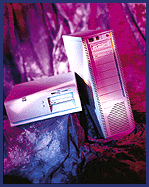
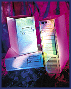

# Workstation Ratings

*BYTE Hardware Lab Report*

Best Overall:

]Dell's OptiPlex GXpro 200, Digital's Personal Workstation 200i, and Polywell's Poly P6-200ND2

In a very tight race, the Dell, Digital, and Polywell workstations

Dtied for first in Overall score. They are also the top three in our

@performance benchmarks. Dell's OptiPlex GXpro received the most

Fimpressive Features score thanks to important workstation ingredients

Dlike integrated networking and an eight-speed CD-ROM drive. A great

Aperformer, the roomy Poly P6-200ND2 also has one of the smallest

Eprice tags. Keep in mind that IBM and Xi (the Pro400 Ntower DP) were

not far behind.

Weightings

Features 16%

Usability 16%

Price 8%

Performance 60%

## Ratings

H Price Tech- Imple- Perfor- Usa- Fea- OVERALL

G nology menta- mance bility tures RATING

& tion

Dell OptiPlex $6685 **** **** **** **** **** ****

Xpro 200

Polywell $5270 **** **** **** *** **** ****

P6-200ND2

Digital Personal $5834 **** **** **** *** **** ****

Workstation 200i

FIBM PC 365 $7081 **** **** **** **** **** ****

Xi Pro400 $4788 **** **** **** **** *** ****

Ntower DP

FSAG STF 3000 $5650 **** **** **** *** **** ****

FHP Vectra $9206 **** **** **** ***** *** ****

XU 6/200

Xi Pro400 $4688 **** *** *** ** *** ***

Mtower DP

Key

***** Outstanding

**** Very Good

*** Good

** Fair

* Poor

High Performance:

Dell's OptiPlex GXpro, Digital's Personal Workstation 200i, and Polywell's Poly P6-200ND2

As the top speedsters, these three systems performed within several

Ahundredths of a point of each other. However, each excelled in a

Edifferent test. The Dell OptiPlex took advantage of its large 512-KB

@L2 processor caches to get the high score in the dual-processor

Visual C++ compiling benchmark. Digital's Personal Workstation 200i

>got the top score in the InterMark low-level test. Polywell's

Fworkstation finished far ahead in the Excel/Word application testing.

Again, the other systems were not far behind. The IBM PC 365 had the

Dhighest combined score in the two dual-processor workstation tests,

=but it faired poorly in the less important Excel/Word tests.

Weightings

Performance 100%

## Ratings

H Price Tech- Imple- Perfor- Usa- Fea- OVERALL

G nology menta- mance bility tures RATING

& tion

Dell OptiPlex $6685 **** **** **** **** **** ****

Xpro 200

Polywell $5270 **** **** **** *** **** ****

P6-200ND2

Digital $5834 **** **** **** *** **** ****

Personal

Workstation

200i

FIBM PC 365 $7081 **** **** **** **** **** ****

FSAG STF 3000 $5650 **** **** **** *** **** ****

Xi Pro400 $4788 **** **** **** **** *** ****

Ntower DP

FHP Vectra $9206 **** **** **** ***** *** ****

XU 6/200

Xi Pro400 $4688 **** *** *** ** *** ***

Mtower DP

Key

***** Outstanding

**** Very Good

*** Good

** Fair

* Poor

## Best Overall: 3-Way Tie

## High Performance

Copyright

1994-1997 BYTE

! {

W {

;!{

c!{

P"{

0#{

b#{

k${

h%{

@&{

q&{

x'{

9({

o({

*){

R){

## Images

