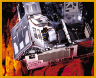
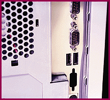
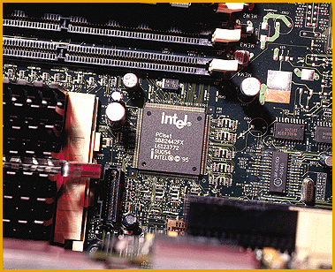

# Details

*BYTE Hardware Lab Report*

Designer's Choice: Kudos to the engineers at Dell and Hewlett-Packard for thoughtful system designs. Dell made its compact OptiPlex GXpro 200 (

shown below

) easy to service with a hinged power supply and expansion cards that lock in with a lever. Also easy to open, HP's Vectra XU 6/200 achieved our highest Usability score with features like accessible DIMM slots near the top of its mini-tower chassis.

Betting Twice on USB: Digital believes Universal Serial Bus (USB) peripherals will become widely available in the next six to nine months and that you'll want both of the USB ports incorporated in the Personal Workstation 200i. You'll likely use one port to daisy chain the keyboard and mouse in front of the system, the other for peripherals like scanners and printers that cable out from the side or rear. Systems from Polywell and Xi also have dual USB ports.

Down to Three: Most of the systems we tested use Intel's new Pentium Pro chip set, the 440FX PCIset. For workstations, it provides performance efficiencies by reducing the chip count to three (from the seven chips of Intel's Orion sets), supporting EDO memory, and allowing its dual PCI buses to work concurrently.

## Designer's Choice

## Betting Twice on USB

## Down to Three

Copyright

1994-1997 BYTE

](|

## Images

