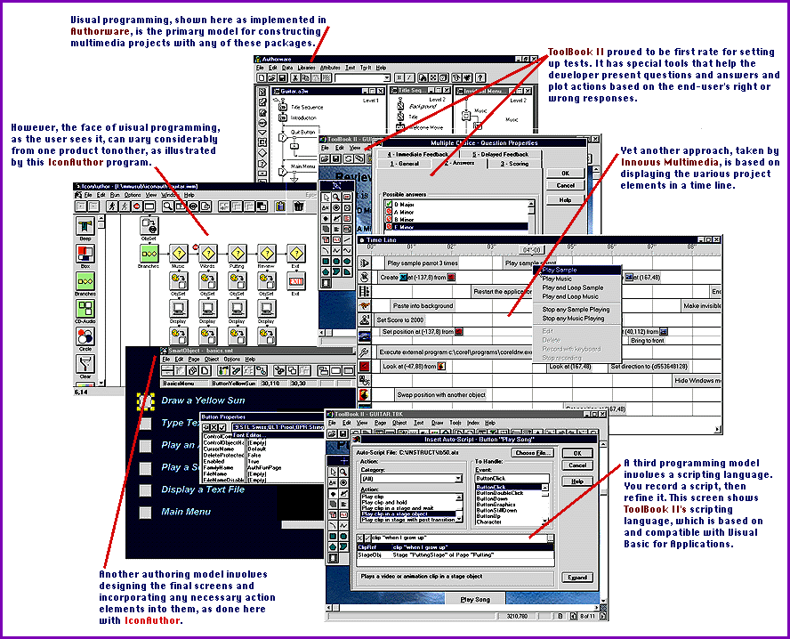
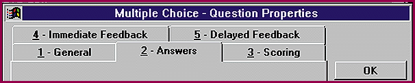

# How Multimedia Multitools Compare

*BYTE Software Lab Report*

DNSTL tests four remarkable packages for creating mixed-media hits.

David Seachrist

Putting on a multimedia presentation used to be a real bear. But computer-based multimedia has changed all that. Everything is virtual.

We found the leading edge in four tools on the high end of the scale, all multimedia authoring packages that run under Windows 95 (though some are 16-bit and some are 32-bit): Macromedia's Authorware Interactive Studio 3.5 (hereinafter Authorware), Aimtech's IconAuthor 7.0, Innovus's Multimedia 2.1, and Asymetrix's ToolBook II Instructor 5.0.

As an all-around package for creating our test applications -- a computer-based training (CBT) program and a kiosk program -- ToolBook II Instructor offers the best balance of usability and flexibility. It comes with the most complete set of tools for developing and managing tests, offers a bevy of learning aids (including wizards and templates), provides the easiest integration of database information, and supports program distribution like no other product. Also, it's the best Web-enabled multimedia authoring tool for distributing CBT material via the Internet.

Macromedia is almost synonymous with multimedia, and its Authorware package is still the one to beat for producing games and other audiovisual-intensive material. However, for the test CBT and kiosk applications we created, the program's flowchart interface was less satisfactory than ToolBook II's screen-based approach. Authorware simply doesn't do as much to automate making tests and accessing databases.

The new kid on the block, Innovus Multimedia, is impressive. Unlike many authoring tools, it isn't designed to create eye-popping audio and video extravaganzas. Innovus says the program is for "business multimedia." It's best used as a kind of programmable, interactive, super PowerPoint. The time-line view is helpful, and its scripting language -- compatible with Visual Basic for Applications (VBA) -- will be of interest to many people working in corporate environments. But the package's learning aids and test-writing tools aren't as complete as ToolBook II's. The next version's Rich Text Format (RTF) import facility and Internet support will be key enhancements.

Despite its power and many useful mini-applications, IconAuthor's interface, database connectivity, and tools for formulating tests are more difficult to learn and use than ToolBook II's or Innovus Multimedia's. But if you want to develop native OS/2 applications, Icon-Author is the only game in town.

## How We Tested

We modeled our tests on typical multimedia projects likely to be encountered in corporate and academic environments. Our target user is someone with basic knowledge of business software but no experience in writing program code. Because these tools can be used to build a vast range of applications, our ratings would likely change if the test application had been, for example, a computer game.

With each product, we created two applications. One was a CBT program designed to teach the user to play a song on the guitar; the program includes text, graphics, sound, digital video, and a test. The second program was an information-kiosk application tied to a real estate database.

We've evaluated these authoring tools primarily on the basis of their ease of learning and ease of use. Performance isn't a big issue with authoring software; speed of operation isn't as important as speed and ease of creation, and the time needed to add or import files into an application is minimal compared to the time needed to construct and check program logic.

Our testers needed approximately two days to learn the programs and create the two test applications with Authorware and IconAuthor. They needed one day with Innovus Multimedia and ToolBook II Instructor.

Structure or Content?

The heart of any authoring process is applying structure to content. You need both subject matter and a logical way to present it. For multimedia authoring, it's especially handy to be able to view both the structure and the content of a project. In fact, each of the four tested programs offers at least two authoring modes. One mode is organizational and provides a top-down view of the components in an application by showing their sequence and relationship to one another. A second mode lets you see how a screen will actually be displayed. Innovus Multimedia also offers a time-line view that shows graphically the timing of all the events and objects tied to a given screen. We found this especially helpful in creating a screen that plays a sound file and a video file.

Authorware, IconAuthor, and Innovus Multimedia all use a visual flowchart for structuring applications. ToolBook II uses an object browser to view component hierarchies; its organizing principle is that of a book with chapters and pages. In constructing the CBT application, we found that Authorware and IconAuthor lend themselves to creating structure first and then adding content. Innovus Multimedia and ToolBook, on the other hand, are better suited to starting with the content and developing screens on-the-fly.

All the packages allow you to create applications using visual programming techniques, though the

emphasis varies

from program to program. Authorware and IconAuthor, for example, offer on-screen icons that work like elements of an electronic flowchart. To add a bit of programming logic to an application, you drag an icon that represents the desired programming construct into the flowchart area of the screen. Authorware in particular rewards those who plan their text ahead. But as the project grows longer and more complicated, you have to consolidate the individual programming construct icons into compound icons, making it harder to maintain the bird's-eye view of the application.

ToolBook II's visual programming emphasis is on screen design. Making a button to play a video involves selecting a button tool, much as you would draw with a rectangle tool in an illustration program. After creating the button, you select menu options in order to assign properties that define how the button will work.

All four programs offer strong features for application development and programming constructs, including the ability to create and evaluate variables, build looping and branching structures, accept and evaluate user input, and provide feedback. The powerful scripting languages in ToolBook II, Authorware, and Innovus Multimedia give these programs an advantage in a corporate environment with skilled programmers. Innovus's script language is compatible with VBA, and ToolBook II allows access to VBX controls to extend its power. All four programs support OLE, but only Authorware and Innovus currently support OLE 1.0 and 2.0.

Text in Context

Although "multimedia" conjures images of splashy graphics, sound, and video, text remains the fundamental means of communication. Any authoring tool worth its salt must provide flexible and easy-to-use text tools. The text editing environments in all four programs will seem below par compared to today's word processors. For example, Innovus Multimedia won't let you italicize just one word in a block, and you have to edit a block of text in a dialog rather than directly on-screen. IconAuthor's text editing is also less fluid than other aspects of the program.

Still, these packages are primarily for combining content, not creating it. Each one can import text, so you would normally edit and format screen text in with your word processor, then import it into the authoring program. With Innovus Multimedia, you can't currently import RTF files, just straight ASCII text, which doesn't maintain formatting attributes like bold type and character size. The next version, due out in November, will contain an RTF import capability.

Authorware offers the best text import, with the option to interpret page breaks as new screens. This really saves time when designing screens with lots of text. Innovus allows a similar option with straight text files, but the files require careful formatting with tabs, not page breaks.

Graphics and AV Tools

All four tools are good for creating, manipulating, and importing graphics. We did find that Authorware doesn't import JPEG graphics, and ToolBook II initially threw us for a loop until we learned that it loads JPEGs through its resource manager rather than through its graphic import option.

The relatively modest use of video and audio in our CBT test application didn't challenge any of these tools. It was easy to attach sound files of guitar chords to the JPEG photos of the chords being played and to attach AVI (Video for Windows) files for video of the song being played. The only tricky element was synchronizing the video playback with the sound file. But all the programs control playback speed and can start and stop audio and video files easily.

Authorware has the most extensive audiovisual tool set, mainly because Macromedia bundles Director and SoundForge with it. But its tools are really geared toward building an audiovisual production, not the kind of application our tests focused on. You can make drawn objects move in a designated path (path animation), and you can create simple cel (frame-by-frame) animations. Although ToolBook's animation and video tools aren't as complete as Authorware's, the program offers ancillary video capture and editing software at minimal additional cost.

Testing

ToolBook II is the environment of choice for creating courseware, although a third-party course management package is available at extra charge for Authorware. ToolBook II lets you develop interactive tests that use a wide variety of predefined question types (multiple choice, true/false, etc.). Its course management system allows an administrator to track students' progress and test scores. Design tasks -- specifying correct and incorrect answers, answer feedback, and scoring -- are all properties of question objects that the application designer can set from a single tabbed dialog box. This was by far the easiest approach to learn and use. Innovus Multimedia has question objects, but with fewer options. Authorware and IconAuthor have programming constructs to facilitate formulating test questions but lack the others' easy, object-oriented interface.

Program Distribution

Once an application is finished, it's time to distribute it. Authoring tools that can save programs as EXE files, easily manage resources (such as digital video, sound files, and drivers), and add an installation program can simplify this job.

All four packages let you freely distribute run-time players. IconAuthor, Innovus Multimedia, and ToolBook II have distribution programs that let you manage program resources and create floppy disk sets complete with an installation program. ToolBook II and Authorware allow you to save your programs as executables, so you don't need a run-time player. All in all, the packaging capabilities of ToolBook II and Innovus Multimedia are more complete than Authorware and easier to learn and use than IconAuthor.

Platform Support

Authorware is the only program we tested that runs as an authoring and playback application under both Windows and the Mac OS. IconAuthor offers OS/2 authoring and playback capabilities in addition to Windows support. Authorware and Innovus Multimedia run as 32-bit applications under Windows 95.

But platform-specific support becomes less critical as the World Wide Web grows in popularity. Already, ToolBook II is powerfully Web-enabled; it can save applications in Hypertext Markup Language (HTML) and Java formats, has a browser plug-in, and offers templates for building applications distributed via the Web. Authorware also offers a browser plug-in, and end-users can configure Authorware and IconAuthor run-times as helper applications. Innovus Multimedia plans Internet capabilities for the next version, due out in November.

In the final analysis, ToolBook II is our top pick because it does the best job of balancing ease of use with a rich set of features. Innovus Multimedia, which takes a minimalist, PowerPoint-like approach, would be our second choice, especially for developing simple presentations.

Evaluations in this report represent the judgment of BYTE technical editors, based in part on extensive tests conducted by National Software Testing Labs, as documented in a recent issue of NSTL's monthly Software Digest. To purchase a copy of that report, with NSTL's own evaluations and data, contact NSTL at 625 Ridge Pike, Conshohocken, PA 19428; (610) 941-9600; fax (610) 941-9950; editors@nstl.com. For a subscription, call (800) 257-9402. BYTE Magazine and NSTL are both operating units of The McGraw-Hill Companies.

## Product Information

Authorware 3.5......................$4995 ($595 upgrade)

(486, 8 MB;16 MB recommended)

Macromedia

San Francisco, CA

Phone: (800) 326-2128

Phone: (415) 252-2000

Fax: (415) 626-0554

http://www.macromedia.com

Internet:

http://www.macromedia.com

Circle 1022 on Inquiry Card.

9IconAuthor 7.0......................$1295 ($895 upgrade)

(486, 8 MB;16 MB recommended)

Aimtech

Nashua, NH

Phone: (800) 289-2884

Phone: (603) 883-0220

Fax: (603) 883-5582

http://www.aimtech.com

Internet:

http://www.aimtech.com

Circle 1023 on Inquiry Card.

9Innovus Multimedia 2.1..............$ 495 ($150 upgrade)

" (486SX, 8 MB; 16 MB recommended)

Innovus

Salt Lake City, UT

Phone: (800) 433-1806

Phone: (801) 463-8200

Fax: (801) 484-9561

http://www.innovusmm.com

Internet:

http://www.innovusmm.com

Circle 1024 on Inquiry Card.

*ToolBook II Instructor 5.0 .........$1995

" (386DX, 8 MB; 12 MB recommended)

Asymetrix

Bellevue, WA

Phone: (206) 462-0501

Fax: (206) 637-1650

http://www.asymetrix.com

Internet:

http://www.asymetrix.com

Circle 1025 on Inquiry Card.

9Corel Click and Create 2.0..........$ 695 (upgrade $249)

Corel

Ottawa, Ontario, Canada

Phone: (613) 728-8200

http://www.corel.com

Internet:

http://www.corel.com

Circle 1026 on Inquiry Card.

*mTropolis 1.0.......................$1195

Factory

Burlingame, CA

Phone: (415) 548-0600

http://www.mfactory.com

Internet:

http://www.mfactory.com

Circle 1027 on Inquiry Card.

*Oracle Media Objects 1.1............$ 495

Oracle

Redwood Shores, CA

Phone: (415) 506-7000

http://www.oracle.com

Internet:

http://www.oracle.com

Circle 1028 on Inquiry Card.

*PowerMedia 2.0......................$ 495

RadMedia

Palo Alto, CA

Phone: (415) 617-9430

Fax: (415) 473-6826

http://www.radmedia.com

Internet:

http://www.radmedia.com

Circle 1029 on Inquiry Card.

Best Overall:

$Asymetrix ToolBook II Instructor 5.0

ToolBook II balances usability and flexibility with a wealth of

Econstruction and management tools, learning aids, and integrated Web

features.

P Price Technology Implementation Usability OVERALL

O (New/Upgrade) VALUE

ToolBook II $1995 **** ***** ***** ****

Instructor 5.0

Authorware Inter- $4995/$595 **** **** **** ****

active Studio 3.5

IconAuthor 7 $1295/$895 *** *** *** ***

Innovus Multi- $495/$150 *** *** *** ***

media 2.1

Key

***** Outstanding

**** Very Good

*** Good

** Fair

* Poor

## Features

Authorware IconAuthor Innovus ToolBook II

F Multimedia

General Features

Authoring metaphor Flowchart Flowchart Flowchart Book/Page

Built-in database Y

CODBC support Y Y Y

@Includes screen/page layout templates Y

Training/course management (A) Y

Cross-Platform Compatibility

Windows 95: Authoring, playback Y 16-bit Y 16-bit

Windows 3.1: Authoring, playback Y Y Y Y

1Macintosh: Authoring Y

Macintosh: Playback Y Future Via Web

TOS/2: Authoring, playback Y Web playback

Windows NT: Authoring, playback Y 16-bit Y 16-bit

Unix: Authoring, playback Future Web playback

Application Development

OOLE 1.0 and 2.0 support Y OLE 1.0 Y OLE 1.0

KVBX support Y

Scripting language Y Y Y

Script recorder Y Y

SWYSIWYG structure/screen design Y Y Y screen only

Hypertext, hypermedia links, Y Y Y Y

event handling

Assign procedures to screen controls Y Y Y Y

Program flow statements (B) (B) Y Y

Integrated debugging environment Y Y Y Y

Text tools

Import RTF and ASCII files Y Y (C) Y

Search and replace Y Y (D) Y

Text search and retrieval tools Y Y

Drawing and Image Tools

Number of graphics formats imported 7 34 14 20

Pen, line, rectangle, oval tools, Y Y Y Y

snap-to grid

Image manipulation Y Y Y

Graphics object manipulation Y Y Y Y

commands

Clipart and tools included Y Y Y Y

Animation and Video Tools

Number of animation/movie 5 7 5 6

formats imported

Path, frame-by-frame animation Y Y Y Y

(Automatic, polymorphic in-betweening Y

Animate text Y Y Y

Video capture and editing tools Y Y Y extra cost

Video control tools Y Y Y Y

Transition effects Y Y Y Y

(fades, wipes, etc.)

Audio Tools

Number of sound formats imported 3 3 3 3

Sound synchronization Y Y Y Y

Control sound speed, duration, Y Y Y Y

sequence

Internet and Deployment Tools

Package to Web server Y Y Y

Save to HTML and Java Y

KFTP utility to transfer files Y Y Y

to Web server

Can be run from Web browser using Y Y Y

player software or plug-in

Network deployment Y Y Y Y

Free run-time player Y Y Y Y

Create distribution disks with Y Y Y

install program

Create stand-alone executables Y Y

Key

Y = Yes

A = Third-party application

7B = Branching, conditional branching, and repeat until

;C = Import ASCII (*.txt) files; RTF files supported via a

? separate RTF editor included with the authoring software.

+D = Available in script editor environment

## Authoring As You Like It

Name your multimedia programming style and it's probably supported by one of these versatile tools.

## ToolBook is Loaded

mailto:"dseachrist@prodigy.com"

David Seachrist has tested software for NSTL for 10 years, concentrating on desktop publishing and graphics. You can reach him at

dseachrist@prodigy.com

Copyright

1994-1997 BYTE

I/~

I/~

=0~

I/~

I/~

I/~

$1~

I/~

a1~

I/~

I/~

I/~

I/~

I/~

~:~

I/~

I/~

I/~

I/~

I/~

I/~

I/~

I/~

I/~

IG~

I/~

NJ~

I/~

I/~

VN~

I/~

I/~

I/~

I/~

ET~

I/~

I/~

I/~

I/~

"Z~

I/~

ZZ~

I/~

I/~

'^~

I/~

C_~

I/~

ia~

I/~

I/~

I/~

<e~

I/~

~f~

I/~

I/~

&i~

I/~

I/~

I/~

<j~

I/~

I/~

I/~

I/~

)k~

I/~

hk~

I/~

I/~

7l~

I/~

zl~

I/~

I/~

I/~

Km~

I/~

ym~

I/~

I/~

I/~

(n~

I/~

~n~

I/~

I/~

4o~

I/~

\o~

I/~

I/~

I/~

6p~

I/~

op~

I/~

I/~

I/~

Eq~

I/~

I/~

I/~

%r~

I/~

zr~

I/~

I/~

I/~

%s~

I/~

ds~

I/~

I/~

1t~

I/~

tt~

I/~

I/~

I/~

,u~

I/~

ju~

I/~

I/~

/v~

I/~

rv~

I/~

I/~

I/~

I/~

Sw~

I/~

I/~

I/~

ax~

I/~

I/~

I/~

I/~

Dy~

I/~

I/~

I/~

Nz~

I/~

vz~

I/~

I/~

I/~

.{~

I/~

m{~

I/~

I/~

8|~

I/~

{|~

I/~

I/~

m}~

I/~

I/~

?~~

I/~

o~~

I/~

I/~

I/~

I/~

I/~

I/~

I/~

I/~

I/~

I/~

I/~

I/~

I/~

I/~

I/~

I/~

I/~

I/~

I/~

I/~

I/~

I/~

I/~

I/~

I/~

I/~

I/~

I/~

I/~

I/~

I/~

I/~

I/~

I/~

I/~

I/~

I/~

I/~

I/~

I/~

I/~

I/~

I/~

I/~

I/~

I/~

I/~

I/~

I/~

I/~

I/~

I/~

I/~

I/~

I/~

I/~

I/~

I/~

I/~

I/~

I/~

I/~

I/~

I/~

I/~

I/~

I/~

I/~

I/~

I/~

I/~

I/~

I/~

I/~

I/~

I/~

I/~

I/~

I/~

I/~

I/~

I/~

I/~

I/~

I/~

I/~

I/~

I/~

I/~

I/~

I/~

I/~

I/~

I/~

I/~

I/~

I/~

I/~

I/~

I/~

I/~

I/~

I/~

I/~

I/~

I/~

I/~

I/~

AG~

gn~

,q~

## Images

