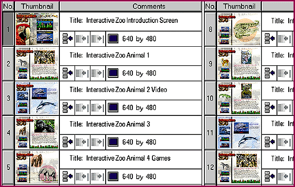

# New Products, New Properties, New Prices

*BYTE Software Lab Report*

The range and number of multimedia authoring tools is expanding at an amazing rate. When NSTL started this evaluation a few months ago, none of the programs in this report were available for under $1000, and two were priced at $5000. But since then, several vendors have changed their pricing drastically. Authorware is the only program that remains at $5000; rather than reduce price, Macromedia decided to add value by bundling Macromedia Director, Extreme 3D, SoundForge XP, and xRes with the product.

Several other programs were outside our focus or arrived too late for inclusion in this review. While we didn't put them through the rigors of our testing program, they are packages worth considering.

Corel Click & Create 2.0

This international production (a U.K. product sold by a Canadian company) is aimed at a variety of multimedia developers and uses. The $695 package ($249 update) uses a storyboard paradigm, makes heavy use of drag-and-drop editing, and supports DirectX video, WinG, ODBC databases, QuickTime, and Rich Text Format. As with most Corel applications, it comes with hundreds of fonts, clipart, animation files, and video clips (on two CD-ROMs).

Tropolis 1.1

A heavy-duty performer from mFactory, this program lets you build applications out of reusable objects. It's intended primarily for designing commercial CD-ROMs and Internet presentations. It relies heavily on its scripting language, which is extensible. With mTropolis, you create your multimedia program once and can then deploy it on the Macintosh (68K and PowerMac) and on Windows 3.1 and 95 platforms. Cost is $1195.

Oracle Media Objects 1.1

Oracle's entry, as you might expect, readily connects to Oracle databases and is focused heavily on entertainment and interactive broadcast production as well as corporate communications and training. With this product, you can build your program on either a Windows machine or a Macintosh, then play it back on either platform or -- tada! -- Apple's forthcoming set-top box. With that addition, as well as Oracle's commitment to Web computers, this $495 package may become an important player in the multimedia market.

PowerMedia 2.0

RadMedia's authoring package is a good bet if you don't need database support (though the company promises that for the future). What your $495 buys now is a storyboarding environment that enables easy Web distribution with one-click hyperlinking and generating of Hypertext Markup Language files. You also get hundreds of screen layout templates; good support for a wide variety of graphics, video, and audio imports; an image editor; and illustration tools. This will be of interest to people developing educational courseware, Internet advertising, entertainment titles, and corporate communications.

## Corel's Versatile Creation

Corel's Click and Create, with its time line and storyboard, is especially versatile.

## Images

