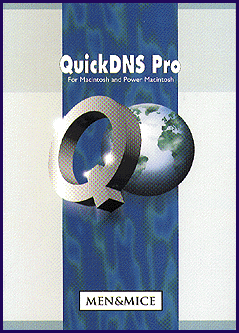
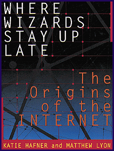
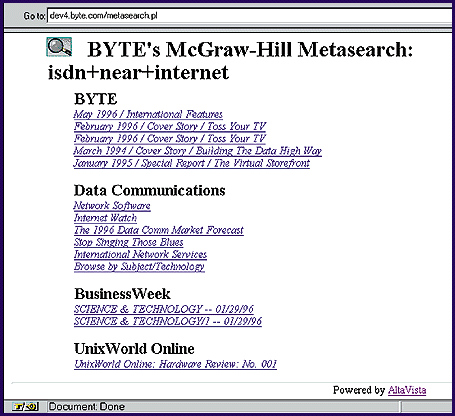

# On-Line Componentware

*Web Project*

qI use AltaVista to build BYTe's Metasearch application and realize that every Web site is a software component.

Jon Udell

http://www.byte.com/art/9405/sec5/sec5.htm

Software components can turn up in the unlikeliest places. In our May 1994 cover story ("Componentware,"

*http://www.byte.com/art/9405/sec5/sec5.htm

), for instance, we pointed out that object-oriented programming (OOP) technology had failed to produce a rich harvest of plug-and-play software objects. However, we showed that Visual Basic custom control (VBX) technology -- a hastily conceived mechanism for Visual Basic plug-ins -- had, to everyone's surprise, jump-started a thriving component-software industry.

Fast-forward to 1996. I want to prototype a Web-search application that embraces BYTE and five fellow McGraw-Hill publications. I have only a few hours to spend on the task. What component can I pull off the shelf and use? Java or ActiveX components? They're coming, but they're not here yet. Distributable search engines? They exist, but deployment across six Web sites will take more than the allotted few hours.

http://www.altavista.digital.com/

As I drove home from work, I suddenly knew where to find the right component for the job. It was sitting in plain view at

!http://www.altavista.digital.com/

. That's right -- Digital Equipment's AltaVista, a public Web site, is also the software component that let me prototype the McGraw-Hill Metasearch application before I went to bed that night.

http://altavista.software.digital.com/sitemap/nfbusexten.htm

A powerful capability for ad hoc distributed computing arises naturally from the architecture of the Web. This month's column demonstrates that fact, in a compelling way, using AltaVista as an example. But the technique that I describe here applies equally to The BYTE Site or any public Web site. My intent is only to demonstrate the technique and consider how it enables large-scale software componentry. For commercial-grade solutions that leverage AltaVista, check out the AltaVista Business Extensions at

<http://altavista.software.digital.com/sitemap/nfbusexten.htm

Web Site as Software Component

Brad Allen, who created Quarterdeck's WebCompass, first showed me how a Web site can work as a software component. At Fall Comdex in 1995, he plugged The BYTE Site into WebCompass and showed how Quarterdeck's product could add value to our site's native search function. How was this possible? If there is a telnet on your system, try doing this experiment:

telnet www.byte.com 80

get /

The above sequence transmits an HTTP GET request to the BYTE Web server and then asks for the server's root document. What telnet subsequently spews forth will be the Hypertext Markup Language (HTML) source text of BYTE's home page.

Internet newcomers are often surprised to learn that the Web is built on such a simple mechanism. Old hands just take it for granted because they're familiar with other Internet applications that work the same way. For example, telnet to dev4.byte.com on port 119 and enter help to reveal the NNTP command set of BYTE's news server. And below is a way that you can query the BYTE archive and our Virtual Press Room for documents that contain references to NNTP:

telnet dev5.byte.com 80

get /cgi-bin/sw2.pl?keywords=

nntp&index=both

Like all Web sites that run scripts to generate pages, The BYTE Site has an implicit API. It's not documented, but it's easy to discover. Just run an interactive search and then view the source of the results page. There you will see how the form variables keywords and index control the several search engines that are running on the site.

When you query interactively, those variables are transmitted by way of a temporary file using the HTTP POST method. However, an equivalent command line that uses the HTTP GET method, as shown above, works just as well.

A Naive Implementation of Metasearch

A little interactive experimentation with AltaVista revealed the API that I needed to call to implement Metasearch. I exploited AltaVista's fielded search capability to isolate a set of Web sites, like this:

q=host:www.byte.com+and+host:

lantimes.com+and+nntp

I couldn't expect users to telnet to AltaVista and type this junk. So my first naive implementation was a Web form that called a BYTE Site script that returned another form that called AltaVista.

Sound squirrelly? It was. I needed the first form to capture the search keywords, the script to interpolate the keywords into a Common Gateway Interface (CGI) request template, and the second form to present the final request to the user as an action that could be invoked via an HTML Submit button.

When Javascript and VBscript stablilize, they'll eliminate the need for many of these CGI gymnastics. Simple active-client technology could have streamlined my naive implementation. But if Metasearch did nothing more than point the user's browser at AltaVista, I'd still call it naive.

The finished application does more. It adds value by intercepting the results that AltaVista returns and grouping them by site of origin (

see the screen

). You could achieve this effect using advanced active-client technology -- a Java program or an appropriately scripted ActiveX control. Or, since these technologies are not yet widespread and stable, you could do it on the server side with conventional CGI techniques. Because I wanted to write the application in a few hours and know it would work on most installed browsers, I chose the latter approach.

Script Control

ftp://ftp.digital.com/pub/plan/perl/CPAN/

http://www.ics.uci.edu/pub/arcadia/libwww-perl/

http://www.maths.usyd.edu.au:8000/jmr/perl/PerlCode.html

There are several Perl libraries that you can use to call uniform resource locators (URLs) from your own Perl scripts (see CPAN, the Comprehensive Perl Archive Network, at many URLs, including

)ftp://ftp.digital.com/pub/plan/perl/CPAN/

7). Two that I've tried are Roy Fielding's libwww-perl (

/http://www.ics.uci.edu/pub/arcadia/libwww-perl/

) and Jim Richardson's Wire.pm (

8http://www.maths.usyd.edu.au:8000/jmr/perl/PerlCode.html

For arbitrary reasons, I used Wire.pm, but libwww-perl (or another equivalent package) would also have worked. With any of these, you can pass a URL to a library function that "calls" it and "returns" the resulting HTML document (or perhaps just an HTTP header), which you assign to a Perl string variable. Then you can use Perl's unparalleled string-handling power to analyze and act on the result page. When that page is program output, it will typically exhibit a regular, repeating structure. Parsing these kinds of pages is like shooting fish in a barrel.

There was one complication. Rather than issuing a single request that combines all the Web sites that are checked on the form, Metaseach instead issues one request per site. Why? AltaVista chunks its results across a series of pages that must be fetched sequentially. A search that produces hits for all the selected sites often won't represent each of those sites on the first results page. That mandated a multirequest strategy.

One approach would be to thread a series of requests using the URL that's behind the Next link on every AltaVista result page. But how to decide when to stop? One query might yield a few result pages; another, dozens. So I opted for one page of results per selected site.

Doesn't that mean each site's results aren't fully enumerated? Yes. There are other problems, too. Metasearch is only as current as the most recent AltaVista visit to the sites I list. And it forces you to wait twice -- once for AltaVista to return the results to The BYTE Site, and again for Metasearch to process them and return a final page to you.

Metasearch isn't a real solution. Some commercial-grade solutions are available from Digital, including one that will "custom crawl" a group of sites and maintain a separate index for that group. I describe Metasearch here only to show how the Web is transforming software development even more profoundly than it's transforming publishing.

A Web of Components

It should be clear to you now that you can use tools such as libwww-perl and Wire.pm to quite easily construct your own customized link checkers and Web spiders. Why bother? Well, I've tried a bunch of shareware and commercial link checkers, and none that I've found can integrate easily and well with my site-management procedures.

But spiders and link checkers merely scratch the surface. Imagine a cousin to Metasearch called Metaorder, which would automatically spring into action when you ordered a subscription to BYTE using our site's order form. Metaorder might need to update four or five different databases in different locations around the world. Each of these databases might use a different engine and run on a different OS, but all could be available (behind layers of encryption and authentication) on the Web.

Metaorder could therefore orchestrate a heterogeneous two-phase commit. The "APIs" at each of the sites will have been built anyway to support browser-based interactive execution of these several tasks, per corporate intranet objectives. Once that's done, it shouldn't take 18 worker-months to prototype Metaorder. It should take a day.

## Toolwatch

## QuickDNS Pro

.................$290

Men and Mice

Reykjav

k, Iceland

http://www.menandmice.com

Internet:

http://www.menandmice.com

Who says you need a Unix box to provide DNS service for your site? QuickDNS Pro does it very nicely on a Macintosh.

## Booknote

7Where Wizards Stay Up Late: The Origins of the Internet

" by Katie Hafner and Matthew Lyon

Publisher: Simon and Schuster

http://www.simonsays.com/

Internet:

http://www.simonsays.com/

Price: $24

Tales from the sixties, when the Internet was just two tin cans and some string.

## QuickDNS Pro

## Where Wizards Stay Up Late

"Interception Scores a Search Goal

{In only a few hours, I created an application that intercepts AltaVista search results and groups them by site of origin.

mailto:"jon_u@dev5.byte.com"

]Jon Udell is BYTE's executive editor for new media. You can contact him by sending e-mail to

jon_u@dev5.byte.com

## Images

