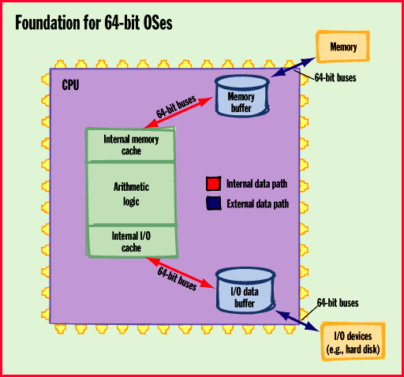

# Unix Leads the 64-bit Charge

*Special Report*

T64-bit OSes are moving from the horizon to your desktop. And you get the benefits.

Laurent Lachal

Computer technologies march relentlessly to the rhythm of bigger and faster. CPU clock speeds, which once seemed fast at 33 MHz, now push past the 200-MHz mark. Similarly, OSes that gave us a speed boost with 16-bit architectures now are evolving to 64-bit technology to meet the demands of processor-hungry applications, such as data warehousing and virtual reality (VR).

But if you're not setting up an on-line transaction-processing (OLTP) server, how much can you really benefit from today's 64-bit versions of Unix or tomorrow's 64-bit Windows NT or Mac OS? In reality, the added capabilities of 64 bits are narrow in scope. The most significant changes affect process and file management and memory capacities. The 64-bit transition leaves reasonably untouched such aspects of OSes as concurrency (where multiple applications share resources), scheduling, and security.

The answer to how you can benefit from a 64-bit OS ultimately depends on what applications you are running, whether your hardware is tuned for 64 bits, and whether your system has the massive amounts of memory needed to take advantage of the architecture. In the end, the possible advantages of 64-bit technology come in shades of gray, not the relatively black-and-white distinction that defines the performance differences between 16- and 32-bit systems.

Faster Number Crunching

Process management benefits from 64-bit OSes because the OS kernel executes larger instructions that can do

more processing

per cycle. The kernel can also manipulate 64-bit integers to give applications faster, more complex number-crunching abilities.

This increased processing capability goes hand in hand with an exponential growth in the memory (virtual and real) that's addressable by each process. A 64-bit memory space can now address a maximum RAM of 2*64 bits -- or more than 18 billion GB -- compared to the mere 2*32 bits (4 GB) possible for 32-bit OSes.

More and Larger Files

Virtual memory enables an application to use RAM as a disk cache. In turn, a larger disk cache is necessary with 64-bit OSes because not only can they handle a larger number of files, but they can accommodate much larger ones. Vendors are starting to speak in terms of terabytes -- not just gigabytes -- of data. Data handling among the CPU, memory, and hard disk improves with 64-bit registers because the registers not only enable the system to move data around more quickly but can also reference a larger number of data chunks.

You don't need a 64-bit OS just to handle 64-bit-long integers, manage large files, or get yourself more memory. After all, you can use several 32-bit instructions to come up with a 64-bit operation, split large files into more manageable ones, use a parallel design for multiple storehouses of memory, or opt for a large block of memory residing on a hard disk. However, 64-bit OSes are certainly the most straightforward technology for achieving these capabilities.

Beyond these general benefits, 64-bit OSes have distinct implications for desktop systems and servers. Desktop applications will be able to exploit 64 bits to provide Nintendo-like graphics -- first for 3-D-based programs and then for VR-based ones. Advanced GUIs are already available: Computer Associates' flagship management tool, CA Unicenter TNG, sports a new VR interface.

On the server side, the very-large-memory (VLM) capability of 64-bit OSes will first attract developers in specialty areas, such as video on demand. The technology will then appeal to more mainstream OLTP and data-warehousing applications developers. Microsoft has pointed to credit-card transaction-authorization databases and worldwide reservation-system applications for its long-range move toward 64-bit NT.

DBMS vendors and, increasingly, business-applications vendors say they will use 64-bit architectures to develop leading-edge technology and support their large corporate customers. Similarly, Unix vendors have jumped on the 64-bit bandwagon, partly because it's a way to keep Microsoft's NT development team on its toes (prompting Microsoft's vague public comments about 64-bit technology being in NT's future). Unix vendors might also find themselves in a battle to keep up technologically with the "Joneses": namely, 64-bit pioneers Digital Equipment and Silicon Graphics.

The Impact on Applications

Overall,

64-bit technology

should have little impact on the fundamental architecture of applications, since programs are discrete and rather small data structures. However, applications will benefit from the following:

64-bit high-speed I/O: Commercial applications that shift data rather than just massage it can take advantage of the capability to boss around larger chunks of data more quickly. Devices that require improved I/O, including Nintendo's latest game station, QMS's printers, and Cisco's routers, also have the ability to exploit 64-bit technology.

64-bit logical/arithmetic operations: These operations increase the performance of "rocket science" applications based on complex data calculations, including satellite-imaging, weather-forecasting, technical-modeling, genetic-research, and simulation applications. Graphics also inherently benefit from high-speed calculations and extended memory capacity, as they are essentially continuous large data structures modeled discretely. In addition, 64-bit virtual addressing gives a boost to OLTP and data-warehousing applications, as well as more technical applications, such as computational fluid dynamics. All these types of applications require large amounts of memory.

Large files: This is a gain for all types of applications, as new features expand software and consume the ever-increasing hard disk space.

OS vendors are promising unified APIs and more advanced compiler technology for software developers who will need to write code for 64-bit OSes. Unix developers in particular will probably be the first to have a unified 64-bit Unix API that will enable 64-bit applications to run on any of the various versions of Unix that support 64-bit architectures.

You shouldn't expect an end to divergent APIs for 64-bit Unix, although we can certainly hope that the number of different APIs will be diminished. An interesting twist to the Unix tale is that the intricacies of 64-bit OSes are likely to lead to fewer versions of Unix as the smaller Unix vendors rally to the bigger ones, such as the Hewlett-Packard/Santa Cruz Operation team, which promises to deliver a super 64-bit OS sometime during 1998.

How will OS vendors migrate from 32- to 64-bit applications support? Each designer team might take a different approach. For instance, Digital chose to skip 32-bit applications support, but it released a 32-bit translator for Ultrix and VMS to 64-bit Alphas. Sun pledges 100 percent binary compatibility between its 32-bit and 64-bit architectures.

Better Compilers

The same Solaris binary source will run on 32- and 64-bit systems, so it won't require the recompiling of 32-bit applications. However, this feature will come in handy only for a while, as recompilation is ultimately the only way to produce executables that use the full capabilities of 64-bit OSes. This process in turn requires sophisticated compilers that will be critical to the competitive edge of 64-bit OS vendors.

Even with a good 32-to-64-bit porting environment, there's still the question of which applications would benefit most from a conversion from 32 to 64 bits. The extra 64-bit coding is difficult to master and can actually decrease performance if the application doesn't have the ability to take advantage of the extra power delivered by the 64-bit OS.

This is why software developers have not started to 64-bit-enable their applications en masse, as few of these packages actually exceed the capacity delivered by 32-bit systems. Indeed, 64-bit technology is likely to come hand in hand with market education; this way, companies will be able to avoid repeating the mistake that Intel made when people realized that the Pentium Pro boosts 32-bit-application performance but delivers poor 16-bit-application speed.

64-bit Technology vs. Parallelism

As important as 64-bit technology is, it's only a small part of some larger changes that are currently taking place in OS development. One trend is the fragmentation and modularization of OSes, which will confine the hardware-specific portion of the OS code to a small microkernel. Another trend is the adaptation of de facto standard OSes to parallel environments -- specifically, symmetric multiprocessing (SMP), a shared-disk architecture; massively parallel processing (MPP), a shared-nothing architecture; and clustering.

The advent of 64-bit architectures is interwoven closely with the various approaches to parallelism. Both technologies benefit from the R&D and marketing muscle of vendors of relational database management systems (RDBMSes). These companies are employing 64-bit technology and parallelism to support next-generation RDBMS products, such as content management systems (CMSes), which handle structured and unstructured data alike. (According to one study, reported in the May issue of European Software Markets Service, CMSes will represent 28 percent of the total European database market by the year 2000.)

Cost vs. Speed

The best mix of 64-bit technology and parallelism, however, is unclear. "There's no easy answer," says Oracle marketing director John Spiers. "You have to balance cost and need, since infinitely fast is also infinitely expensive."

Indeed, the RAM needed to hold gigabyte-size databases does not come inexpensively. For instance, 4 GB of memory costs hundreds of thousands of dollars, compared to just a few thousand dollars for installing an extra processor in a parallel system. On the other hand, according to Jean Jacque Pairault, senior consultant of R&D strategy at Groupe Bull, you get a decreasing performance boost with each added processor. The alternative -- a complete 64-bit system with a lot of memory -- yields increased performance over 32-bit systems.

Vendors are unsure about how these technologies will improve your life. "Parallelism boosts performance in all situations, while 64-bit OSes help mostly in read-only situations, such as data warehousing," says Arthur Hochberg, European marketing director for Informix. On the other hand, "the large-memory approach is more relevant to OLTP than to data warehousing, where databases have grown too large for current hardware platforms," explains Spiers.

Alternatively, 64-bit technology may not be the most important issue. "At the high end, where people concentrate more on scalability than on large memory size, [the emphasis is on] solutions that combine parallel systems with advanced disk-storage technology," explains Jon Barnes, RS/6000 hardware product manager at IBM U.K.

The debate goes on. For the moment, the combination of 64-bit and parallel technologies will prove more beneficial to SMP than to MPP and clusters. Why? First, a 64-bit address space dramatically improves the scalability of SMP systems. Second, both technologies address different bottlenecks: SMP addresses a processing-power bottleneck, while 64-bit memory reduces the processor-to-disk bottleneck.

Software developers are likely to postpone implementation of MPP , which requires a real architectural revolution, in favor of SMP, which is much closer to nonparallel systems. "For people who require very high throughput, the real battle will be between 64-bit technology and clusters, " says Julian Lomberg, Solaris product manager for Europe. The cost/performance ratio currently favors clusters, due to the huge cost of memory.

In the long run, we will see tighter integration of 64-bit and parallel systems, for two reasons. First, parallel-systems vendors are moving, albeit slowly, toward an architecture that combines SMP and MPP. Second, the data-warehousing and OLTP markets are converging as demand emerges for read/write analytical databases, where decisions from analytical work automatically feed into changes to production data.

Technology Mix

Very few of the 64-bit-enabled hardware platforms that are currently shipping actually sport the huge memory capabilities that make a real performance difference. Digital acknowledges that only about 30 percent of its 2000 64-bit Turbo Laser systems sold during their first 15 months of release have shipped with enough memory to actually benefit from the VLM capability of Digital Unix.

But standard Alpha configurations may soon ship with substantially more memory, according to Pauline Nist, vice president for Alpha Server operations. "DRAM prices collapsed by over 60 percent in mid-1996," she says. "Digital responded with a midrange server, capable of 8 GB of RAM, that started shipping in June." Bill Reed, advanced technology consultant for IBM's AS/400 business, predicts that by the end the century, AS/400s will ship with at least 40 GB of memory and more than 50 TB of disk space.

Performance First

In the meantime, we need to closely watch how software suppliers take advantage of the underlying technology and see whether they implement 64-bit technology or parallelism, says Hochberg. But David Hughes-Solomon, director of technology at the client/server powerhouse SAP, believes end users don't care whether their systems use a 32- or 64-bit OS. "End users are mostly concerned about how well an application performs, especially on a large scale. If it can deliver, then they look at the price and decide," he explains.

In the same way that most PCs consist of a mix of elements running at various speeds and bandwidth capacities (e.g., 128-bit memory buses, 64-bit graphics accelerators, and 32-bit processors), we will probably see a mix of 32- and 64-bit OSes, hardware, and applications. "Three to five years," reasons Hochberg, "seems a reasonable time frame for 64-bit technology to permeate the high end of the market, while 32-bit technology will keep on satisfying the bulk of the market for the foreseeable future."

## Where To Find

Digital Equipment Corp.

Maynard, MA

Phone: (508) 493-5111

Fax: (508) 493-8780

http://www.digital.com

Internet:

http://www.digital.com

Groupe Bull

Louveciennes, France

Phone: +331 3966 6060

Fax: +331 3966 6062

http://www.bull.com

Internet:

http://www.bull.com

## Hewlett-Packard

Palo Alto, CA

Phone: (415) 857-1501

Fax: (415) 857-5518

http://www.hp.com

Internet:

http://www.hp.com

## IBM

Old Orchard Road

Armonk, NY

Phone: (914) 765-1900

http://www.ibm.com

Internet:

http://www.ibm.com

The Santa Cruz Operation

Santa Cruz, CA

Phone: (408) 425-7222

Fax: (408) 458-4227

http://www.sco.com

Internet:

http://www.sco.com

Silicon Graphics, Inc.

Mountain View, CA

Phone: (415) 960-1980

Fax: (415) 390-6220

http://www.sgi.com

Internet:

http://www.sgi.com

Sun Microsystems, Inc.

Mountain View, CA

Phone: (415) 960-1300

Fax: (415) 969-9131

http://www.sun.com

Internet:

http://www.sun.com

## What 64 Bits Buys You

Feature Benefit vs. 32-bit OSes Best Applications

Larger files Can process terabytes of data OLTP; data warehousing;

P (vs. megabyte-size files). high-end graphics; processing-

J intensive applications;

P general business applications.

Greater RAM Memory can be a maximum OLTP; data warehousing;

D of 18 billion GB (vs. 4 GB). high-end graphics.

Faster Can handle more calculations High-end graphics; processing-

I processing faster. intensive applications.

Faster I/O Access times between main High-end graphics; general

H system and peripheral hardware business applications.

, are shortened dramatically.

## Foundation for 64-bit OSes

{To deliver performance improvements over 32-bit systems, 64-bit OSes need CPUs with 64-bit data buses for memory and I/O.

mailto:"editors@bix.com"

Laurent Lachal, a consultant specializing in IT, is editor of European Software Markets Service, a quarterly publication that analyzes OSes, applications development tools, business applications, and database management systems. You can contact him at

editors@bix.com

## Images

