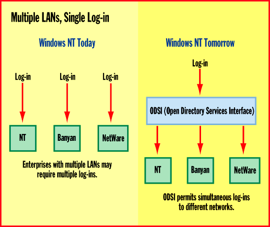

# Unearthing Cairo

*Special Report*

The next version of Windows NT will flex its enterprise muscle by incorporating features from "Cairo."

Mark Minasi

At the first NT developers conference in 1992, Bill Gates announced that Cairo would arrive in three years and would incorporate object-oriented technologies, especially an object file system. Since then, we've seen Windows NT 3.1, NT 3.5, NT 3.51, and most recently NT 4.0. None is object oriented, none has an object file system, none is Cairo. It seems that Cairo is Microsoft's sly way of promising the world. "Will we see Plug and Play in NT?" "Oh yes, of course, in Cairo." "Will NT ever produce world peace and cheap antigravity?" "You bet -- in Cairo."

What is becoming apparent is that we'll never see Cairo as the manifestation of Microsoft's next-generation operating system. But much of the development work that went into the Cairo project will see the light of day. Indeed, some Cairo features have already been bolted onto NT 4.0, and others may be slipstreamed into interim NT releases or will appear in the next major release of NT sometime in 1997 or early '98. Either way, don't expect to see a shrink-wrapped box of Cairo at your corner software store.

For its part, Microsoft is framing its course correction in the best possible light: Cairo isn't an OS, it's a set of technologies. What does this mean for current NT users or for those people who are contemplating a switch? Here's a rundown of the Cairo features you can expect to see in future versions of Windows NT.

Networking Enhancements

Windows NT will continue to be Microsoft's "enterprise" OS as the company tries to push into large corporations and pry data off mainframes and Unix machines and onto PCs. To that end, the company has partnered with companies such as Digital Equipment to gain access to big-iron IS managers. But NT is developing a reputation more as an excellent OS for workgroup servers than for enterprise-level systems. Thus, one of Microsoft's missions is to instill NT with more enterprise character. To do that, Microsoft must refine how NT handles domains. NT's domain structure looked wonderful when compared to NetWare 3.x's server-based bindery, Novell's term for a server's list of recognized users. Unfortunately, domains pale as an enterprise structure beside NetWare 4.x's NetWare Directory Service (NDS).

That's because NT currently lets you centralize the lists of user accounts for a number of servers on one single server -- kind of a security server -- called a primary domain controller. Taken together, these servers constitute a domain, in Microsoft parlance. (NT allows you to establish "backup" domain controllers as well.) If you've got 50 servers in that domain, then you have to build your company's users only on one server rather than having to rebuild them 50 times, once on each server. But NT-based enterprise networks become clumsy when a second domain appears, which requires administrators to manage interdomain security treaties called trust relationships. The number of these relationships can easily grow to become almost unmanageable. For example, six domains require 30 trust relationships, but in organizations with 50 domains, the number of relationships soars to 2450.

One of Microsoft's main development efforts will be to reply to NDS. Instead of having to create dozens of domains, and then having to establish hundreds of trust relationships among them, you'll probably be able to create "trees" of domains. While Microsoft hasn't released much information about this change, we expect to see a domain tree notion that sounds suspiciously like Novell's directory trees in NDS. In fact, Microsoft has recently taken to calling its current domains-and-trusts model Microsoft Directory Services, or MDS.

Additionally, NT's current notion of one primary domain controller and a collection of subordinate domain controllers may give way to multiple master domain controllers, a great boon to maintaining geographically widespread domains. Currently, it's possible (and convenient) to put a backup domain controller in a branch office. That backup domain controller can authenticate network log-ins, so users in the branch office needn't wait for their log-ins to occur over the slower WAN links to the primary domain controller. In fact, the WAN link can be down altogether and users can still log on through the backup domain controller.

What users can't do now is change anything about their accounts: passwords, groups they're members of, etc. They can do that only if they're connected to the primary domain controller. The multiple master domain controller model would mean the domain controller in the branch office could handle changes locally, reconciling them with the other domain controllers when the WAN link comes back up.

The Cairo Internet

Two pillars of Microsoft's Internet strategy, the Dynamic Host Configuration Protocol (DHCP) and the Windows Internet Naming Service (WINS), will also see changes in future versions of NT. DHCP is a system that greatly simplifies installing IP addresses and TCP/IP configuration information on a new PC. DHCP allows you to create a server that hands out that configuration information. The problem is there's no simple way to provide fault tolerance for the server's function -- it's not acceptable to have two DHCP servers on a network handing out IP addresses from the same pool of addresses. The Cairo development effort is working to change that: DHCP servers will be able to replicate among themselves so that if one goes down, the others know what that server was doing.

WINS, Microsoft's server-based "naming" system, supports NetBIOS-based programs (like Microsoft's own network redirector). And it provides translations between human-friendly names like "Bigserver" and the necessary IP addresses like 210.32.11.87. The problem with WINS is there already is an Internet standard called the Domain Naming System (DNS) that handles this chore. NT-based Internet servers must run both WINS and DNS, and they must somehow persuade the WINS server to share its knowledge with the DNS server. The Cairo approach does away with WINS altogether by wedding DNS and WINS into something called Dynamic DNS, which reportedly is working its way through the request-for-comment process now.

What's more, Services for NetWare (the new name for the combined File and Print Services for NetWare and the Directory Services Manager for NetWare) will include NDS support, something even the NT 4.0 version of Services for NetWare lacks. The Microsoft networking client will include client-side support for the Lightweight Directory Access Protocol (LDAP) as well. Microsoft's big push for creating unified log-in and administration tools sits atop its support of Open Directory Services Interface (ODSI). A user control tool like the User Manager would sit atop an ODSI layer; there would be ODSI drivers for NT, Banyan, NetWare, or other networks. This ODSI-dependent User Manager would handle user accounts for each of those network operating systems. Similarly, an ODSI-based log-on could perform simultaneous log-ins to different networks (see the figure

"Multiple LANs, Single Log-in"

Desktop Enhancements

While the enterprise is important, Microsoft also has to battle for corporate desktops. First and foremost is Plug and Play support. This is essential if NT's going to be a simple-to-use OS, given today's PCs and the market's embracing of the PCI bus. PCI's great for its speed and flexibility, but it is nightmarish to try to set IRQs, DMAs, and memory addresses on PCI-based machines, which typically don't give you a way to control what resources your PCI add-in cards claim. Plug and Play gets rid of these problems.

So, why wasn't Plug and Play in Windows NT 4.0? According to NT product manager Andrew McGehee, Microsoft just didn't have time. While Plug and Play may be simpler on Intel platforms, putting it into Mips, PowerPC, or Alpha systems is tough and will require some development support from hardware vendors.

Microsoft is also working to make drivers for hardware easier to come by. The company will merge the driver models of Windows 95 and Windows NT. Because drivers for 95 and NT are now different, board vendors without large programming staffs often end up ignoring NT driver development or staying in "perpetual beta" stage. Microsoft will also try to simultaneously ship Windows 97 and a new version of NT next year. The two OSes will still be quite different, but they'll use identical drivers for sound cards, video boards, network cards, and the like. Hardware vendors will all want to support Win 97, so there'll be tons of drivers for Cairo: a bonanza for NT users.

UI Updates

The NT user interface, which went to the Windows 95 style in version 4.0, will continue to evolve. Expect to see the "Nashville" version of the Explorer, which integrates a Web browser and a disk browser. This may appear before the next major edition of NT, perhaps as part of a service pack.

An interesting rumor, and potentially the most important UI improvement, is the Bookmark API, a set of programming extensions for the UI. Here's how it would work: You shut down NT while Word and Exchange are running. The system says to Word, "Tell me what you're doing." Word replies, "I'm on document X at page Y with the cursor on the 300th character." Exchange reports similar info. When you start up your system the next day, Word and Exchange launch, and document X loads. The screen and state of the PC go back to where you were when you shut down the day before.

Information may become easier to find thanks to the Object File System (OFS). For example, if you're interested in pictures of the Space Shuttle, you may already have some files on your C: drive and others on a D: drive. An FTP site may post new pictures, and Web sites may also store shuttle images. The OFS would allow you to create a pseudodirectory that would seem to contain the scattered data from all these locations.

Servers will benefit because network objects, such as shared directories, won't be associated with a particular machine. You'll just see a shared object called "mail database" and attach to it, without having to know what server it's on.

Other new features will include NT support for Direct3D and DirectInput, FireWire/P1394, and the Universal Serial Bus. And for laptop users, there's power management coming, Microsoft says.

## Beyond Cairo

What must Microsoft address after Cairo pushes the evolution of NT? It will have to match the 64-bit muscle of chips like Digital's Alpha. Microsoft says there will be a 64-bit NT "in the next couple years." Fault tolerance must appear in all networking services, and NT's clustering "Wolfpack" technology will need to move beyond simple support of pairs of machines. Let's hope Microsoft's fascination with the Net extends to better support for TCP/IP infrastructure issues like better dynamic routing protocols, better support of static routing over remote access servers, and Ipng.

But beware of basing your enterprise plans on Microsoft plans. Cheap antigravity may come before Plug and Play and other enhancements NT needs.

## Where To Find

## Microsoft

Redmond, WA

Phone: (206) 882-8080

http://www.microsoft.com

Internet:

http://www.microsoft.com

## Beyond Cairo

Here's a wish list of improvements that need to be part of

)Microsoft's long-term development plans.

Support for 64-bit processors

$Fault tolerance for all networking

services

3Clustering support for more than pairs of machines

!Better dynamic routing protocols

3Improved static routing over remote access servers

Png support

## Multiple LANs, Single Log-In

Open Directory Services Interface (ODSI) can support unified log-in and administration tools for a variety of network operating systems.

mailto:"mark@mmco.com"

^Mark Minasi writes books and gives seminars on desktop and network OSes. You can reach him at

mark@mmco.com

## Images

