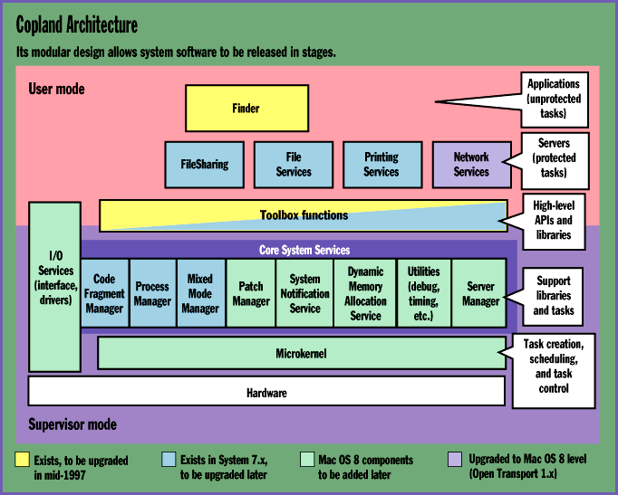
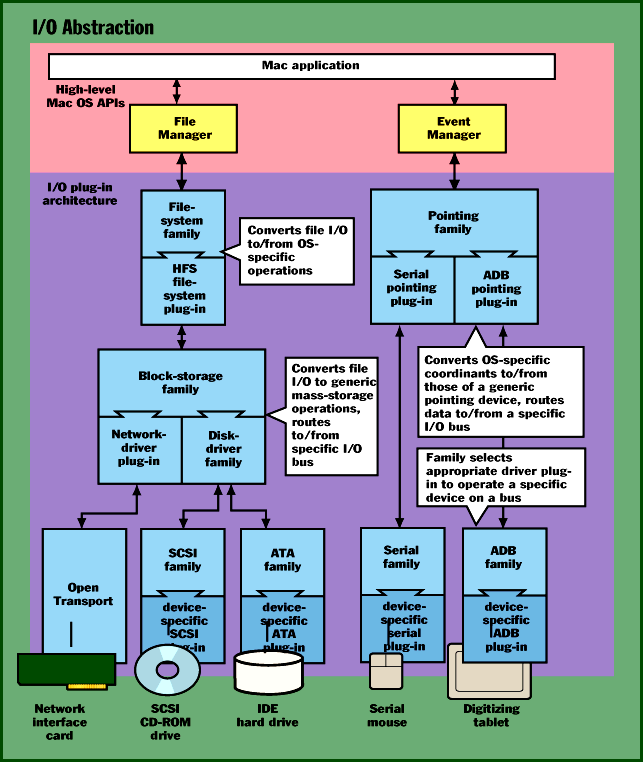

# Copland, Revisited

*Special Report*

mA closer look at how the microkernel adn hardware abstraction services will strengthen Apple's upcoming OS.

Tom Thompson

For more than a year, Apple has provided tantalizing glimpses of Mac OS 8, its future OS, which is more commonly known by its code name of Copland. Unfortunately, much like Microsoft's Windows 95 launch, the release of Copland has been plagued with delays. The expected shipping date has slipped from this year until well into 1997. (For BYTE's previous coverage of Copland, see "Apple's New Operating System," June 1995, and "Copland: The Abstract Mac OS," July 1995.)

At the August MacWorld trade show in Boston, Apple CEO Gilbert Amelio announced a new blueprint for OS releases. Instead of a monolithic release of system software, as happened with System 7, Apple will release portions of Copland piecemeal over the next year.

Component of the Month

This piecemeal plan has several benefits. First, the development breaks into manageable chunks for the system-software engineers. Any bugs that appear after a release are probably due to the newly introduced OS components, which simplifies code maintenance.

Second, some of the promised Copland technologies will get into the hands of users without their having to wait for Apple to roll out other portions. For example, an OS release slated for the middle of 1997 will provide many Copland user-interface (UI) elements, Java support, and a much-needed multithreaded Finder update, as shown in the figure

"Copland Architecture"

. (The improved object-based UI, with sophisticated messaging and scripting functions, was the easiest part of the Mac OS to win early release.)

Finally, the staggered-release schedule means that Apple can craft some of these components as 680x0 code. Thus, some of Copland's features -- but not all -- will be available to owners of 680x0-based Macs.

This incremental-release strategy has problems, too. Copland's elements can't all separate conveniently into discrete components. The most glaring examples: System 7.x's File Manager and parts of the I/O subsystem (still emulated 680x0 code). Releasing these crucial parts as native code early would boost the performance of PowerPC-based Macs and Mac clones, but, says AppleSoft vice president Jim Gable, "Much of the file-system code is tightly coupled to the preemptive features of the Copland microkernel: There's no way to separate them."

This plan also affects new PowerPC Platform systems next year: Such systems will need a special System 7.x to manage the hardware abstraction for each hardware design. Finally, Apple must work closely with third-party developers to spot and fix problems that these small releases might cause to applications software.

In Apple's favor, it has experience in extending the OS in stages. Separate releases of QuickDraw GX, QuickTime, QuickDraw 3D, and Open Transport added new capabilities to System 7.5 without revamping the OS code. Furthermore, Apple has been designing parts of the system software as OpenDoc components. This helps the plan because OpenDoc is a modular architecture, the very thing required to ship the OS as parts.

With all these sudden changes in direction, trying to figure out exactly what Copland is requires a scorecard. I'll review the Copland system architecture first, then focus on the latest information available on the microkernel and I/O abstraction.

As of now, Copland consists of several parts: microkernel, core system services, and tasks. The microkernel performs all low-level services directly with the processor or hardware: task creation (programming the processor's memory management units [MMUs] to set up a separate memory space and access rights), scheduling (with the processor's interrupt mechanism and timers), and task control (which uses processor-specific atomic instructions for low-level messaging and semaphores).

Modular Microkernel

The microkernel has a modular structure that lets other software modules (e.g., ones that implement a virtual memory backing store or perform memory allocation) plug into it without modification. This differs from some Unix kernels, where adding a new service requires you to rebuild the kernel. The microkernel's design also supports symmetric multiprocessing (SMP) on systems that have multiple processors. A low-level multiprocessor API has been available for special-purpose applications under System 7.x, and it will work under Copland.

The core system services are clients of the microkernel. They implement a number of services that higher-level portions of the Mac OS rely on. These services consist of either DLLs or OpenDoc components. Some of them are familiar services, such as Code Fragment Manager (which loads and unloads PowerPC code libraries), Process Manager (which manages task creation), and Mixed Mode Manager (which handles transitions between native PowerPC code and the 680x0 emulator).

However, there are also many new services, such as Patch Manager (tracks software patches), System Notification Service (coordinates tasks), and Dynamic Memory Allocation Service (no more fixed memory partitions). Some core software utilities have obvious functions, such as Debug Services, Interrupt Services, Timing Services, and Exception Handler. Another utility, Server Manager, creates and controls special-purpose processes, as described below.

The last part of the OS architecture consists of tasks. A task is a basic unit of program execution in Copland. Processes consist of one or more tasks and use a common set of memory and system resources. Notable examples of processes are the Finder (the shell application that manages the Desktop screen and handles certain file operations), Printing Services, and FileSharing (which implements peer-to-peer network services).

A process's code might be located in RAM or on disk, and it has its own stack and register set. Even better, because of Dynamic Memory Allocation Service, such code need not occupy a contiguous section of memory. Instead, a process's code fragments can be located anywhere in memory, arranged as necessary to best fit a limited amount of RAM.

The familiar Mac application consists of a main task the Process Manager sets up, plus any threads this main task spawns via the Thread Manager. Mac applications can create one or more threads, which implement single paths of execution. For new Copland-aware applications, the microkernel can schedule the tasks to execute simultaneously, which improves load balancing on the system.

It's important to note that certain parts of Copland's services (e.g., the QuickDraw graphics engine) contain nonreentrant code. Therefore, any task using these services must be scheduled to execute cooperatively (i.e., one at a time). Typically, these are applications because they make heavy use of the UI.

Because the Process Manager creates and launches each application's main task, it ensures that only one main task executes at a time. The microkernel, certain core system services, and any task that doesn't rely on graphics can operate under preemptive time scheduling. Processes that provide specific functions but don't need a UI -- such as those that handle file-system and network services -- are called servers.

Copland's architecture thus makes Apple's release plan possible. The scheduled mid-1997 release, for instance, consists of a new process (the Finder), which System 7.5 treats as an application. This release will also provide an assortment of DLLs that implement the Copland UI elements and the Java virtual machine, which, again, System 7.x's Code Fragment Manager can handle.

Memory Matters

Copland's microkernel provides memory protection and address-space isolation, except for existing System 7.5 applications. The microkernel, drivers, and certain servers execute in the PowerPC processor's privileged mode. Most servers and Mac applications operate in the processor's user mode, and they can obtain memory or perform I/O only by making requests to the OS. This improves the overall system reliability because it ensures that only the low-level OS code can directly operate the hardware, such as fielding interrupts, modifying the access attributes to sections of memory, and controlling the processor's caches.

The microkernel provides another level of protection by placing servers and OS code in separate address spaces. Accessing a separate space requires building its address using values from page-table entries (PTEs) in the processor's MMU. Because only the microkernel can use and modify the PTEs, this effectively "walls off" these tasks from any errant memory accesses that a malfunctioning program generates. Copland maps the microkernel code into every address space, so that tasks can quickly use system functions without involving cycle-stealing memory-access mechanisms. This scheme still provides ample protection, because the OS code is marked read-only.

For compatibility's sake, existing Mac applications and certain sections of the UI Toolbox code must cohabit a single memory space: The System 7.x application model expects a contiguous address space and unfettered access to some system globals. Still, Code Fragment Manager flags system code and native System 7.x applications as read-only, which offers some protection.

Process Manager also provides an extra level of safety. When it loads a System 7.x application, it places guard pages above and below the application's fixed memory partition. These guard pages are marked with excluded access permission. If an application attempts to overrun its boundaries, it generates an exception. It's possible that a misbehaving application might corrupt the data of another application, because everyone can modify any of the data inside this address space. However, given the address-space isolation and write-protection safeguards, Copland is significantly more reliable than its predecessor, which has no protection mechanisms.

The payback for this compromise is that users can carry their existing body of Mac software to Copland and expect it to work. AppleSoft's Gable admits: "If we could rewrite the OS without regard for the installed software base, the job would be done by now."

## I/O Abstraction

One goal of Copland is greater independence from the hardware. Given the growing Mac-clone market, vendors need to differentiate their systems by distinctive hardware features. Also, the Mac OS needn't rely on erratic supplies of custom ASICs that have, on prior occasions, crimped sales.

All I/O operations -- from hard drive to video to pointing devices -- are grouped into families (see the figure

"I/O Abstraction"

). An I/O family is a set of software components to perform specific I/O services. If a task uses the SCSI family, that in turn uses interface modules (called plug-ins) to operate SCSI devices.

For example, one application might -- via the OS -- call the SCSI family to perform file I/O to a device on the SCSI bus. The SCSI-family module calls the plug-in that manages a SCSI hard drive. Next, a scanning application uses the SCSI family, but this time the SCSI-family module calls a plug-in to control a color scanner.

The I/O family provides an interface library that implements device functions and exports data structures for use by the applications or the OS. Although an I/O-family module provides one interface, it might have two sets of interface libraries: one for user-mode tasks and another for supervisor-mode tasks. The OS uses the supervisor-mode library, which can be performance-tuned because it doesn't require the user-mode I/O request mechanism, and no address-space conversions are involved.

The I/O-family architecture provides a remarkable degree of hardware abstraction, because an I/O family can call other families to route data to the appropriate device. Suppose an application calls File Manager to perform file I/O. File Manager first calls a file-system family. This family calls a file-system plug-in, which implements a particular OS file format, such as the Mac's HFS or Windows NT's NT File System (NTFS).

The file-system plug-in next calls the block-storage family, which orchestrates operations on large-capacity, random-access storage devices, such as hard drives, CD-ROMs, or digital videodiscs (DVDs). This family in turn calls a disk-driver plug-in or a network plug-in if the target device is on a network. If the disk-driver plug-in is called, it might call the SCSI family or the ATA family, depending on whether the target device is a SCSI or an IDE drive.

Adding a new device usually requires writing a driver that conforms to the Open Firmware specification (IEEE-1275-1994) and a suitable plug-in. Practically, the Mac OS probably won't use an NTFS plug-in, because you normally access such storage indirectly through a networked NT server. However, that you could write such a plug-in shows that the microkernel is completely uncoupled from its file system. So, if Apple uses a better file-system format later, it can add a plug-in without revamping the system software.

Furthermore, access to new device interfaces and peripherals is vastly simplified. Normally, you'd have to wait for a new OS release to gain use of a new device interface (e.g., IEEE-1394 Firewire). With Copland, you simply add a Firewire board and the corresponding plug-in modules that handle the Firewire interface. You then connect a peripheral.

The Once and Future OS

The major problem with Copland: When will it finally ship? While the incremental-release strategy is difficult, Apple has shown it can add new capabilities to System 7.x without overhauling the OS code. Open Transport's release is a prime example. This Copland networking technology was in users' hands last year, letting Apple fix bugs and tune performance before Copland itself ships. Still, releasing the microkernel as soon as is practical helps Apple, because it will significantly enhance the Mac platform.

First, Copland will boost the performance of PowerPC systems by eliminating almost all the emulated 680x0 code. The staged-release schedule also offers the possibility that some Copland services will appear on 680x0-based Macs. The new memory services will also make efficient use of available system RAM.

Another major benefit is that Copland will exploit the computing power of multiprocessor systems. The OS will distribute tasks, which server applications created by calling the microkernel services, among the processors for better load balancing. (For compatibility, applications that spawn threads via Thread Manager must be cooperatively scheduled.)

Technologies such as QuickDraw 3D and QuickTime 2.5 already use reentrant code and can automatically leverage the power of a multiprocessor system under Copland. The multiprocessor systems from Apple and DayStar Digital provide the hardware necessary for work in this area.

Finally, Copland's hardware abstraction will let clone vendors offer a variety of systems. One vendor might opt for low-cost parts, while another might provide advanced high-performance peripherals for vertical markets or custom jobs. This variety lets you pick the system that best fits your needs, and the competition will hold the line on system prices.

## Copland Architecture

## I/O Abstraction

Copland achieves hardware independence through a layer of interface libraries and plug-in modules.

mailto:"tom_thompson@bix.com"

Tom Thompson is a BYTE senior technical editor at large with a B.S.E.E. degree from the University of Memphis. You can contact him on the Internet or BIX at

tom_thompson@bix.com

## Images

